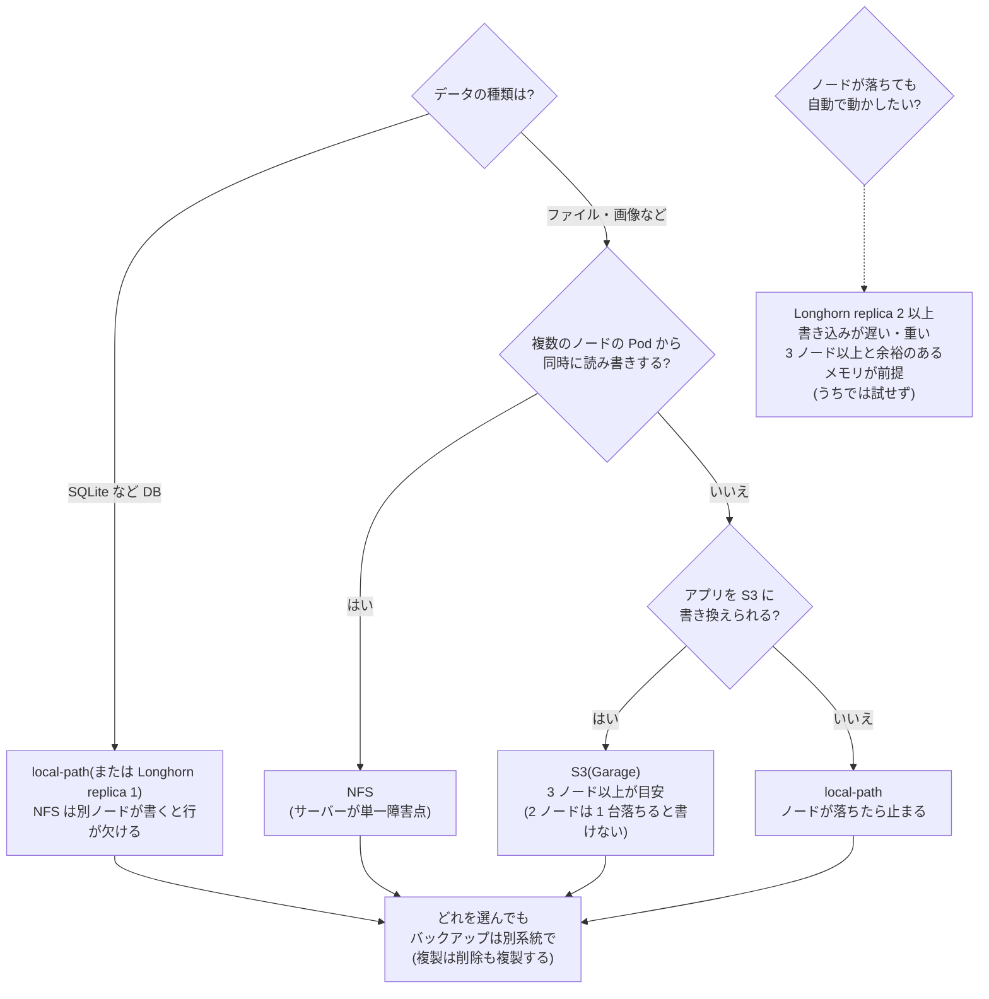

# LT 計画: 複数ノードになった自宅 k8s のデータの扱い方 ― NFS・Longhorn・Garage を比べる

- イベント: Cloud Native Days Winter 2026 / LT(初心者向け「新しく触ったクラウドネイティブ技術」)
- 状態: **試行は完了(2026-11-06)**、片付けもほぼ完了。選定(§7)は実測で埋めた**案**で、構築(§8)は未着手。結果の数字は [`measurements/log.md`](measurements/log.md) の M-016〜M-023 にあり、ここには要約だけを書く。
- 前提の調査: [`storage-options.md`](storage-options.md)(選択肢・必要条件・SQLite との相性)。

> **根拠の凡例**: 📖 公式ドキュメント・構造から言える / ✅ 実機・実測で確認済み / ⚠ 記憶・二次情報(要確認) / 🔜 試して確かめる / 🎯 予想(試す前に書く。外れたらそのまま残す)

---

## 1. ゴールと筋

**ゴール(聞き手が持ち帰るもの)**

> **オンプレでノード間のデータを扱うとき、「どの場合に何が適するか」を自分で判断できる。**

**筋は「調査 → 比較 → 選定 → 構築」**。実験が主役ではなく、図とユースケースの比較が主役。

| 段階 | 内容 | 見せるもの |
|---|---|---|
| 1 背景 | 2 台目の worker を足したら、データが 1 台に縛られた | 図(`local-path` は 1 ノードに固定) |
| 2 手法 | NFS・Longhorn・Garage が何をするか | 方式ごとの図 |
| 3 比較 | ユースケースごとに、どれが合うか | 図 + 早見表 |
| 4 選定 | うちの制約(メモリ 3.3 GB、SQLite、家族向けで数時間の停止は許容、バックアップは R2)に当てはめて選ぶ | 制約 → 選択 |
| 5 構築 | 選んだものを実際に作った記録 | 手順、詰まった点、動作 |
| 6 振り返り | 良かった点、確かめていないこと | 一覧 |

**動機づけ**: ミニ PC を買って worker を 2 台にしたら、データが 1 台に縛られた。直し方は NFS・Longhorn・Garage とあるが、公式の機能表だけでは自分の用途で選べなかった。だから、図で整理し、決め手になる点だけ小さく試し、選んで作った。

**見せ方の方針: 図が主役、数字は注釈**。方式ごとに図を 1 枚描き、データの通り道と「どこが落ちたら何が止まるか」を示し、「この場合は〜」を 1 行添える。図に書く主張は、出典(📖)か試行(🔜)で裏が取れたものだけ。

| 方式 | 一言で | 目的 |
|---|---|---|
| `local-path`(今) | ノードのディスクをそのまま | 基準 |
| NFS | 1 台のサーバーのフォルダを皆で使う | 共有 |
| Longhorn | ノードのディスクを複製して 1 つのボリュームに見せる | 冗長化 |
| Garage | ファイルではなく S3 の API で保存する | 設計の変更 |

Garage は PV の代わりではなく**アプリの作りを変える**方式。性能と障害は同じ土俵では比べない(§11)。

### 1.1 応募文との対応

| 応募文の約束 | どこで答えるか |
|---|---|
| 3 方式を `local-path` 基準に小さな VM(既存の worker)で試す | §4 の軽い試行(T1〜T4) |
| 性能 | T4(軽く)。補足の 1 枚 |
| ノード障害時の挙動 | T2(Garage・NFS を中心に各 1 回。Longhorn は T1 の結果で判断)+ 図の説明(📖) |
| メモリの常駐コスト | T1 |
| SQLite との相性 | T3 |
| どの状況で何を選ぶか | §7 の早見表と選び方の流れ図 |
| 初めて触った立場 | §5 の試行錯誤の記録、§8 の構築の記録 |

### 1.2 試行の位置づけ

> **試すかどうかの基準**: ドキュメントや構造から言えることは、試さず出典を付けて言い切る。**軽く試す**のは次のどれかのときだけ。
> (a) ドキュメントが黙っている / (b) 結果が思い込みと違いそう / (c) 自分の環境に固有の条件がある(メモリ 3.3 GB など)

**参考にした発表の学び**(3 件目のスライドは読み込めず未確認)

| 発表 | 学び | この LT での使い方 |
|---|---|---|
| 自宅 k8s のバックアップ構成(Longhorn・MinIO・B2) | 数字より**実際の障害 → 原因 → 設計の判断**が中心。Argo CD が Longhorn ごと削除して全 PV 消失、再インストールでバックアップ先 NFS が消去。「取れたか」でなく「**戻せるか**」が本題 | 構築で、復元の照合まで確認する。うちも Argo CD 運用なので、消したときの挙動に気をつける |
| youki への Memory Policy 実装 | 結果の数字はなく、**やって分かった落とし穴**と、**検証できなかったことの正直な記載** | 試行は不明点に絞り、確かめられなかったことを明記 |

## 2. 実際のケース(選び方の軸)

| ケース | 実際の場面 | 要るもの |
|---|---|---|
| **C1 DB(SQLite)** | Control Plane の DB(WAL)、SQLite を使う生成アプリ | 低レイテンシの同期書き込み、強いロック。共有は不要 |
| **C2 複数 Pod で同じデータ** | Agent Job・お試し版・本番・helper が同じ PVC を使う | RWX(同時アクセス) |
| **C3 ノードが落ちても再開** | 家族のアプリが 1 台のノードで止まる | 別ノードで再開、データが残る |
| **C4 ファイル・画像の塊** | 家族のアプリの写真や添付(**想定**。現状は未使用) | 容量、API でよい |
| **C5 バックアップ・履歴の置き場** | dsnap、restic の保存先 | 安く大きく、壊れにくい。S3 向き |
| **C6 誤削除・破損からの復旧** | 家族がデータを消した、アプリが壊した | 複製ではなく**バックアップ** |

## 3. 図の主張と、その根拠

| 図の主張 | 根拠 | 試行 |
|---|---|---|
| `local-path` の PVC は最初に使ったノードに固定され、別ノードの Pod は動かない | ✅ 実機で確認済み(overview.md §5) | D1(再現のみ) |
| NFS はサーバーが単一障害点。容量は強制されず、リサイズ不可 | 📖 | - |
| NFS は RWX で複数 Pod から使える | 📖 | D3 |
| NFS に SQLite(WAL)を置くと不具合が出る | 📖 公式は「WAL はネットワーク FS 非対応」とだけ。**実際の壊れ方は不明** | **T3** |
| Longhorn は複製を持ち、ノードが落ちても別ノードのデータで動ける | 📖 | - |
| **Longhorn でノードが落ちたとき、Pod が自動で別ノードで再開する** | ⚠ 「冗長化なら自動」と思われがち。時間・手動操作の要否が不明 | **T2**(T1 で重すぎれば試さず、その旨を書く) |
| **Longhorn のメモリは 3.3 GB のノードに収まる**(うちの規模ではオーバースペックではないか) | ⚠ 公式に必要量の記載なし。「オーバースペック」は現時点では推論。自分の環境固有 | **T1** |
| restic は S3 互換の保存先に書ける | 📖 公式にある | - |
| **Garage を自宅内のバックアップ先(R2 と合わせて 2 段)にして、全消しから戻せる** | 🔜 「取れた」でなく「戻せた」まで確認する | **T5** |
| Longhorn の RWX は中で NFS(share manager)を使う | 📖 | - |
| Garage は S3 の API で使う。ファイルとしては開けない(SQLite は置けない) | 📖 | D4 |
| **Garage を 2 ノードで使うと、1 台落ちたとき書き込みが止まる** | ⚠ replication factor 2 の quorum による推論 | **T2** |
| 複製は削除も複製する(誤削除を防がない) | 📖 設計から言える | D2 |
| Longhorn を消す(Argo CD の prune / uninstall)とデータはどうなるか | ⚠ 他者の事例(二次情報)。設定に依存 | 構築前に公式で確認 |
| 性能: `local-path` > Longhorn > NFS の順に遅くなる | 🎯 応募文で約束したので軽く測る | T4(補足) |

## 4. 軽い試行

**「軽く」の意味**: 各方式を入れて、決め手になる点だけを 1〜3 回確認する。統計は取らない。**n を必ず書く**。

| # | 何を確かめるか | 方法 | 測るもの | 🎯 予想 |
|---|---|---|---|---|
| **T1** | **導入とメモリ**: 3.3 GB の worker に収まるか | 導入前後に `free -m`、`kubectl top`。手順・所要時間・詰まった点を記録(§5)。**Longhorn は worker-02 だけ・replica 1** で測る | 常駐メモリ・CPU、手順数、所要時間 | Longhorn が最も重く、余裕が小さい。Garage は軽い |
| **T2** | **ノード停止(各 1 回)**: 書き込み中に Pod のいる worker を強制停止 | Pod が 1 秒ごとに連番を書き(ファイル or S3)、VM を停止。**Garage と NFS を中心に**。Longhorn は T1 の結果で判断する(重すぎれば「試さなかった」と書く。試すなら新しい VM を足す案。`lt-storage-lab-layout.md` §5.1) | 別ノードで再開するまでの時間、手動操作の要否、連番の欠け | NFS(サーバー別)は影響なし。Longhorn は再開に時間/手動が要るかも。Garage は 2 ノードで書けなくなるかも |
| **T3** | **SQLite を置く**: 複数プロセスから WAL で書く | 4 プロセス × 1 万 INSERT。**NFS を中心に**、`local-path` を対照に(別ノードの Pod からも書く)。Longhorn は T1 で入れた場合のみ(RWO で同一ノード) | `integrity_check`、`database is locked`、欠けた行 | NFS は壊れる/locked。他は問題なし |
| **T4** | **性能(補足)**: 小さい同期書き込み | `fio --rw=randwrite --bs=4k --fsync=1 --iodepth=1 --runtime=60`、n=3。Garage は 4 KiB の PUT/GET を別表 | IOPS・p99 / PUT・GET のレイテンシ | `local-path` > Longhorn > NFS |
| **T5** | **Garage を restic のバックアップ先にして、戻せるか** | `storage-lab` のテストデータ(家族のデータは使わない)を restic で Garage に保存 → 全消し → 復元 → `sha256sum` で照合。R2 には別のリポジトリを使い、本物のバックアップには触れない | 復元の成否、中身の一致、所要時間、詰まった点 | 通る。Garage は 2 ノードの複製で、1 台止めても読める(書けるかは T2) |

**実演**(測定ではなく、図の主張を目で確認):

| # | 内容 | 使う場面 |
|---|---|---|
| D1 | `local-path` の Pod を別ノードで動かして `Pending`(Events を保存) | 導入の図 |
| D2 | ファイルを消すと、複製先からも消える(Longhorn / S3)。restic(R2)からは戻る | 「複製はバックアップではない」 |
| D3 | NFS の RWX に 2 つの Pod から同時に書く | NFS の図 |
| D4 | サンプルのデータ層(JSON ファイル)を S3 API に書き換える差分(行数・直す箇所) | Garage の図 |

## 5. 試行錯誤の記録(「初めて触った立場」の材料)

方式ごとに**同じ形式**で残す。成功した手順より、**詰まった点**を重視する。

| 項目 | 内容 |
|---|---|
| 導入 | 手順数、所要時間、公式ドキュメントだけで足りたか |
| 前提 | ノードに要るパッケージ・設定(例: `nfs-common`、`iscsid`)、足りなくて起きたこと |
| 詰まった点 | 症状 → 原因 → 直した方法(時系列。失敗も消さない) |
| 掃除 | アンインストール後に残るもの(特に Longhorn) |
| 運用で気になった点 | 状態の見え方(UI / CLI)、障害時にどこを見るか |

置き場: `docs/measurements/data/storage-<方式>-notes.md`。LT では、初心者が同じところで詰まりそうなものを選ぶ。

## 6. Pros/Cons

各方式を「**カバーできること / できないこと**」で書く。**主張には根拠(§3 の📖か試行 ID)を付ける**。根拠がなければ ⚠ を付けるか書かない。

| | カバーできること | カバーできないこと(🎯 現時点の予想) |
|---|---|---|
| `local-path` | 速い、簡単、追加のメモリなし | ノードをまたげない、ノードが落ちると止まる、容量を強制しない |
| NFS | RWX、別ノードで再開、導入が軽い | サーバーが単一障害点、SQLite(WAL)に不向き、容量は強制されずリサイズ不可 |
| Longhorn | 複製でノード障害に耐える、ブロックなので SQLite OK、UI あり | 常駐メモリが重い、RWX は中で NFS、2 ノードでは replica 2 まで、**バックアップではない** |
| Garage | 共有の問題がなくなる、軽い、複製、バックアップに向く | ファイルとして使えない(SQLite は置けない)、アプリの改修が要る、2 ノードの複製では書き込みが止まりうる |

> 共通: **どれも誤削除・破損は防げない**(D2)。

## 7. 選定

### 7.1 ケース別の早見表(2026-11-06 の実測で埋めた)

| ケース | local-path | NFS | Longhorn | Garage |
|---|---|---|---|---|
| C1 DB(SQLite) | **◎** 基準。fio 588〜592 IOPS、4 万行 約 65 秒(65.2〜65.9)、整合 ok(M-016) | **×** 同一ノードなら動くが**約 8 倍遅い**。**別ノードも書くと `disk I/O error` が 1155 回、2000 行中 1837 行**、`integrity_check` は ok のまま(M-017) | **○** replica 1 は 77〜78 秒で ok(M-020)。**replica 2 は 347〜356 秒(約 5 倍遅い)**、データは壊れない(M-021) | **-** ファイルとして開けない(📖、D4) |
| C2 複数 Pod で共有 | **×** PVC が 1 ノードに固定。別ノードの Pod は `Pending`(D1、M-016)。同一ノードの複数 Pod は今も可 | **◎** RWX。2 ノードの Pod が同じ PVC を使えた(M-017)。ただし**書き込みの競合は別問題** | **○** RWX は中で NFS(share manager)。📖 のみ・**未検証** | **○** 全員が S3 の API で使える。ただしアプリの改修が要る(D4、M-019) |
| C3 ノードが落ちても再開 | **×** 新しい Pod は `Pending`、worker-02 が戻って約 12 分 20 秒後に再開(M-023) | **◎**(サーバーが別なら)約 5 分 53 秒で別ノードで再開、**欠けなし**(M-023)。ただし**サーバーが止まれば全員止まる**(📖、未検証) | **?** replica 2 の再開は**試せなかった**(M-022 のインシデントで中止) | **△** 読み取りは続き、**書き込みは止まる**(2 ノード・factor 2)。復旧は `Ready` の約 81 秒後。**失敗と返った PUT の約 7 割は保存されていた**(M-023) |
| C4 ファイル・画像の塊 | **○** 📖 | **○** 📖 | **○** 📖 | **◎** S3 向き(📖)。**スループットは未測定**。PUT は 4 KiB で p50 70〜140 ms(M-018) |
| C5 バックアップ置き場 | **×** 同じノード | **○** 📖(**未検証**) | **×** Longhorn 自体はバックアップ先ではない(📖) | **◎** restic の保存先として、バックアップ → 全消し → 復元 → sha256 照合が 3 回とも通った(M-018)。ただし**2 ノードだと片方が落ちると書き込めない** |
| C6 誤削除からの復旧 | **×** | **×** | **×** | **×** — どれも複製・共有は削除も反映する(📖。**D2 は実施していない**)。復旧できるのはバックアップだけ |

記号は ◎(向く)/ ○(条件つき)/ △(部分的)/ ×(向かない)/ -(対象外)/ ?(試せなかった)。根拠は M-xxx(`measurements/log.md`)か 📖。

**予想と違ったところ**:
1. **Longhorn のメモリ**: 「3.3 GB のノードに収まらないのでは」は外れ。アイドルの追加は約 0.45 GB で、負荷中も増えなかった(M-020)。→ ただし **replica 2 は書き込みがとても遅く**、余裕の小さい worker-01 に載せたら**ノードが過負荷**になった(M-022、原因は未特定)。
2. **NFS の SQLite**: 「壊れる・locked になる」は半分外れ。**同一ノードなら壊れず、ただ遅い**。壊れたのは**別ノードが加わったとき**で、しかも **`integrity_check` は通る**のに行が欠けた(M-017)。
3. **Garage**: 「1 台落ちると書けなくなるかも」は**当たり**。ただし「失敗」が実際には保存されている(M-023)ことは予想外。
4. **`multipathd`**: Longhorn の既知の落とし穴は、この環境では起きなかった(M-020)。

### 7.2 選び方の流れ図(2026-11-06 の実測を反映)

### 7.3 うちの制約から選ぶ(**案**。最終の決定はまだ)

| 制約 | 内容(2026-11-06 の実測を反映) |
|---|---|
| メモリ | worker-01 の `available` は約 1.7 GB、worker-02 は約 2.3 GB、control-plane は約 0.8〜1.0 GB。**Longhorn を足すと worker-01 が過負荷になった**(M-022) |
| データ | Control Plane の SQLite、アプリのソース(`src` PVC。Agent・お試し版・本番が共有)、アプリのデータ(`data` PVC。JSON ファイル、SQLite を使うアプリもありうる) |
| 許容できる停止 | 家族向け。数時間は許容。`local-path` は落ちたノードが戻るまで再開できない(M-023、約 12 分) |
| バックアップ | 毎晩 R2(restic)。**どの選択でも維持する** |
| 運用 | 一人で運用。道具が増えるほど負担が増える |
| ノード | worker 2 台。**Garage の 2 ノードは 1 台落ちると書けず、Longhorn の replica 2 は遅い**。3 台目が前提になる方式が多い |

**選択肢の案**

| 案 | 内容 | 良い点 | 悪い点・代償 |
|---|---|---|---|
| **1 現状維持** | `local-path` + R2 のバックアップ | 速い(基準)、追加の部品なし、SQLite に最適 | ノードが落ちると止まる(許容範囲)、PVC が 1 ノードに固定 |
| **2 データの性質で分ける** | `src` PVC だけ NFS(RWX)、DB とアプリのデータは `local-path` のまま | `src` の固定が外れ、ノードが落ちても約 6 分で別ノードで再開できる(M-023)。SQLite は `local-path` なので壊れない | NFS サーバーが単一障害点。**今のサーバー候補の control-plane は etcd と同じディスクで、メモリの余裕も小さい**。`src` を NFS に置くと Agent の書き込みが遅くなる(fio の IOPS は `local-path` の約 6 割、fsync は約 3 倍) |
| **3 Garage をバックアップの前段に** | 毎晩 R2 に加えて、自宅内の Garage にも | 復元が速く自宅内で完結(restic の復元は通った。M-018) | **2 ノードは 1 台落ちると書けない**。ノードが落ちたその夜のバックアップが失敗する。本体と同じ物理機に載るため、バックアップの独立性は弱い |
| 4 Longhorn | replica 2 | ノード障害に耐える設計 | 書き込みが遅い(SQLite が約 5 倍)、**余裕の小さいノードで不安定になった**。3 ノード以上が前提。**再開は試せていない** |

**選ばなかった理由(案)**: Longhorn(案 4)は、メモリは収まったが書き込みの遅さと不安定さで割に合わない。Garage の前段(案 3)は、2 ノードだとバックアップが止まる日があり、R2 だけでも足りている。→ 3 台目の worker ができたときに再検討する。
**私の見立て(案)**: 案 1 を基本にして、必要があれば案 2 を最小の構築(`src` PVC だけ)で試す。ただし**案 2 の NFS サーバーをどこに置くかが未解決**。

### 7.5 確かめられなかったこと(スライドの「振り返り」に出す)

- **Longhorn のノード障害時の再開**(M-022 で worker-01 が過負荷になり中止)。replica 2 の Pod がどう再開するか、`node-down-pod-deletion-policy` の効果は不明。
- **複製が削除も複製すること(D2)**、**NFS の RWX 同時書き込み(D3)** を単体の実演としては行っていない(どちらも 📖 と、別の実験からの推測)。
- **NFS サーバー(control-plane)自体が止まったとき**。
- **3 ノードの構成**(Garage の factor 3、Longhorn の replica 3)。
- **大きなデータ・多数のファイル**(T5 は約 3 MB、T4 は 4 KiB)。
- **NFS の `allowVolumeExpansion: true`**(StorageClass は `true` だが、実際にリサイズされるかは未検証)。
- NFS のバージョン・マウントオプション、etcd のレイテンシへの影響(NFS サーバーが etcd と同じディスク)。
- Garage の条件付き書き込み(`If-Match`)、`tolerationSeconds` を短くしたときの再開時間。
- 全て n=1〜3 の観察で、実環境(家族のアプリが動く状態)の値。

### 7.4 Longhorn を運用するなら何が要るか(⚠ 公式で要確認。T1 の結果で見積もりを埋める)

うちの規模(worker 2 台、メモリ 3.3 / 5.4 GB、数時間の停止は許容)では**オーバースペックの可能性が高い**(🎯)。それでも運用するなら:

1. 全 worker に載せる(専用ノードは分けない)。replica はノードが 3 台以上なら 3、2 台なら 2。2 台だと 1 台止まった間は複製 1 つで動き、もう 1 台落ちると失う。
2. ノードを足すかメモリを増設する。T1 で測った常駐メモリに、余裕を足して見積もる。
3. データ用のディスクを分ける(ルートの空きを使わない)。
4. バックアップ先は Longhorn の外にある S3(Garage か R2)。再インストールでバックアップ先ごと消える事例がある。
5. Argo CD の prune で消えないよう保護する。
6. 既定の StorageClass にしない。必要なアプリだけ使う。
7. ノード障害時の Pod の扱いの設定(`node-down-pod-deletion-policy` など)を確認し、実際に落として確かめる。

## 8. 構築(選んだものを実際のクラスタに入れる)

選定が決まってから詳細を確定する(🔜)。今決められる骨組み:

| 段階 | 内容 |
|---|---|
| 事前 | **復元できるバックアップがあること**を確認(restic で実際に戻して照合)。家族への影響が出る時間帯を避ける。入れるものが既定の StorageClass やノード設定を変えないか、公式で確認 |
| 導入 | 試行で分かった手順と注意点のとおりに入れる。Argo CD の管理下に置くか、置くなら prune の影響を確認 |
| 移行 | まず**重要度の低いアプリ 1 つ**で。データの移し方(コピー、バックアップから復元)を決めて記録 |
| 確認 | Pod を別ノードで動かす / ノードを 1 台止める(影響が小さい時間に) / 復元の照合 |
| 戻し方 | うまくいかなかったときに `local-path` に戻す手順を、移行の前に用意 |
| 記録 | 手順、所要時間、詰まった点、動いている様子(画面)を残す |

> 試行(§10)もこの構築も、同じ本物のクラスタで行う。**全消しや Argo CD の prune のような破壊的な操作は、`storage-lab` の外では行わない**。構築のときは §9 の「事前に用意する守り」をもう一度満たす。

### 8.1 構築の方針(2026-11-06 決定: 案 O3「アプリのボリュームを NFS に」)

**目的**: 複数ノード間でデータを共有し、アプリがノードをまたいで動けるようにする(偏りの解消、ノード障害時に別ノードで再開)。

**選んだ理由**: 目的が「共有」なので NFS が合う(M-017、M-023)。守りの強化(バックアップの頻度を上げる)は並行して行う。
**選ばなかった理由**: Longhorn は書き込みが遅く(M-021)余裕の小さいノードで不安定(M-022)。Garage は 2 ノードだと片方が落ちると書けない(M-023)。いずれも 3 ノード以上が前提。

**コードの変更はほぼ要らない(✅ コードで確認)**:
- Control Plane は PVC の StorageClass を環境変数 `AAP_STORAGE_CLASS` で決める(`control-plane/internal/config/config.go`、`internal/kube/kube.go` の `ensurePVCs`)。今は `kubernetes-platform/manifests/ai-app-platform/control-plane.yaml` で `local-path`。→ `nfs-lab` 相当の名前に変えれば、**新しいアプリの `src` / `data` PVC が NFS になる**。既存の PVC は「作成済みなら維持」なので影響しない。
- Control Plane 自身の DB(`control-plane-db`)は、同じ manifest で `storageClassName: local-path` と明示されている。→ **SQLite はそのまま `local-path`**(NFS で別ノードから書くと行が欠けた。M-017)。
- アクセスモードは `ReadWriteOnce` のまま。NFS の PV にはノード固定がないので、どのノードでも使える(🔜 実機で確認)。

**注意(スライドにも書く)**:
- 「ノードをまたいで**スケール**」は、**配置の自由度と障害時の再開**までを指す。ランタイムの `replicas` は 1 固定(`kube.go`)で、**複数レプリカが同じデータを書く**ことは別の問題。参照アプリは状態をメモリに持って最後に書く方式なので、そのままでは複数レプリカで上書きし合う。
- 書き込みは `local-path` の約 6 割(IOPS)、fsync は約 3 倍遅い(M-017)。小さな JSON 程度なら影響は小さいはずだが、Agent の書き込み(`src`)への影響は🔜 確認。
- SQLite を使うアプリは、書くプロセスを 1 つに保つ必要がある(別ノードが加わると行が欠けた)。

**決めること**:
1. **NFS サーバーの置き場**(最重要)。候補: ①Windows PC に新しい小さな VM(推奨。control-plane の再起動・アップグレードと切り離せる)、②control-plane(今の試行の場所。再起動で全アプリの I/O が止まる)、③NAS を買う。ミニ PC(worker-02 と同居)は、ミニ PC の故障で全アプリが止まるので避ける。
2. 範囲: 新しいアプリだけ NFS にするか、既存のアプリも移すか(例: `freed` を移して確認)。移す手順は restic のバックアップ → NFS の PVC を作る → 復元(`backup-restore.md`)。
3. GitOps: provisioner は `kubernetes-platform/manifests/storage/` に Argo CD 管理で置く。NFS サーバー自体は GitOps の外(ノードの設定)。
4. 切り戻し: `AAP_STORAGE_CLASS` を `local-path` に戻せば、新しいアプリは `local-path` に戻る。移したアプリは、バックアップから戻す。

## 9. 環境(既存のクラスタで試す)

配置と順番の図、2026-11-06 の現状確認(各ノードのメモリ・ディスク・Pod)は [`lt-storage-lab-layout.md`](lt-storage-lab-layout.md)。

**方針**: 別のクラスタは作らない。**既存の worker 2 台で試す**。家族のアプリが一時的に使えなくなる可能性は、家族に伝えてある前提(🔜 伝える日を決める)。

| 項目 | 内容 |
|---|---|
| 試す場所 | 専用の namespace `storage-lab`。家族のアプリ(`aap-apps`、`platform-system`)には触らない |
| NFS サーバー | NAS がないので、**control-plane ノード**に `nfs-kernel-server` を入れる(🔜 ディスクの空きを確認)。worker を止める T2 に巻き込まれず、アプリも載っていない |
| 停止する worker | **worker-02**(ミニ PC の Proxmox 上。`qm stop` で止められる)。既存の 4 アプリと Control Plane の DB は worker-01 にあるので、家族への影響が小さい(✅ overview.md §5)。試行用の Pod を worker-02 に固定して止める |
| メモリの余裕 | worker-01 の空きは約 1.9 GB、worker-02 は約 2.3 GB。Longhorn と Garage は**足りなければ中止**する(中止の基準: 空きが 300 MB を切る / 家族のアプリの Pod が OOM で再起動した)。Grafana のダッシュボードで見張る |
| 絶対値 | 実環境の値(家族のアプリが動いている状態)。**「うちの 3.3 GB のノードでの数字」**として扱う |

**事前に用意する守り**

1. **復元できるバックアップ**: restic の最新のバックアップから、実際に戻して照合できることを確認(`backup-restore.md` の手順)。
2. **Proxmox / VM のスナップショット**: 特に Longhorn(ノードの設定に触る)の導入前。worker-02 は Proxmox で、worker-01 は Windows PC 上の VM なので、取れる方法を確認(🔜)。
3. **家族への連絡**: 試す時間帯(特に T2 を行う日時)を伝える。
4. **戻し方**: 各方式の導入前に、アンインストールと掃除の手順を公式で確認して書いておく。
5. **既定の StorageClass を変えない**: Longhorn は chart の既定で自分を既定の StorageClass にするため、`persistence.defaultClass=false` にする。導入前後に `kubectl get sc` で確認。
6. **Argo CD の管理外で試す**: 試行のリソースは Git に載せず、`storage-lab` に閉じる。

| 方式 | 導入 | 設定 |
|---|---|---|
| NFS | `nfs-subdir-external-provisioner`(Helm)、worker に `nfs-common`(apt) | control-plane に `nfs-kernel-server`、エクスポートは試行用のディレクトリだけ |
| Longhorn | 1.13.0(Helm)、`longhornctl check preflight`、worker で `iscsid` を有効化 | T1 は worker-02 だけ・**replica 1**、`persistence.defaultClass=false`(ノード停止まで試す場合は新しい VM を足して replica 2) |
| Garage | 公式 Helm chart(`storage-lab`) | レイアウトを CLI で設定。2 ノード、replication factor 2 |

## 10. 手順(リスクの低い順)

| 段階 | 内容 | ノードへの影響 |
|---|---|---|
| A | 基準(`local-path`): D1、T4、T3 を `storage-lab` で | なし |
| B | NFS: worker に `nfs-common`、control-plane に NFS サーバー。T1 → D3 → T4 → T3 | 小(パッケージ導入) |
| C | Garage: T1 → D4 → T4 → **T5**(restic のバックアップ先) | 小(namespace 内、PVC は `local-path`) |
| D | Longhorn: **スナップショットを取ってから**、**worker-02 だけ・replica 1** で T1。重ければここで止める(T4・T3・D2 は入れた場合のみ) | 中(`iscsid`、CRD、メモリ。worker-01 には入れない) |
| E | T2(worker-02 を停止): Garage → NFS の順に 1 回ずつ(Longhorn は T1 の結果で判断)。停止から再開までを記録、worker-02 を戻して復旧を確認 | **家族のアプリは worker-01 のまま。ただし連絡した時間帯に** |
| F | 後片付け: 各方式をアンインストールし、残るものを記録(§5「掃除」) | 中 |

各段階で、導入前に `free -m`・`kubectl top node` を記録(T1 の基準)、導入して 5 分置いて再度記録、手順・所要時間・詰まった点を §5 の形式で記録する。生データは `docs/measurements/data/storage-<方式>-<日付>.*`。

## 11. 公平さと限界(スライドにも書く)

- n は小さい(1〜3)。**ベースライン、観察**と呼び、統計とは言わない([`measurements/README.md`](measurements/README.md))。
- 「NFS が悪い」「Longhorn が遅い」とは言わない。**この環境(VM 3 台、仮想ネットワーク、小さなメモリ)での観察**と言う。
- Garage は S3、他はブロック/ファイル。**同じ指標では比べない**。
- 試行は worker 2 台のみ。3 台目があれば Garage の replication factor 3 や Longhorn の replica 3 の様子は変わる。
- 確かめられないことは各試行の「限界」欄と、振り返りのスライドに書く。
- Rook/Ceph は試さない(理由は [`storage-options.md`](storage-options.md) §3.4)。

## 12. 結果の残し方

- `measurements/log.md` に **M-016 以降**で、試行ごとに追記(日時・方法・環境・結果・生データ・注意・n)。
- 再現コマンドは `hack/storage-exp/` に置く。
- 予想(🎯)は先に書いてあるので、**外れた試行を優先して図とスライドにする**。
- 構築の記録は `docs/dev-log.md`(実装中の問題と判断)に追記し、`overview.md` を更新する。

## 13. スライドの構成案(図が主役、12 枚。持ち時間は後で調整)

**この 12 枚で確定**(2026-11-07。冒頭に「結論と話すこと」「背景: なぜ共有が必要か」を追加)。各枚に書く内容と実測の数字は [`lt-storage-slides-draft.md`](lt-storage-slides-draft.md)。

| # | 内容(図) | 根拠 |
|---|---|---|
| 1 | **この発表で話すこと**(結論と、持ち帰れるもの) | 全体 |
| 2 | **背景: なぜノード間でデータを共有する必要があるのか**(1 つのアプリの Pod が同じボリュームを使う → 2 台目で固定・偏り・ノード障害) | overview.md §5、M-022 |
| 3 | 2 台目の worker で何が起きたか: `local-path` が 1 ノードに固定される図 | D1・M-016、M-023 |
| 4 | 直し方は 3 つ、目的が違う(共有 / 冗長化 / 設計変更)。PV/PVC を 1 枚で | storage-options.md |
| 5 | **NFS の図**: 通り道、サーバーが単一障害点。「この場合は〜」 | M-017、M-023 |
| 6 | **Longhorn の図**: 複製と share manager。メモリ・書き込みの遅さ・worker-01 の過負荷。ノード停止は試せなかった | M-020、M-021、M-022 |
| 7 | **Garage の図**: S3 で使う設計変更、2 ノードの quorum、書き換えの差分、バックアップ先としての復元 | M-018、M-019、M-023 |
| 8 | **SQLite はどこに置く?** 方式ごとの置けた/壊れた | M-016〜M-021 |
| 9 | 複製はバックアップじゃない | 📖、M-018 |
| 10 | ケース別の早見表 + 選び方の流れ図 | §7.1、§7.2 |
| 11 | うちはこれを選んだ(制約 → 選択、選ばなかった理由)と、構築の様子 | §7.3、§8 |
| 12 | 振り返り: 良かった点、確かめていないこと / (補足)数字 1 枚、ノード停止の比較 | §7.5 |

## 14. 進め方と時期

| 段階 | 内容 |
|---|---|
| 0 | 守りの用意(§9): 復元の確認、スナップショット、家族への連絡。`storage-lab` の作成。§7.1 の早見表を空欄で先に作る |
| 1 | §10 の A〜D を順に。試行錯誤を記録 |
| 2 | §10 の E(ノード停止)。F(後片付け) |
| 3 | 結果から早見表を埋め、選定(§7) |
| 4 | 構築(§8)。記録を取りながら |
| 5 | M-016〜の記録、図とスライド、通しの練習 |

LT の日付が分かったら、そこから逆算して日付を入れる(🔜)。

## 15. 決めること・確認すること

1. LT の**日付**(持ち時間は後で調整するので後回しでよい)。
2. ~~自宅に NAS があるか~~ → **なし(2026-11-06 確認)**。NFS サーバーは control-plane ノードに `nfs-kernel-server` で立てる(§9)。
3. ~~試行用クラスタの Proxmox の空き~~ → **既存の worker で試す(2026-11-06 決定)**。家族のアプリが一時的に使えなくなる可能性は家族に伝える。連絡する日と、T2 を行う日時を決める。
3b. control-plane のディスクの空き(NFS サーバーの置き場)と、worker-01 のスナップショットの取り方。
4. C4(写真など)は現状ないので、「想定」と明記して残すか外すか。
5. スライドの道具(図の作り方)と、既存の `summary.md` の資産の流用。

## 出典

- [`storage-options.md`](storage-options.md)(各公式ドキュメントへのリンクを含む)
