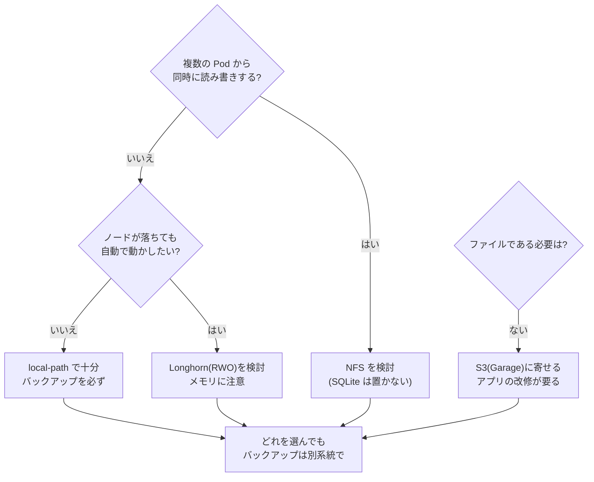

# LT 計画: 複数ノードになった自宅 k8s のデータの扱い方 ― NFS・Longhorn・Garage を比べる

- イベント: Cloud Native Days Winter 2026 / LT(初心者向け「新しく触ったクラウドネイティブ技術」)
- 状態: **計画(ドラフト v4 2026-11-06)**。実験・構築はまだ。結果は [`measurements/log.md`](measurements/log.md) に追記し、ここには書かない。
- 前提の調査: [`storage-options.md`](storage-options.md)(選択肢・必要条件・SQLite との相性)。

> **根拠の凡例**: 📖 公式ドキュメント・構造から言える / ✅ 実機・実測で確認済み / ⚠ 記憶・二次情報(要確認) / 🔜 試して確かめる / 🎯 予想(試す前に書く。外れたらそのまま残す)

---

## 1. ゴールと筋

**ゴール(聞き手が持ち帰るもの)**

> **オンプレでノード間のデータを扱うとき、「どの場合に何が適するか」を自分で判断できる。**

**筋は「調査 → 比較 → 選定 → 構築」**。実験が主役ではなく、図とユースケースの比較が主役。

| 段階 | 内容 | 見せるもの |
|---|---|---|
| 1 背景 | 2 台目の worker を足したら、データが 1 台に縛られた | 図(`local-path` は 1 ノードに固定) |
| 2 手法 | NFS・Longhorn・Garage が何をするか | 方式ごとの図 |
| 3 比較 | ユースケースごとに、どれが合うか | 図 + 早見表 |
| 4 選定 | うちの制約(メモリ 3.3 GB、SQLite、家族向けで数時間の停止は許容、バックアップは R2)に当てはめて選ぶ | 制約 → 選択 |
| 5 構築 | 選んだものを実際に作った記録 | 手順、詰まった点、動作 |
| 6 振り返り | 良かった点、確かめていないこと | 一覧 |

**動機づけ**: ミニ PC を買って worker を 2 台にしたら、データが 1 台に縛られた。直し方は NFS・Longhorn・Garage とあるが、公式の機能表だけでは自分の用途で選べなかった。だから、図で整理し、決め手になる点だけ小さく試し、選んで作った。

**見せ方の方針: 図が主役、数字は注釈**。方式ごとに図を 1 枚描き、データの通り道と「どこが落ちたら何が止まるか」を示し、「この場合は〜」を 1 行添える。図に書く主張は、出典(📖)か試行(🔜)で裏が取れたものだけ。

| 方式 | 一言で | 目的 |
|---|---|---|
| `local-path`(今) | ノードのディスクをそのまま | 基準 |
| NFS | 1 台のサーバーのフォルダを皆で使う | 共有 |
| Longhorn | ノードのディスクを複製して 1 つのボリュームに見せる | 冗長化 |
| Garage | ファイルではなく S3 の API で保存する | 設計の変更 |

Garage は PV の代わりではなく**アプリの作りを変える**方式。性能と障害は同じ土俵では比べない(§11)。

### 1.1 応募文との対応

| 応募文の約束 | どこで答えるか |
|---|---|
| 3 方式を `local-path` 基準に小さな VM で試す | §4 の軽い試行(T1〜T4) |
| 性能 | T4(軽く)。補足の 1 枚 |
| ノード障害時の挙動 | T2(1 回)+ 図の説明(📖) |
| メモリの常駐コスト | T1 |
| SQLite との相性 | T3 |
| どの状況で何を選ぶか | §7 の早見表と選び方の流れ図 |
| 初めて触った立場 | §5 の試行錯誤の記録、§8 の構築の記録 |

### 1.2 試行の位置づけ

> **試すかどうかの基準**: ドキュメントや構造から言えることは、試さず出典を付けて言い切る。**軽く試す**のは次のどれかのときだけ。
> (a) ドキュメントが黙っている / (b) 結果が思い込みと違いそう / (c) 自分の環境に固有の条件がある(メモリ 3.3 GB など)

**参考にした発表の学び**(3 件目のスライドは読み込めず未確認)

| 発表 | 学び | この LT での使い方 |
|---|---|---|
| 自宅 k8s のバックアップ構成(Longhorn・MinIO・B2) | 数字より**実際の障害 → 原因 → 設計の判断**が中心。Argo CD が Longhorn ごと削除して全 PV 消失、再インストールでバックアップ先 NFS が消去。「取れたか」でなく「**戻せるか**」が本題 | 構築で、復元の照合まで確認する。うちも Argo CD 運用なので、消したときの挙動に気をつける |
| youki への Memory Policy 実装 | 結果の数字はなく、**やって分かった落とし穴**と、**検証できなかったことの正直な記載** | 試行は不明点に絞り、確かめられなかったことを明記 |

## 2. 実際のケース(選び方の軸)

| ケース | 実際の場面 | 要るもの |
|---|---|---|
| **C1 DB(SQLite)** | Control Plane の DB(WAL)、SQLite を使う生成アプリ | 低レイテンシの同期書き込み、強いロック。共有は不要 |
| **C2 複数 Pod で同じデータ** | Agent Job・お試し版・本番・helper が同じ PVC を使う | RWX(同時アクセス) |
| **C3 ノードが落ちても再開** | 家族のアプリが 1 台のノードで止まる | 別ノードで再開、データが残る |
| **C4 ファイル・画像の塊** | 家族のアプリの写真や添付(**想定**。現状は未使用) | 容量、API でよい |
| **C5 バックアップ・履歴の置き場** | dsnap、restic の保存先 | 安く大きく、壊れにくい。S3 向き |
| **C6 誤削除・破損からの復旧** | 家族がデータを消した、アプリが壊した | 複製ではなく**バックアップ** |

## 3. 図の主張と、その根拠

| 図の主張 | 根拠 | 試行 |
|---|---|---|
| `local-path` の PVC は最初に使ったノードに固定され、別ノードの Pod は動かない | ✅ 実機で確認済み(overview.md §5) | D1(再現のみ) |
| NFS はサーバーが単一障害点。容量は強制されず、リサイズ不可 | 📖 | - |
| NFS は RWX で複数 Pod から使える | 📖 | D3 |
| NFS に SQLite(WAL)を置くと不具合が出る | 📖 公式は「WAL はネットワーク FS 非対応」とだけ。**実際の壊れ方は不明** | **T3** |
| Longhorn は複製を持ち、ノードが落ちても別ノードのデータで動ける | 📖 | - |
| **Longhorn でノードが落ちたとき、Pod が自動で別ノードで再開する** | ⚠ 「冗長化なら自動」と思われがち。時間・手動操作の要否が不明 | **T2** |
| **Longhorn のメモリは 3.3 GB のノードに収まる** | ⚠ 公式に必要量の記載なし。自分の環境固有 | **T1** |
| Longhorn の RWX は中で NFS(share manager)を使う | 📖 | - |
| Garage は S3 の API で使う。ファイルとしては開けない(SQLite は置けない) | 📖 | D4 |
| **Garage を 2 ノードで使うと、1 台落ちたとき書き込みが止まる** | ⚠ replication factor 2 の quorum による推論 | **T2** |
| 複製は削除も複製する(誤削除を防がない) | 📖 設計から言える | D2 |
| Longhorn を消す(Argo CD の prune / uninstall)とデータはどうなるか | ⚠ 他者の事例(二次情報)。設定に依存 | 構築前に公式で確認 |
| 性能: `local-path` > Longhorn > NFS の順に遅くなる | 🎯 応募文で約束したので軽く測る | T4(補足) |

## 4. 軽い試行

**「軽く」の意味**: 各方式を入れて、決め手になる点だけを 1〜3 回確認する。統計は取らない。**n を必ず書く**。

| # | 何を確かめるか | 方法 | 測るもの | 🎯 予想 |
|---|---|---|---|---|
| **T1** | **導入とメモリ**: 3.3 GB の worker に収まるか | 導入前後に `free -m`、`kubectl top`。手順・所要時間・詰まった点を記録(§5) | 常駐メモリ・CPU、手順数、所要時間 | Longhorn が最も重く、余裕が小さい。Garage は軽い |
| **T2** | **ノード停止(各 1 回)**: 書き込み中に Pod のいる worker を強制停止 | Pod が 1 秒ごとに連番を書き(ファイル or S3)、VM を停止。Longhorn と Garage(対照として NFS) | 別ノードで再開するまでの時間、手動操作の要否、連番の欠け | NFS(サーバー別)は影響なし。Longhorn は再開に時間/手動が要るかも。Garage は 2 ノードで書けなくなるかも |
| **T3** | **SQLite を置く**: 複数プロセスから WAL で書く | 4 プロセス × 1 万 INSERT。NFS は別ノードの Pod からも。Longhorn は RWO で同一ノード | `integrity_check`、`database is locked`、欠けた行 | NFS は壊れる/locked。他は問題なし |
| **T4** | **性能(補足)**: 小さい同期書き込み | `fio --rw=randwrite --bs=4k --fsync=1 --iodepth=1 --runtime=60`、n=3。Garage は 4 KiB の PUT/GET を別表 | IOPS・p99 / PUT・GET のレイテンシ | `local-path` > Longhorn > NFS |

**実演**(測定ではなく、図の主張を目で確認):

| # | 内容 | 使う場面 |
|---|---|---|
| D1 | `local-path` の Pod を別ノードで動かして `Pending`(Events を保存) | 導入の図 |
| D2 | ファイルを消すと、複製先からも消える(Longhorn / S3)。restic(R2)からは戻る | 「複製はバックアップではない」 |
| D3 | NFS の RWX に 2 つの Pod から同時に書く | NFS の図 |
| D4 | サンプルのデータ層(JSON ファイル)を S3 API に書き換える差分(行数・直す箇所) | Garage の図 |

## 5. 試行錯誤の記録(「初めて触った立場」の材料)

方式ごとに**同じ形式**で残す。成功した手順より、**詰まった点**を重視する。

| 項目 | 内容 |
|---|---|
| 導入 | 手順数、所要時間、公式ドキュメントだけで足りたか |
| 前提 | ノードに要るパッケージ・設定(例: `nfs-common`、`iscsid`)、足りなくて起きたこと |
| 詰まった点 | 症状 → 原因 → 直した方法(時系列。失敗も消さない) |
| 掃除 | アンインストール後に残るもの(特に Longhorn) |
| 運用で気になった点 | 状態の見え方(UI / CLI)、障害時にどこを見るか |

置き場: `docs/measurements/data/storage-<方式>-notes.md`。LT では、初心者が同じところで詰まりそうなものを選ぶ。

## 6. Pros/Cons

各方式を「**カバーできること / できないこと**」で書く。**主張には根拠(§3 の📖か試行 ID)を付ける**。根拠がなければ ⚠ を付けるか書かない。

| | カバーできること | カバーできないこと(🎯 現時点の予想) |
|---|---|---|
| `local-path` | 速い、簡単、追加のメモリなし | ノードをまたげない、ノードが落ちると止まる、容量を強制しない |
| NFS | RWX、別ノードで再開、導入が軽い | サーバーが単一障害点、SQLite(WAL)に不向き、容量は強制されずリサイズ不可 |
| Longhorn | 複製でノード障害に耐える、ブロックなので SQLite OK、UI あり | 常駐メモリが重い、RWX は中で NFS、2 ノードでは replica 2 まで、**バックアップではない** |
| Garage | 共有の問題がなくなる、軽い、複製、バックアップに向く | ファイルとして使えない(SQLite は置けない)、アプリの改修が要る、2 ノードの複製では書き込みが止まりうる |

> 共通: **どれも誤削除・破損は防げない**(D2)。

## 7. 選定

### 7.1 ケース別の早見表(空欄は試行後に埋める)

| ケース | local-path | NFS | Longhorn | Garage |
|---|---|---|---|---|
| C1 DB(SQLite) |  |  |  |  |
| C2 複数 Pod で共有 |  |  |  |  |
| C3 ノードが落ちても再開 |  |  |  |  |
| C4 ファイル・画像の塊 |  |  |  |  |
| C5 バックアップ置き場 |  |  |  |  |
| C6 誤削除からの復旧 |  |  |  |  |

記号は ◎(向く)/ ○(条件つき)/ ×(向かない)/ -(対象外)。**根拠(📖か試行 ID)を併記**し、予想と違った升目は理由を 1 行書く。

### 7.2 選び方の流れ図(試行後に確定。現時点の 🎯 仮説)

### 7.3 うちの制約から選ぶ

| 制約 | 内容 |
|---|---|
| メモリ | worker-01 の空きが約 1.9 GB、worker-02 が約 2.3 GB(T1 の結果と突き合わせる) |
| データ | Control Plane の SQLite、アプリのソース/データの PVC(複数 Pod が同じ PVC を使う) |
| 許容できる停止 | 家族向け。数時間は許容 |
| バックアップ | 毎晩 R2(restic)。**どの選択でも維持する** |
| 運用 | 一人で運用。道具が増えるほど負担が増える |

選んだ理由は、**「何を選んだか」と同じ重さで「何を選ばなかったか」も書く**。併用する場合は、代償(メモリ合計と運用の数)を明記する。

## 8. 構築(選んだものを実際のクラスタに入れる)

選定が決まってから詳細を確定する(🔜)。今決められる骨組み:

| 段階 | 内容 |
|---|---|
| 事前 | **復元できるバックアップがあること**を確認(restic で実際に戻して照合)。家族への影響が出る時間帯を避ける。入れるものが既定の StorageClass やノード設定を変えないか、公式で確認 |
| 導入 | 試行で分かった手順と注意点のとおりに入れる。Argo CD の管理下に置くか、置くなら prune の影響を確認 |
| 移行 | まず**重要度の低いアプリ 1 つ**で。データの移し方(コピー、バックアップから復元)を決めて記録 |
| 確認 | Pod を別ノードで動かす / ノードを 1 台止める(影響が小さい時間に) / 復元の照合 |
| 戻し方 | うまくいかなかったときに `local-path` に戻す手順を、移行の前に用意 |
| 記録 | 手順、所要時間、詰まった点、動いている様子(画面)を残す |

> 本物のクラスタなので、**破壊的な試行(ノード強制停止、全消し)はここではやらない**。それは試行用の VM で済ませておく。

## 9. 環境(試行用)

- 試行は**本物のクラスタには入れず**、Proxmox のミニ PC に使い捨てクラスタを作る(🔜 空きの確認)。壊す試行(T2)と、既定の StorageClass やノード設定に触る Longhorn の導入があるため。
- 構成: control-plane 1 + worker 2、Kubernetes v1.36.4、CNI は Cilium、OS・カーネルは本番と同じ。VM は **worker-02 と同じ 4 CPU / 3.3 GB**(Longhorn が足りるかが見どころ)。
- NFS サーバーは独立した VM(または NAS)。worker を止める T2 に巻き込まないため。
- 絶対値は自宅の VM の値。同じ環境内の相対値として扱う。

| 方式 | 導入 | 設定 |
|---|---|---|
| NFS | `nfs-subdir-external-provisioner`(Helm)、ノードに `nfs-common` | サーバー VM に `nfs-kernel-server` |
| Longhorn | 1.13.0(Helm)、`longhornctl check preflight` | worker が 2 台なので **replica 2**(3 のままだと Degraded になる様子も記録) |
| Garage | 公式 Helm chart | レイアウトを CLI で設定。2 ノード、replication factor 2 |

## 10. 手順(1 方式あたり)

1. 導入前に `free -m`・`kubectl top node` を記録(T1 の基準)。
2. 導入し、手順・所要時間・詰まった点を記録(§5)。
3. 5 分置いて、同じ値を記録(T1)。
4. D1 → D3 → D4 → T4 → T3 → D2 → **T2(VM を止めるので最後)** の順。
5. 生データを `docs/measurements/data/storage-<方式>-<日付>.*` に保存。

## 11. 公平さと限界(スライドにも書く)

- n は小さい(1〜3)。**ベースライン、観察**と呼び、統計とは言わない([`measurements/README.md`](measurements/README.md))。
- 「NFS が悪い」「Longhorn が遅い」とは言わない。**この環境(VM 3 台、仮想ネットワーク、小さなメモリ)での観察**と言う。
- Garage は S3、他はブロック/ファイル。**同じ指標では比べない**。
- 試行は worker 2 台のみ。3 台目があれば Garage の replication factor 3 や Longhorn の replica 3 の様子は変わる。
- 確かめられないことは各試行の「限界」欄と、振り返りのスライドに書く。
- Rook/Ceph は試さない(理由は [`storage-options.md`](storage-options.md) §3.4)。

## 12. 結果の残し方

- `measurements/log.md` に **M-016 以降**で、試行ごとに追記(日時・方法・環境・結果・生データ・注意・n)。
- 再現コマンドは `hack/storage-exp/` に置く。
- 予想(🎯)は先に書いてあるので、**外れた試行を優先して図とスライドにする**。
- 構築の記録は `docs/dev-log.md`(実装中の問題と判断)に追記し、`overview.md` を更新する。

## 13. スライドの構成案(図が主役、10 枚程度。持ち時間は後で調整)

| # | 内容(図) | 根拠 |
|---|---|---|
| 1 | 2 台目の worker で何が起きたか: `local-path` が 1 ノードに固定される図 | D1 |
| 2 | 直し方は 3 つ、目的が違う(共有 / 冗長化 / 設計変更)。PV/PVC を 1 枚で | §1 |
| 3 | **NFS の図**: 通り道、サーバーが単一障害点。「この場合は〜」 | 📖, D3 |
| 4 | **Longhorn の図**: 複製と share manager。ノードを落としたときの動き、メモリ | T2, T1 |
| 5 | **Garage の図**: S3 で使う設計変更、2 ノードの quorum、書き換えの差分 | T2, D4 |
| 6 | **SQLite はどこに置く?** 方式ごとの置けた/壊れた | T3 |
| 7 | 複製はバックアップじゃない | D2 |
| 8 | **ケース別の早見表** + 選び方の流れ図 | §7 |
| 9 | **うちはこれを選んだ**(制約 → 選択、選ばなかった理由)と、構築の様子 | §7.3, §8 |
| 10 | 振り返り: 良かった点、確かめていないこと / (補足)数字 1 枚 | §11, T1, T4 |

## 14. 進め方と時期

| 段階 | 内容 |
|---|---|
| 0 | 試行用クラスタ(Proxmox)と NFS サーバー VM を用意。§7.1 の早見表を空欄で先に作る |
| 1 | 方式ごとに導入(T1)と D1・D3・D4・T4・T3・D2、最後に T2。試行錯誤を記録 |
| 2 | 結果から早見表を埋め、選定(§7) |
| 3 | 構築(§8)。記録を取りながら |
| 4 | M-016〜の記録、図とスライド、通しの練習 |

LT の日付が分かったら、そこから逆算して日付を入れる(🔜)。

## 15. 決めること・確認すること

1. LT の**日付**(持ち時間は後で調整するので後回しでよい)。
2. 自宅に **NAS があるか**(なければ NFS サーバーを VM に立てる)。
3. 試行用クラスタを作れる **Proxmox の空き**(worker 相当 2 台 + control-plane + NFS サーバー)。
4. C4(写真など)は現状ないので、「想定」と明記して残すか外すか。
5. スライドの道具(図の作り方)と、既存の `summary.md` の資産の流用。

## 出典

- [`storage-options.md`](storage-options.md)(各公式ドキュメントへのリンクを含む)
