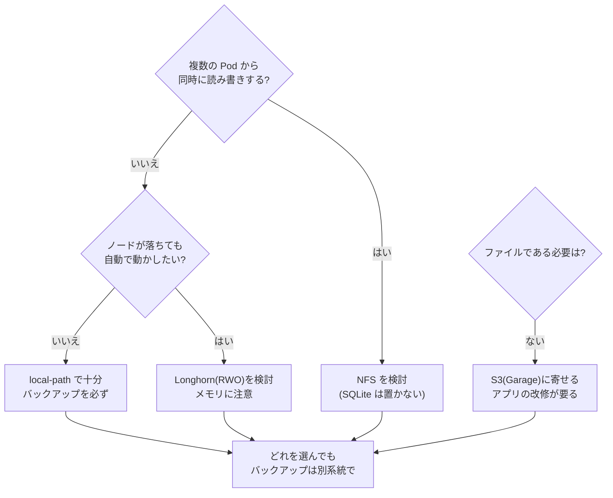

# LT 実験計画: 複数ノードになった自宅 k8s のデータの扱い方 ― NFS・Longhorn・Garage を比べる

- イベント: Cloud Native Days Winter 2026 / LT(初心者向け「新しく触ったクラウドネイティブ技術」)
- 状態: **計画(ドラフト v3 2026-11-06)**。実験はまだ。結果は [`measurements/log.md`](measurements/log.md) に追記し、ここには書かない。
- 前提の調査: [`storage-options.md`](storage-options.md)(選択肢・必要条件・SQLite との相性)。

> **根拠の凡例**: 📖 公式ドキュメント・構造から言える / ✅ 実機・実測で確認済み / ⚠ 記憶・二次情報(要確認) / 🔜 実験で確かめる / 🎯 予想(実験前に書く。外れたらそのまま残す)

---

## 1. ゴールと筋

**ゴール(聞き手が持ち帰るもの)**

> **オンプレでノード間のデータを扱うとき、「どの場合に何が適するか」を自分で判断できる。**

**動機づけ**: ミニ PC を買って worker を 2 台にしたら、データが 1 台に縛られた。直し方を調べると NFS・Longhorn・Garage があるが、公式の機能表だけでは**自分の用途で選べなかった**。小さな VM で試し、単体で確かめ、データの性質が違うので併用も試し、「どの状況で何を選ぶか」にまとめた。

**見せ方の方針: アーキテクチャ(図)が主役、数字は注釈**

- 方式ごとに**図を 1 枚**描く。データの通り道と、「どこが落ちたら何が止まるか」を示し、「この場合は〜」を 1 行添える。
- 数字は図の注釈か、補足の 1 枚に。数字だけを並べる発表にしない。
- 図に書いた主張は、**出典(📖)か実験(🔜)で裏が取れているものだけ**書く。

| 方式 | 一言で | 目的 |
|---|---|---|
| `local-path`(今) | ノードのディスクをそのまま | 基準(困りごとの再現) |
| NFS | 1 台のサーバーのフォルダを皆で使う | 共有 |
| Longhorn | ノードのディスクを複製して 1 つのボリュームに見せる | 冗長化 |
| Garage | ファイルではなく S3 の API で保存する | 設計の変更 |

Garage は PV の代わりではなく**アプリの作りを変える**方式。性能と障害は同じ土俵では比べない(§10)。

### 1.1 実験の目的

**実験の目的**: 方式の優劣を決めることではない。**図に書いた主張が、自分の環境で本当かを裏取りすること**。

> **実験するかどうかの基準**: ドキュメントや構造から言えることは、実験せず出典を付けて言い切る。実験するのは次のどれかのときだけ。
> (a) ドキュメントが黙っている / (b) 結果が思い込みと違いそう / (c) 自分の環境に固有の条件がある(メモリ 3.3 GB など)

**参考にした発表の学び**(3 件目のスライドは読み込めず未確認)

| 発表 | 学び | この LT での使い方 |
|---|---|---|
| 自宅 k8s のバックアップ構成(Longhorn・MinIO・B2) | 数字より**実際の障害 → 原因 → 設計の判断**が中心。Argo CD が Longhorn ごと削除して全 PV 消失、再インストールでバックアップ先 NFS が消去。本題は「取れたか」でなく「**戻せるか**」 | 失敗の観察を主役に。うちも Argo CD 運用なので、消したときの挙動と復元の照合を併用の実験に入れる |
| youki への Memory Policy 実装 | 結果の数字はなく、**やって分かった落とし穴**と、**検証できなかったこと(CI が UMA)の正直な記載** | 公式に書かれていない点(Longhorn のメモリなど)を実測し、自分の環境で確かめられないことを明記 |

## 2. 実際のケース(選び方の軸)

このプラットフォームと自宅 k8s にある、実際のデータの使い方を「ケース」として使う。

| ケース | 実際の場面 | 要るもの |
|---|---|---|
| **C1 DB(SQLite)** | Control Plane の DB(WAL)、SQLite を使う生成アプリ | 低レイテンシの同期書き込み、強いロック。共有は不要 |
| **C2 複数 Pod で同じデータ** | Agent Job・お試し版・本番・helper が同じ PVC を使う | RWX(同時アクセス) |
| **C3 ノードが落ちても再開** | 家族のアプリが 1 台のノードで止まる | 別ノードで再開、データが残る |
| **C4 ファイル・画像の塊** | 家族のアプリの写真や添付(**想定**。現状は未使用) | 容量、API でよい |
| **C5 バックアップ・履歴の置き場** | dsnap、restic の保存先 | 安く大きく、壊れにくい。S3 向き |
| **C6 誤削除・破損からの復旧** | 家族がデータを消した、アプリが壊した | 複製ではなく**バックアップ** |

## 3. 図の主張と、その根拠

実験の要否は、図に書く主張ごとに決める。

| 図の主張 | 根拠 | 実験 |
|---|---|---|
| `local-path` の PVC は最初に使ったノードに固定され、別ノードの Pod は動かない | ✅ 実機で確認済み(overview.md §5)。画面を載せるだけ | D1(再現のみ) |
| NFS はサーバーが単一障害点。容量は強制されず、リサイズ不可 | 📖 | なし |
| NFS は RWX で複数 Pod から使える | 📖 | D3(デモ) |
| NFS に SQLite(WAL)を置くと不具合が出る | 📖 公式は「WAL はネットワーク FS 非対応」とだけ。**実際の壊れ方は不明** | **E3** |
| Longhorn は複製を持ち、ノードが落ちても別ノードのデータで動ける | 📖 | - |
| **Longhorn でノードが落ちたとき、Pod が自動で別ノードで再開する** | ⚠ 「冗長化なら自動」と思われがち。時間・手動操作の要否が不明 | **E2** |
| **Longhorn のメモリは 3.3 GB のノードに収まる** | ⚠ 公式に必要量の記載なし。自分の環境固有 | **E1** |
| Longhorn の RWX は中で NFS(share manager)を使う | 📖 | - |
| Garage は S3 の API で使う。ファイルとしては開けない(SQLite は置けない) | 📖 | D4(書き換えの差分) |
| **Garage を 2 ノードで使うと、1 台落ちたとき書き込みが止まる** | ⚠ replication factor 2 の quorum による推論 | **E2** |
| 複製は削除も複製する(誤削除を防がない) | 📖 設計から言える | D2(コマンド 1 本の実演) |
| Longhorn を消す(Argo CD の prune / uninstall)とデータはどうなるか | ⚠ 他者の事例(二次情報)。Longhorn の設定に依存 | E4 の中で確認 |
| 併用すると、メモリ合計・運用の数が増える。全消しからバックアップで戻せる | 🔜 自分の結論の根拠になる | **E4** |
| 性能: `local-path` > Longhorn > NFS の順に遅くなる | 🎯 応募文で約束したので最小限だけ測る | E5(補足) |

## 4. 実験(本番の 5 本)と実演(軽い 4 本)

### 4.1 実験

| # | 何を確かめるか | 方法 | 測るもの | 🎯 予想 |
|---|---|---|---|---|
| **E1** | **導入コスト**: 各方式を入れると、3.3 GB の worker に収まるか | 導入前後に `free -m`、`kubectl top`。手順・所要時間・詰まった点を記録(§5) | 常駐メモリ・CPU、手順数、所要時間 | Longhorn が最も重く、余裕が小さい。Garage は軽い |
| **E2** | **ノード停止**: 書き込み中に Pod のいる worker を強制停止 | Pod が 1 秒ごとに連番を書き(ファイル or S3)、`qm stop`。対象は Longhorn、Garage、(対照として NFS、`local-path`) | 別ノードで再開するまでの時間、手動操作の要否、連番の欠け | NFS(サーバー別)は影響なし。Longhorn は再開に時間がかかる/手動が要るかも。Garage は 2 ノードで書けなくなるかも |
| **E3** | **SQLite を置く**: 複数プロセスから WAL で書く | 4 プロセス × 1 万 INSERT。NFS は別ノードの Pod からも。Longhorn は RWO で同一ノード | `integrity_check`、`database is locked` の回数、欠けた行 | NFS は壊れる/locked。他は問題なし |
| **E4** | **併用の通し**(段階 2。§4.3) | 構成を 2〜3 個作り、メモリ合計・ノード停止・全消しからの復元 | §4.3 | 代償はメモリ合計と運用の数 |
| **E5** | **性能(補足)**: 小さい同期書き込み | `fio --rw=randwrite --bs=4k --fsync=1 --iodepth=1 --runtime=60`、n=5。Garage は 4 KiB の PUT/GET を別表 | IOPS・p99 / PUT・GET のレイテンシ | `local-path` > Longhorn > NFS |

### 4.2 実演(測定ではなく、図の主張を目で確認するもの)

| # | 内容 | 使う場面 |
|---|---|---|
| D1 | `local-path` の Pod を別ノードで動かして `Pending`(Events を保存) | 導入の図。✅ 既知の再現 |
| D2 | ファイルを消すと、複製先からも消える(Longhorn / S3)。restic(R2)からは戻る | 「複製はバックアップではない」 |
| D3 | NFS の RWX に 2 つの Pod から同時に書く | NFS の図 |
| D4 | サンプルのデータ層(JSON ファイル)を S3 API に書き換える差分(行数・直す箇所) | Garage の図 |

### 4.3 段階 2: 併用の実験(E4)

データの性質が違う(§2)ので、1 つに決めず**データごとに置き場を分ける**。構成の候補は**E1〜E3 の結果を見てから 2〜3 個に絞る**。現時点の仮説(🎯):

| 構成 | DB(C1) | 共有(C2) | バックアップ(C5) | ねらい |
|---|---|---|---|---|
| **A 現状** | `local-path` | 同一ノードに寄せる | R2(restic) | 基準 |
| **B 冗長化中心** | Longhorn(RWO) | Longhorn | Longhorn の backup target = Garage(S3)+ R2 | ノードが落ちても再開。バックアップは別系統 |
| **C 目的別に分ける** | `local-path` | NFS | Garage + R2 | 重い Longhorn を避ける |

構成ごとに同じ手順で確かめる:

1. **メモリの合計**: 全部入れて 3.3 GB の worker に収まるか。
2. **ノード停止**: データの種類ごとに、何が止まり、何が自動で戻り、何が手動か(表にする)。
3. **全消しからの復元**: Helm uninstall / Argo CD の prune で消し、バックアップ(Garage / R2)から復元して**中身を照合**。消したときにデータや**バックアップ先まで**消えないかも見る(先に読んだ事例)。
4. **運用の数**: 障害時に見る場所の数、導入と掃除の手順の数、詰まった点。

> 併用の代償は**メモリ合計と運用の数**。LT の結論は「どれか 1 つ」ではなく「データの性質で分ける。ただし代償はこれ」。

## 5. 試行錯誤の記録(「初めて触った立場」の材料)

方式ごとに**同じ形式**で残す。成功した手順より、**詰まった点**を重視する。

| 項目 | 内容 |
|---|---|
| 導入 | 手順数、所要時間、公式ドキュメントだけで足りたか |
| 前提 | ノードに要るパッケージ・設定(例: `nfs-common`、`iscsid`)、足りなくて起きたこと |
| 詰まった点 | 症状 → 原因 → 直した方法(時系列。失敗も消さない) |
| 掃除 | アンインストール後に残るもの(特に Longhorn) |
| 運用で気になった点 | 状態の見え方(UI / CLI)、障害時にどこを見るか |

置き場: `docs/measurements/data/storage-<方式>-notes.md`。LT では、初心者が同じところで詰まりそうなものを選ぶ。

## 6. Pros/Cons

各方式を「**カバーできること / できないこと**」で書く。**主張には根拠(§3 の📖か実験 ID)を付ける**。根拠がなければ ⚠ を付けるか書かない。

| | カバーできること | カバーできないこと(🎯 現時点の予想) |
|---|---|---|
| `local-path` | 速い、簡単、追加のメモリなし | ノードをまたげない、ノードが落ちると止まる、容量を強制しない |
| NFS | RWX、別ノードで再開、導入が軽い | サーバーが単一障害点、SQLite(WAL)に不向き、容量は強制されずリサイズ不可 |
| Longhorn | 複製でノード障害に耐える、ブロックなので SQLite OK、UI あり | 常駐メモリが重い、RWX は中で NFS、2 ノードでは replica 2 まで、**バックアップではない** |
| Garage | 共有の問題がなくなる、軽い、複製、バックアップに向く | ファイルとして使えない(SQLite は置けない)、アプリの改修が要る、2 ノードの複製では書き込みが止まりうる |

> 共通: **どれも誤削除・破損は防げない**(D2)。

## 7. ケース別の選び方(早見表と流れ図。空欄は実験後に埋める)

| ケース | local-path | NFS | Longhorn | Garage |
|---|---|---|---|---|
| C1 DB(SQLite) |  |  |  |  |
| C2 複数 Pod で共有 |  |  |  |  |
| C3 ノードが落ちても再開 |  |  |  |  |
| C4 ファイル・画像の塊 |  |  |  |  |
| C5 バックアップ置き場 |  |  |  |  |
| C6 誤削除からの復旧 |  |  |  |  |

記号は ◎(向く)/ ○(条件つき)/ ×(向かない)/ -(対象外)。**根拠(📖か実験 ID)を併記**する。予想と違った升目は理由を 1 行書く。

**選び方の流れ図**(結論のスライド。実験後に確定。現時点の 🎯 仮説):

最後に、自分の環境での結論(「うちは何を選んで、何を選ばなかったか」、併用の結果)を書く。**自分の事情であって一般解ではない**と断る。

## 8. 環境

- **本物のクラスタには入れない**(家族のアプリが動いている)。Proxmox のミニ PC に使い捨てクラスタを作る。
- 構成(本番に寄せる): control-plane 1 + worker 2、Kubernetes v1.36.4、CNI は Cilium、OS・カーネルは本番と同じ。VM は **worker-02 と同じ 4 CPU / 3.3 GB**(Longhorn が足りるかが見どころ)。
- NFS サーバーは**独立した VM**(または NAS)。worker を止める E2 に巻き込まないため。
- 注意: VM は同じ物理ディスク・仮想ネットワークを共有する。**絶対値は自宅の値**で、比較は同じ環境内の相対値。

| 方式 | 導入 | 設定 |
|---|---|---|
| NFS | `nfs-subdir-external-provisioner`(Helm)、ノードに `nfs-common` | サーバー VM に `nfs-kernel-server` |
| Longhorn | 1.13.0(Helm)、`longhornctl check preflight` | worker が 2 台なので **replica 2**(3 のままだと Degraded になる様子も記録) |
| Garage | 公式 Helm chart | レイアウトを CLI で設定。2 ノード、replication factor 2 |

## 9. 手順(1 方式あたり)

1. 導入前に `free -m`・`kubectl top node` を記録(E1 の基準)。
2. 導入し、手順・所要時間・詰まった点を記録(§5)。
3. 5 分置いて、同じ値を記録(E1)。
4. D1 → D3 → D4 → E5 → E3 → D2 → **E2(VM を止めるので最後)** の順。
5. 生データを `docs/measurements/data/storage-<方式>-<日付>.*` に保存。
6. 全方式が終わったら E4(併用)。

## 10. 公平さと限界(スライドにも書く)

- n=5 の中央値は**ベースライン**であって統計ではない。n を必ず併記([`measurements/README.md`](measurements/README.md))。
- 「NFS が悪い」「Longhorn が遅い」とは言わない。**この環境(VM 3 台、仮想ネットワーク、小さなメモリ)での観察**と言う。
- Garage は S3、他はブロック/ファイル。**同じ指標では比べない**。
- 実験は worker 2 台のみ。3 台目があれば Garage の replication factor 3 や Longhorn の replica 3 の様子は変わる。LT では「うちは 2 台」と断る。
- 確かめられないことは各実験の「限界」欄と、結論のスライドに書く。
- Rook/Ceph は試さない(理由は [`storage-options.md`](storage-options.md) §3.4)。

## 11. 結果の残し方

- `measurements/log.md` に **M-016 以降**で、実験ごとに表で追記(日時・方法・環境・結果・生データ・注意・n)。
- 再現コマンドは `hack/storage-exp/` に置く。
- 予想(🎯)は先に書いてあるので、**外れた実験を優先して図とスライドにする**。
- Pros/Cons(§6)と早見表・流れ図(§7)は、**根拠の ID を付けて**反映する。

## 12. スライドの構成案(図が主役、10 枚程度)

| # | 内容(図) | 根拠 |
|---|---|---|
| 1 | 2 台目の worker で何が起きたか: `local-path` が 1 ノードに固定される図 | D1 |
| 2 | 直し方は 3 つ、目的が違う(共有 / 冗長化 / 設計変更)。PV/PVC を 1 枚で | §1 |
| 3 | **NFS の図**: データの通り道、サーバーが単一障害点。「この場合は〜」 | 📖, D3 |
| 4 | **Longhorn の図**: 複製と share manager。ノードを落としたときの動き。メモリ | E2, E1 |
| 5 | **Garage の図**: S3 で使う設計変更、2 ノードの quorum。アプリを書き換える差分 | E2, D4 |
| 6 | **SQLite はどこに置く?** 方式ごとの置けた/壊れた | E3 |
| 7 | 複製はバックアップじゃない(消すと全部から消える) | D2 |
| 8 | **併用の全体図**: データの種類ごとの置き場と、代償(メモリ合計・運用の数) | E4 |
| 9 | **選び方の流れ図** + 早見表 | §7 |
| 10 | うちの結論と、確かめられなかったこと / (補足)数字 1 枚: メモリと性能 | E1, E5 |

持ち時間は後で調整する(2・7・10 を縮める/削る)。

## 13. 進め方と時期

| 段階 | 内容 |
|---|---|
| 0 | 使い捨てクラスタ(Proxmox)と NFS サーバー VM を用意。§7 の早見表を空欄で先に作る |
| 1 | 方式ごとに導入(E1)と、D1・D3・D4・E5・E3・D2、最後に E2。試行錯誤を記録(**段階 1: 単体**) |
| 2 | E1〜E3 の結果から併用の構成を 2〜3 個に絞り、E4(**段階 2: 併用**) |
| 3 | M-016〜の記録、Pros/Cons・早見表・流れ図を埋める(**段階 3: 結論**)、図とスライド、通しの練習 |

LT の日付が分かったら、そこから逆算して日付を入れる(🔜)。

## 14. 決めること・確認すること

1. LT の**日付**(持ち時間は後で調整するので後回しでよい)。
2. 自宅に **NAS があるか**(なければ NFS サーバーを VM に立てる)。
3. 使い捨てクラスタを作れる **Proxmox の空き**(worker 相当 2 台 + control-plane + NFS サーバー)。
4. C4(写真など)は現状ないので、「想定」と明記して残すか外すか。
5. スライドの道具(図の作り方)と、既存の `summary.md` の資産の流用。

## 出典

- [`storage-options.md`](storage-options.md)(各公式ドキュメントへのリンクを含む)
