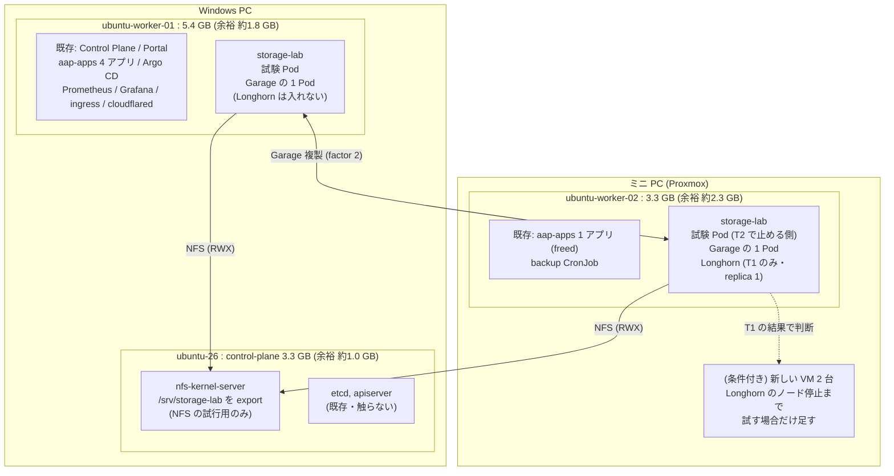
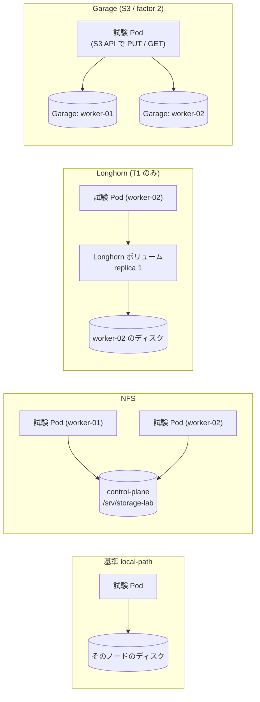
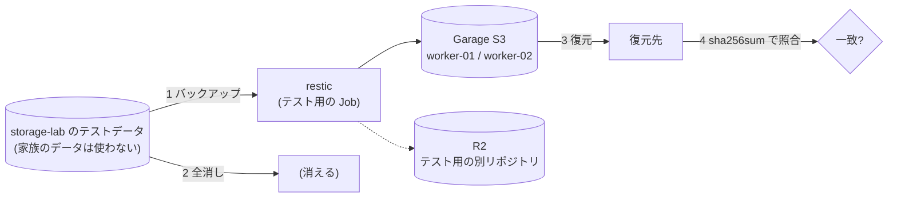
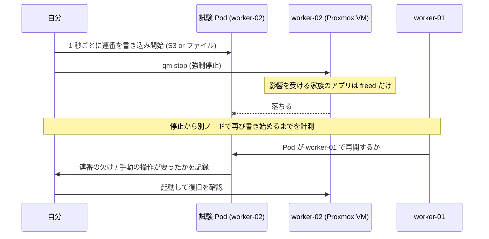
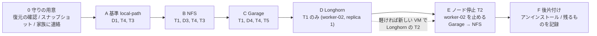

# LT 試行の配置図: どの VM に何を作り、何を試すか

- 計画の本体: [`lt-storage-experiment-plan.md`](lt-storage-experiment-plan.md)(目的・試行 T1〜T4・実演 D1〜D4・守り)。この文書は**配置と順番**を図にしたもの。
- 試す場所: **既存のクラスタ**(家族のアプリが動いている)。専用の namespace `storage-lab` に閉じる。
- 状態: 計画。まだ何も入れていない。

> **根拠の凡例**: ✅ 2026-11-06 に読み取りで確認 / 🔜 試して確かめる / 🎯 予想

---

## 1. 確認した現状(✅ 2026-11-06、読み取りのみ)

| 項目 | control-plane `ubuntu-26` | worker-01 `ubuntu-worker-01` | worker-02 `ubuntu-worker-02` |
|---|---|---|---|
| 置き場所 | Windows PC 上の VM | Windows PC 上の VM | ミニ PC(Proxmox)の VM |
| メモリ(合計) | 3.3 GB | 5.4 GB | 3.3 GB |
| メモリ(使用中 / 余裕 `available`) | 2.3 GB / **約 1.0 GB** | 3.6 GB / **約 1.8 GB** | 1.1 GB / **約 2.3 GB** |
| ルートの空き | 30 GB | 18 GB | 25 GB |
| `kubectl top`(メモリ) | 1.8 GB(56%) | 2.9 GB(55%) | 0.9 GB(27%) |
| Taint | `NoSchedule`(Pod は載らない) | なし | なし |
| `nfs-common` / `nfs-kernel-server` | 未導入 / 未導入 | 未導入 / 未導入 | 未導入 / 未導入 |
| `open-iscsi`(`iscsid`) | 導入済み(inactive) | 導入済み(inactive) | 導入済み(inactive) |
| 載っている Pod | 11(kube-system、etcd、apiserver など) | **28**(下) | **5**(下) |

- **worker-01 に家族のアプリと基盤がほぼ全部ある**: Control Plane / Portal、`aap-apps` の 4 アプリ、Argo CD(7)、Prometheus / Grafana(monitoring 6)、ingress-nginx、cloudflared ×2、Tailscale operator、local-path-provisioner、`apps` / `default` / `dev` の検証用 Pod。
- **worker-02 は空いている**: `aap-apps` の 1 アプリ(`freed`)、Cilium、kube-proxy、node-exporter、毎晩のバックアップ CronJob だけ。
- StorageClass は **`local-path` のみ**(`Delete`、`WaitForFirstConsumer`)。PVC は 12。
- Kubernetes v1.36.4、カーネル 7.0.0-38(3 台とも同じ)。

**ここから言えること**

1. **ノードを止める T2 は worker-02 が適している**。止めて影響が出る家族のアプリは `freed` の 1 つと、worker-02 のバックアップ CronJob だけ。
2. **Longhorn の置き場が一番の問題**。worker-02 は余裕があるが、2 台に複製を置く前提だと worker-01(余裕約 1.8 GB で Prometheus、Argo CD、ingress などが同居)にも載る。→ §5 の判断点。
3. **NFS サーバーは control-plane に置ける**(ディスク 30 GB、アプリは載っていない)。ただし control-plane は etcd と同じディスクなので、`fio` は短く(§5)。
4. 3 台とも `nfs-common` が未導入。**NFS を試すにはノードに `apt install` が要る**(家族のアプリへの影響は小さい)。

## 2. どの VM に何を作るか

| ノード | 入れるもの | 変える設定 | 影響 |
|---|---|---|---|
| **control-plane** | `nfs-kernel-server`(試行用ディレクトリだけ export) | `apt install`、`/etc/exports` | 小。etcd と同じディスクなので負荷に注意 |
| **worker-01** | `nfs-common`、Garage の 1 Pod、試験 Pod | `apt install` | 小。**Longhorn は入れない**(家族のアプリと基盤が同居) |
| **worker-02** | `nfs-common`、Garage の 1 Pod、試験 Pod、**Longhorn(T1 のみ、replica 1)** | `apt install`、`iscsid` を有効化(Longhorn のとき) | 小〜中。T2 で止める |
| (条件付き)新しい VM 2 台 | Longhorn(replica 2)、T2 | `kubeadm join`、taint とラベル | T1 で「重すぎる」と分かったら足さない |

## 3. 方式ごとに何がどこに置かれ、何を試すか

| 方式 | 試験 Pod の置き場 | 試すこと | 🎯 予想 |
|---|---|---|---|
| 基準 `local-path` | worker-02 に固定 → 別ノードへ | D1(Pending の再現)、T4、T3(対照) | Pod が `Pending`、データは元のノードに残る |
| NFS | worker-01 と worker-02 の両方 | T1、D3(同時書き込み)、T4、**T3(別ノードからも書く)**、T2(対照) | 導入は軽い。SQLite は不具合が出る |
| Longhorn | worker-02 | **T1(メモリ・導入)**。重ければここで止め、「試さなかった」理由として記録 | 常駐が重く、うちの規模には過剰 |
| Garage | worker-01 / worker-02 | T1、D4(書き換え差分)、T4(PUT/GET)、**T2**、**T5(restic の保存先)** | 軽い。2 ノードだと 1 台落ちたとき書き込みが止まるかも |

## 4. T5: Garage を restic のバックアップ先にして復元する

- 本物のバックアップ(R2 の既存リポジトリ)には**触れない**。リポジトリもパスワードもテスト用を別に作る。
- 記録するのは、復元の成否、中身の一致、所要時間、詰まった点。Garage を 1 台止めた状態でも読めるか(T2 と合わせて)。

## 5. ノード停止(T2)の流れ

- 対象は **Garage → NFS(対照)** の順に 1 回ずつ。方式ごとに worker-02 を戻して復旧を確認してから次へ。
- **Longhorn は T1 の結果で判断**する。重すぎれば「試さなかった」と、その理由を書く。
- 家族のアプリが使えなくなる時間帯を事前に連絡する(計画書 §9)。
- `local-path` は停止すると再開できないこと(D1 と同じ理由)を図で説明するだけ。再現は不要。

### 5.1 Longhorn の置き場(決定: 最小で始める)

| 案 | 内容 | 判断 |
|---|---|---|
| A: 既存の 2 台に置く(replica 2) | worker-01 にも載る。余裕約 1.8 GB に Prometheus、Argo CD、ingress が同居 | **やらない**(家族の基盤が OOM するおそれ) |
| B: worker-02 だけ(replica 1) | worker-01 には触れない。複製がないので T2 の再開は見せられない | **T1 はこれで行う** |
| D: 新しい VM を 2 台足す(replica 2) | 家族への影響なしで T2 まで試せる。Proxmox に約 6.6 GB の空きが要る | **T1 の結果で判断**(重ければ足さない) |

- 運用するなら何が要るかは、計画書 §7.4。
- 中止の基準(B でも): `available` が **300 MB を切る**、または家族のアプリの Pod が **OOM で再起動**した。Grafana のダッシュボードで見張る。
- 導入前に Proxmox のスナップショットを取り、`persistence.defaultClass=false` にする。

### 5.2 NFS サーバーを control-plane に置く

- 良い点: アプリが載っておらず、worker を止める T2 に巻き込まれない。ディスクの空きは 30 GB。
- 注意: **etcd と同じディスク**。`fio` の同期書き込みが etcd のレイテンシを悪化させうる。→ `fio` は短く(60 秒、n=3)、試行中は etcd の遅延を確認し、悪化したら止める(🔜)。
- 代案: worker-01 に置く(家族の基盤と同居)、または worker-02 に置く(T2 で止まるので T2 の NFS は対象外)。

### 5.3 その他

- control-plane と worker-01 は**同じ Windows PC 上**、worker-02 は別の物理機(LAN 越え)。NFS の速度はノードによって違う(**絶対値は自宅の値**)。
- worker-01 は**単独の障害点**(Argo CD、監視、ingress が同居)。T2 で worker-01 は止めない。

## 6. 順番とリスク

| 段階 | ノードへの影響 | 家族への影響 | 失敗したときの戻し方 |
|---|---|---|---|
| 0 | なし | なし | - |
| A | なし | なし | `storage-lab` を削除 |
| B | 小(`apt install`、export) | なし | `apt remove`、export を削除、namespace を削除 |
| C | 小(namespace 内) | なし | namespace を削除 |
| D | 中(`iscsid`、CRD、メモリ。worker-02 のみ) | メモリ不足のおそれは小さい | 中止の基準で止めて、公式の手順でアンインストール。ダメなら VM スナップショットに戻す |
| E | worker-02 が停止 | `freed` の 1 アプリ + worker-02 のバックアップ | worker-02 を起動 |
| F | 中 | なし | - |

## 7. 確認できていないこと(🔜)

- worker-01(Windows PC 上の VM)のスナップショットの取り方。
- Longhorn と Garage の常駐メモリ(公式に記載なし → T1 で測る)。Longhorn が重すぎたときに新しい VM を足すかどうかの基準。
- `freed` が家族に使われているアプリかどうか(T2 の前に確認)。
- control-plane のディスク I/O の余裕(etcd への影響)。
