# LT スライド下書き: 複数ノードになった自宅 k8s のデータの扱い方 ― NFS・Longhorn・Garage を比べる

各枚は「ひとことのメッセージ → 図 → 数字(あれば) → この場合は〜」の順で書く。判断材料は [`storage-decision.md`](storage-decision.md)、数字の出典は [`measurements/log.md`](measurements/log.md)(M-016〜M-024)。すべて実環境(家族のアプリが動く状態)での n=1〜3 の観察で、持ち時間は後で調整する。

> **未決**: 11 枚目の最終方針(NFS + バックアップ強化が有力)、NFS サーバーの置き場、移す範囲。末尾のチェックリストを参照。

| # | 内容 | 根拠 |
|---|---|---|
| 1 | この発表で話すこと(結論) | 全体 |
| 2 | 背景: なぜノード間でデータを共有する必要があるのか | overview.md §5、M-022 |
| 3 | 2 台目の worker で何が起きたか | D1・M-016、M-023 |
| 4 | 直し方は 3 つ、目的が違う | storage-options.md |
| 5 | NFS | M-017、M-023 |
| 6 | Longhorn | M-020、M-021、M-022 |
| 7 | Garage | M-018、M-019、M-023 |
| 8 | SQLite はどこに置く? | M-016〜M-021 |
| 9 | 複製はバックアップじゃない | 📖、M-018 |
| 10 | ケース別の早見表と選び方 | plan §7 |
| 11 | うちはこれを選んだ | plan §7.3、§8 |
| 12 | 振り返り | plan §7.5 |

---

## 1. この発表で話すこと

複数ノードになった自宅の Kubernetes で、データをどう扱えばよいか。NFS・Longhorn・Garage を小さく試して分かったことを話します。聞いた人が持ち帰れるのは、**「どの場合に何が適するか」を選ぶための軸**と、**実際に壊して分かった落とし穴**です。

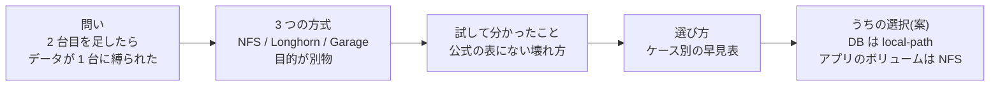

結論を先に言うと、3 つの方式は**同じ土俵の優劣ではなく、目的が別物**です。共有したいなら NFS、落ちても残したいなら Longhorn、作りを変えるなら Garage。試して分かったのは、NFS では別のノードが書くと SQLite の行が欠けること(整合性チェックは通るのに)、Garage は 2 ノードだと 1 台落ちた時点で書き込みが止まること、Longhorn はメモリより書き込みの遅さが効くこと、の 3 つです。うちでは、DB は `local-path` のまま、アプリのボリュームを NFS に移す方針が有力です(3 ノード以上になったら再検討)。

**この発表で分かること**: 自分の環境でどれを選ぶかを、目的・データの種類・ノード数で判断する軸。

---

## 2. 背景: なぜノード間でデータを共有する必要があるのか

1 台のときは気になりませんでした。1 つのアプリを動かす Pod は、本番、AI が修正する Job、お試し版、データの保存や復元の Job と何種類もあり、**全員が同じボリュームを使います**。1 台なら全員が同じノードにいるので、それで成り立っていました。

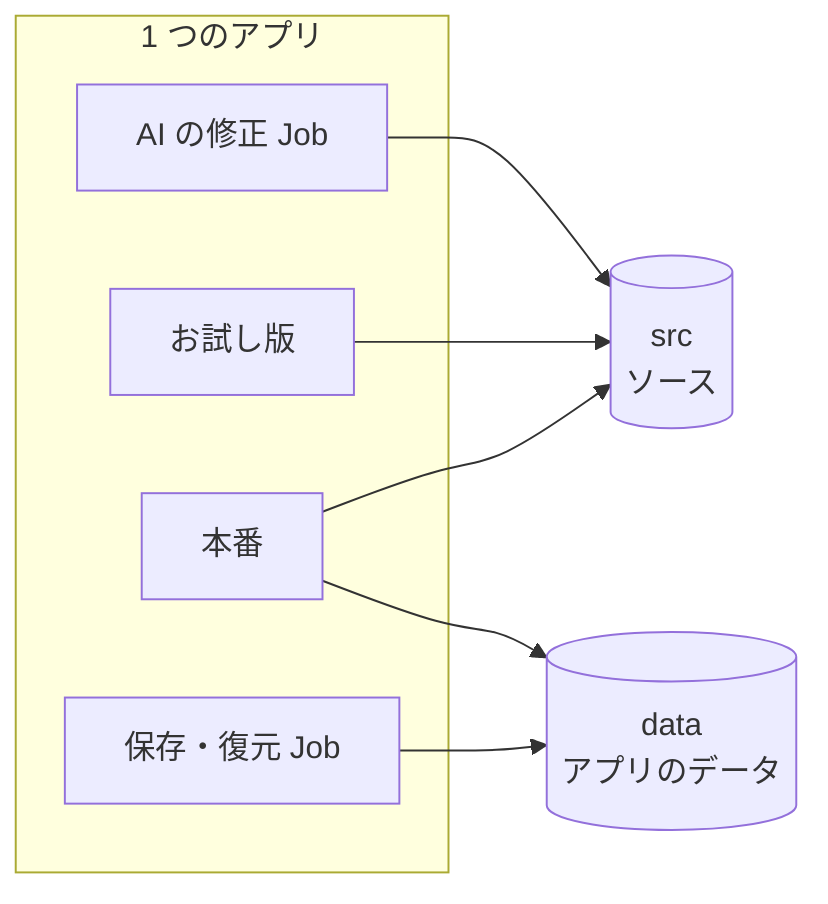

2 台目を足すと、これが困りごとに変わります。ボリュームは最初に使ったノードに固定され、そのアプリの Pod は全部そのノードに寄るからです。

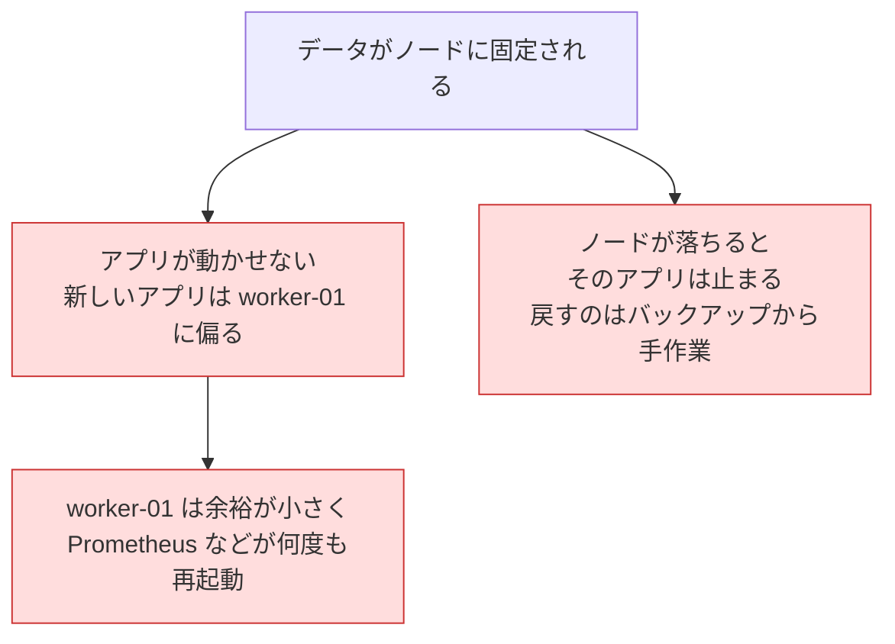

実際、アプリの Pod は worker-01 に偏り、worker-01 は元から余裕が小さく、Prometheus は 143 回、cloudflared は 111〜113 回再起動していました。worker-02 はほとんど空いているのに、動かせません。ノードが落ちたときも、止まったアプリを戻すのはバックアップからの手作業です。

そこで欲しいのは、**どのノードからも同じデータが見えて、Pod をどのノードにも動かせて、落ちたら別のノードで再開できる**ことです。ただし「ノードをまたいで動ける」ことと、「複数のレプリカが同じデータを書く」ことは別の話で、今回扱うのは前者です。

**この場合は**: 家族向けで数時間の停止は許せますが、アプリが 1 台に偏って動かせないのは困ります。

---

## 3. 2 台目の worker を足したら、データが 1 台に縛られた

家族がスマホから頼むと AI が小さな Web アプリを作り、自宅の Kubernetes で動かす基盤です。ミニ PC を買って 2 台目の worker を立てたところ、`local-path` のデータが最初に使ったノードに固定されると分かりました。

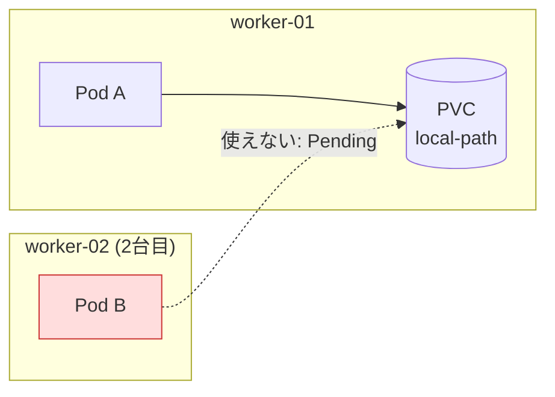

別ノードの Pod は動けず、`didn't match PersistentVolume's node affinity` で `Pending` のままです。実際に worker-02 を止めると、`local-path` のアプリは戻るまで約 **12 分 20 秒**止まりました。

**この場合は**: ノードが落ちるとそのノードのアプリが止まり、アプリは worker-01 に偏ります。

---

## 4. 直し方は 3 つ、目的が違う

公式の機能表だけでは、自分の用途でどれが合うか分かりませんでした。そこで小さく試しました。

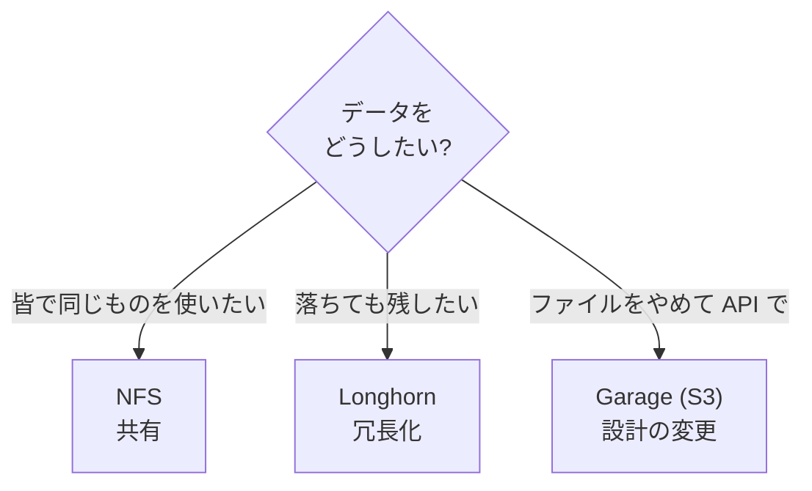

土台の話を 1 枚にすると、Pod は PVC を通して PV を使い、PV が実際のディスクを指します。`local-path` ではこの PV がノードのディスクに結びついているので、Pod もそのノードに縛られます。

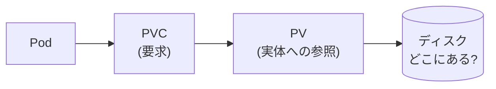

MinIO は配布終了・アーカイブで使えず(二次情報)、Garage を選びました。Rook/Ceph は 3 ノード以上と生ディスクが前提で、メモリも重いので試していません。

**この場合は**: 「共有したい」「落ちても残したい」「作りを変える」のどれが欲しいかで答えが変わります。

---

## 5. NFS: 皆で 1 つのフォルダを使う

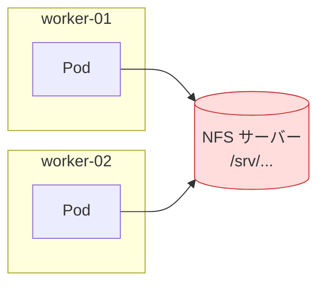

導入は軽く(Helm で 7 秒、provisioner は約 7 MiB)、2 つのノードの Pod が同じ PVC を使えました。ノードを落とすと、サーバーが別にある限り、Pod は約 **6 分**で別ノードで再開し、データの欠けもありませんでした。この 6 分の大半は Kubernetes の既定の待ち時間(300 秒)です。

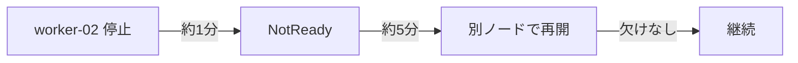

代わりに書き込みは遅くなり、`local-path` の約 6 割の IOPS、fsync は約 3 倍でした。サーバーそのものが落ちれば全員が止まります。

| 強い | 弱い |
|---|---|
| 共有できる / 軽い / ノード障害でも再開 | サーバーが単一障害点 / 遅い / SQLite に向かない(8 枚目) |

**この場合は**: 複数のノードの Pod が、同じファイルを読み書きしたいとき。

---

## 6. Longhorn: ノードのディスクを複製して 1 つに見せる

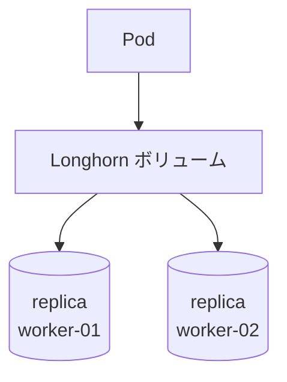

意外だったのはメモリです。22 個の Pod が常駐しても、アイドル時の追加は約 **0.45 GB** で、負荷をかけても増えませんでした。ところが複製を 2 つにすると、書き込みが大きく遅くなりました。

| | IOPS(4 KiB 同期書き込み) | fsync の p99 |
|---|---|---|
| local-path | 約 590 | 約 2.0 ms |
| Longhorn replica 1 | 482〜497 | 3.1〜3.2 ms |
| Longhorn replica 2 | **107〜113** | **19〜25 ms** |

さらに、余裕の小さい worker-01 にも載せたところ、ノードが過負荷になりました(load average 78、原因は未特定)。慌てて外したため、**ノード障害時の再開は試せていません**。

**この場合は**: 3 ノード以上あり、専用のディスクとメモリに余裕があるとき。うちの 2 ノードでは割に合いませんでした。

---

## 7. Garage: ファイルをやめて S3 で保存する

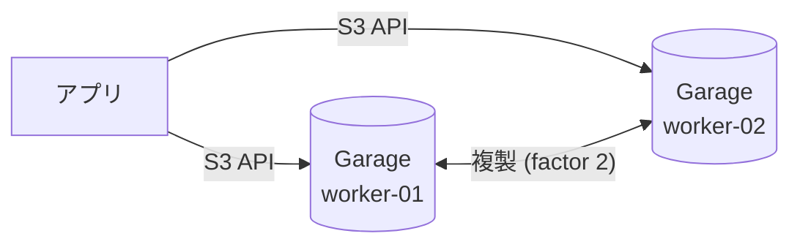

とても軽く(1 Pod 6〜7 MiB)、restic の保存先としては、バックアップ → 全消し → 復元 → 照合が通りました。一方、2 ノードで複製を 2 つにすると、**片方が落ちた時点で書き込みが全て止まります**。

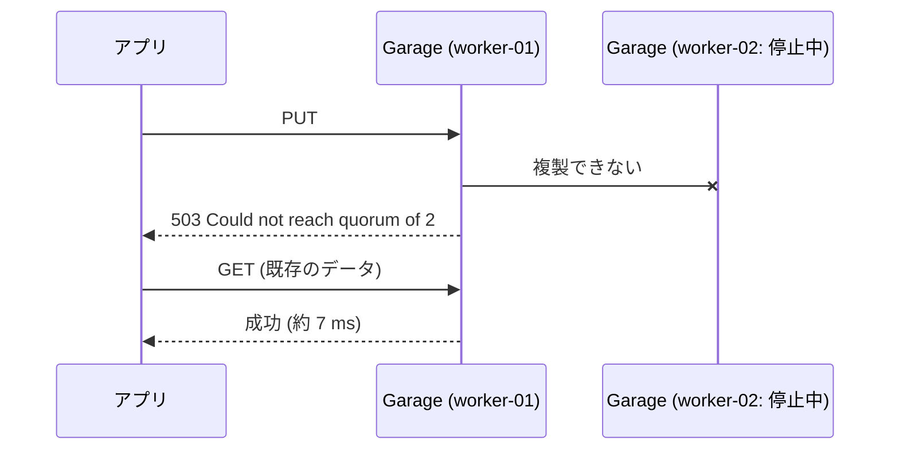

もう一つ意外だったのは、「失敗」と返した PUT 688 件のうち 481 件(約 7 割)が、実際には保存されていたことです。失敗は「書けなかった」ではなく「結果が不明」と扱う必要があります。

アプリを S3 に書き換える差分は、追加 31 行・削除 21 行と小さい一方、依存が 0 から 26 パッケージ(18 MB)に増え、非同期化と、データは `/data` だけという約束(App Contract)の変更が要ります。

**この場合は**: S3 前提のアプリやバックアップ置き場に。ノードは 3 つ以上が目安です。

---

## 8. SQLite はどこに置く?

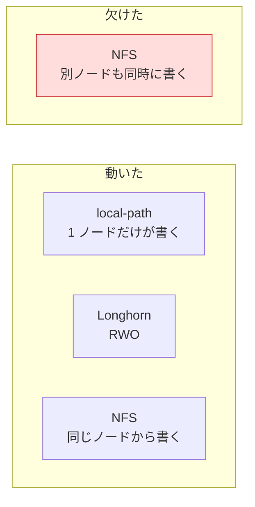

4 プロセスが 1 万行ずつ書いたときの結果です。

| 置き場 | 結果 |
|---|---|
| local-path | 全行あり、約 65 秒 |
| Longhorn replica 1 / 2 | 全行あり、77〜78 秒 / 347〜356 秒 |
| NFS(同じノード) | 壊れないが約 8 倍遅い |
| **NFS(別ノードも書く)** | **`disk I/O error` が 1155 回、2000 行中 1837 行** |
| Garage | 置けない(ファイルではない) |

最も怖いのは、NFS で別ノードが加わったとき、**`integrity_check` は ok のままなのに、書いたはずの行が欠けた**ことです。公式は「WAL はネットワークファイルシステム非対応」としか書いていませんが、どう壊れるかは試して初めて分かりました。

**この場合は**: DB は、書くノードが 1 つに決まる場所(`local-path`)に置きます。

---

## 9. 複製はバックアップじゃない

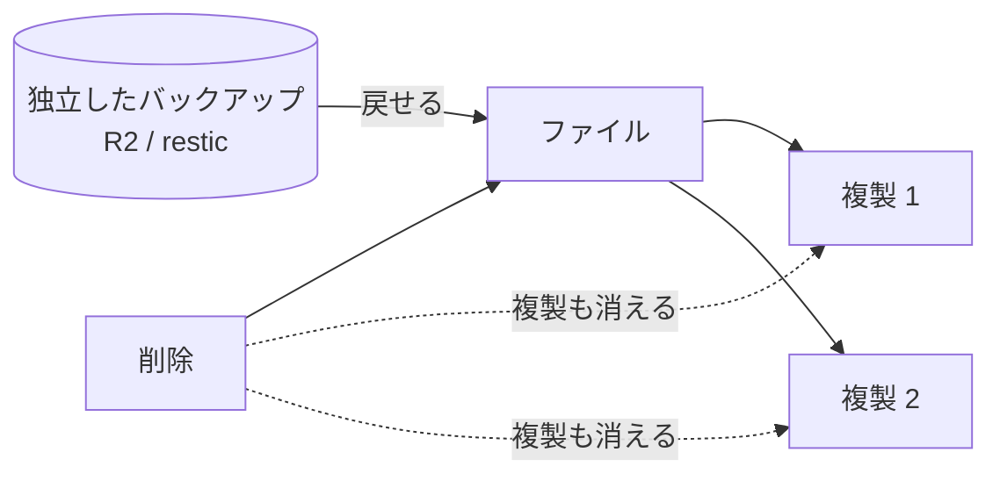

共有も複製も、削除や破損を一緒に反映します。戻せるのは、独立したバックアップだけです。だからどの方式を選んでも、毎晩の R2 へのバックアップは維持します。大事なのは「取れたか」ではなく「戻せるか」で、今回も restic の復元を Garage 上で実際に通して確かめました。

> 単体の実演(ファイルを消して複製先も消えるところ)は、まだ行っていません。話すなら設計から言えること(📖)として扱うか、実演してから載せます。

**この場合は**: 複製があっても、誤って消したときのために別系統のバックアップが要ります。

---

## 10. ケース別の早見表と選び方

| ケース | local-path | NFS | Longhorn | Garage |
|---|---|---|---|---|
| DB(SQLite) | ◎ | × | ○ 遅い | - |
| 複数ノードで共有 | × | ◎ | ○ 未検証 | ○ 要改修 |
| ノードが落ちても再開 | × | ◎ | ? 試せず | △ 書けない |
| ファイル・画像 | ○ | ○ | ○ | ◎ |
| バックアップ置き場 | × | ○ | × | ◎ |
| 誤削除からの復旧 | × | × | × | ×(バックアップだけ) |

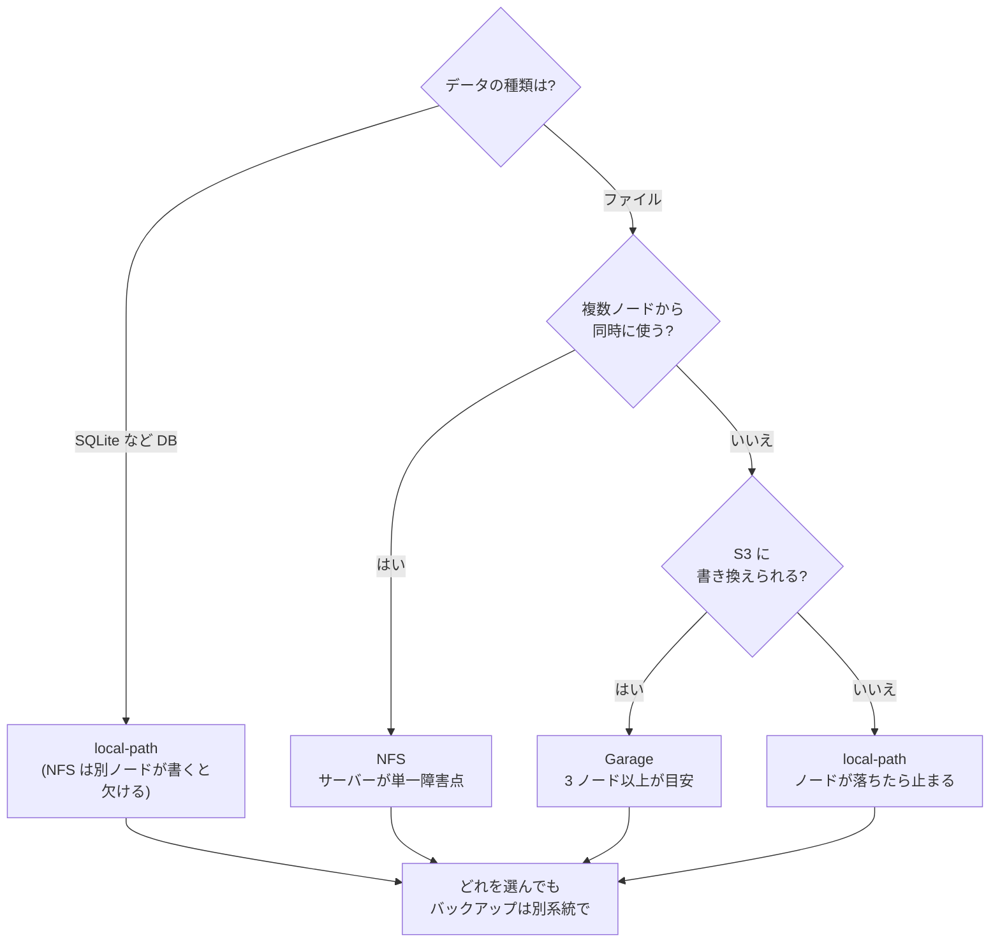

**この場合は**: まずデータの種類で分けて、次に「同時に使うか」「S3 にできるか」で選びます。

---

## 11. うちはこれを選んだ(下書き・未決)

目的は「複数ノード間でデータを共有し、アプリがノードをまたいで動けるようにすること」でした。そこで、アプリのボリュームだけを NFS に移し、DB は `local-path` のまま、バックアップは強化する方針が有力です。

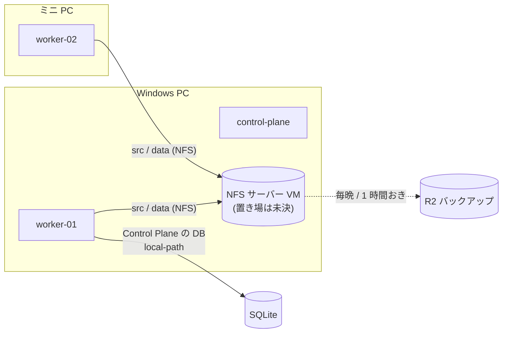

理由は、NFS がノード障害時に約 6 分で別ノードに移れて欠けないこと(M-023)、DB は NFS で欠けたので `local-path` に残すことです。変更は主に設定一つ(`AAP_STORAGE_CLASS`)で、切り戻しもそこを戻すだけです。

選ばなかったのは、書き込みが遅く不安定だった Longhorn と、2 ノードでは書き込みが止まる Garage です。**3 ノード以上になったら再検討**します。代償として、NFS サーバーが単一障害点になり、書き込みが遅くなります。また「スケール」は配置の自由度と障害時の再開までで、複数のレプリカが同じデータを書くのは別の問題です。

> 構築の様子(手順、詰まった点、動作の画面、切り戻し)は、方針が決まってから書きます。

**この場合は**: 目的が「共有」で、DB は別に分けられるとき。

---

## 12. 振り返り

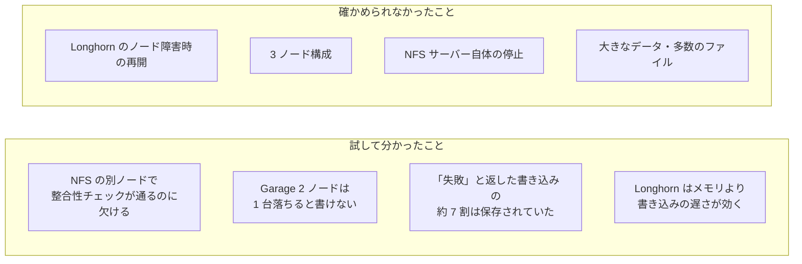

数字はすべて n=1〜3 の観察で、VM・仮想ネットワーク・小さなメモリという自分の環境での値です。「NFS が良く Longhorn が悪い」ではなく、**この環境では**こうだった、と受け取ってください。

---

## 補足 A: 数字を 1 枚に

| 方式 | fio IOPS(4 KiB 同期書き込み) | fsync p99 | SQLite 4 万行 |
|---|---|---|---|
| local-path | 588〜592 | 約 2.0 ms | 約 65 秒 |
| NFS | 347〜380 | 5.6〜7.7 ms | 完走せず(約 8 倍遅い) |
| Longhorn replica 1 | 482〜497 | 3.1〜3.2 ms | 77〜78 秒 |
| Longhorn replica 2 | 107〜113 | 19〜25 ms | 347〜356 秒 |

Garage は S3 なので別の表です(PUT 4 KiB が p50 70〜140 ms、GET が 2.5〜6.5 ms)。常駐メモリは Longhorn が約 0.45 GB(22 Pod)、Garage が 6〜7 MiB、NFS の provisioner が約 7 MiB でした。

## 補足 B: ノードを落としてみた(worker-02 を強制停止、n=1)

| | local-path(今) | NFS | Garage |
|---|---|---|---|
| 別ノードで再開 | できない(`Pending`) | 約 5 分 53 秒で再開 | Pod は動き続けた |
| データ | 戻ってから再開 | 欠けなし | 読み取りは成功 |
| 書き込み | 約 12 分 20 秒止まった | 再開後に継続 | 全て失敗(約 12 分 42 秒) |

---

## 書きながら決めること

- [ ] 強調する目的(共有・再開・損失の縮小・運用の軽さ)
- [ ] NFS サーバーの置き場(Windows PC の VM / control-plane / NAS)
- [ ] 移す範囲(新しいアプリだけ / `freed` なども)
- [ ] バックアップの強化も構築として見せるか
- [ ] Longhorn の再開を、もう一度試すか(新しい VM を足す)、試さずに「未検証」とするか
- [ ] 9 枚目を、実演してから載せるか、設計から言えること(📖)として載せるか
- [ ] 「ノードを落としてみた」を独立した枚にするか(今は 5・7 枚目と補足 B に分散)
