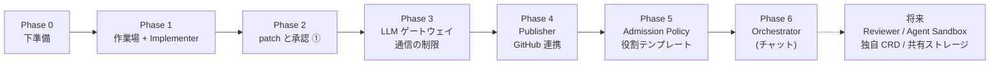
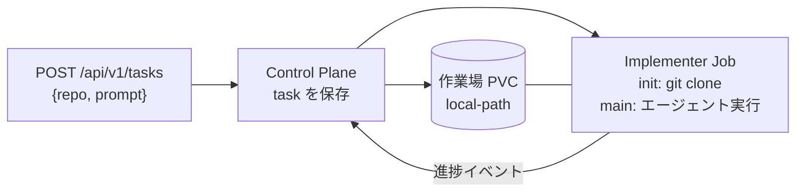

# マルチエージェント基盤: 実行計画

> 状態: **計画(2026-11-25)**。設計は [`multi-agent-permissions.md`](multi-agent-permissions.md)(以下「設計メモ」)。
> 実装済みの範囲は [`architecture.md`](architecture.md)。

## 0. 前提と決めたこと

| 項目 | 決定 | 根拠 |
|---|---|---|
| ストレージ | **`local-path` のまま**(作業場は PVC。共有ストレージには依存しない) | 作業場は短命で、Publisher は patch だけを受け取る(設計メモ §5.3)。NFS は遅く、単一障害点になる([`storage-decision.md`](storage-decision.md)) |
| 実行基盤 | **Job**(Agent Sandbox や独自 CRD は使わない) | ワンショットのタスクで、今の Agent Job の延長で作れる(設計メモ §8) |
| Pod の役割 | **Implementer と Publisher の 2 つ**。Reviewer は将来 | 権限の境目だけで分ける(設計メモ §2) |
| 最初の対象リポジトリ | **`k-kanke/genkan`**(公開) | 公開なので、Phase 1〜3 は認証なしで clone できる。鍵の扱いを後ろに回せる |
| 最初の Orchestrator | **LLM を使わない**(フォームで repo と依頼文を指定)。チャットは最後(Phase 6) | 権限と承認の仕組みを先に固め、LLM による判断は後から載せる |
| 配置 | `aap-agents`(新しい namespace)。`aap-apps`(家族のアプリ)とは分ける | 権限・NetworkPolicy・Admission Policy を別々に決めるため |
| Implementer のエージェント | **`gemini`**(Gemini CLI)。既存の `agent-runtime/agents/gemini.sh` を使う | 2026-11-25 に決定 |
| 作業場の容量 | **2 GiB** | `node_modules` を含むため、現行の `SourceSize`(1 GiB)より大きめ |
| タスクの保持期間 | **24 時間**(失敗した作業場、patch、記録)。**成功した作業場は、patch を保存した時点ですぐ解放する** | 切り分けに足りる長さ。成功後の作業場は誰も読まず、PVC のクォータを使うだけだったため(実装中に判明) |
| PR の種類 | **通常の PR**(draft にしない) | マージは人が GitHub 上で行う(承認 ②) |
| 結果の見せ方 | **チャットに PR へのリンクを出し、マージ画面へすぐ移れる**ようにする | 承認 ② までを、チャットから 1 タップで進めるため |

### 作業の進め方(共通)

- **開発は kind で先に確認し**、通ってから自宅クラスタに反映する(`hack/e2e-kind.sh` の流れ)。
- **クラスタの manifest は `kubernetes-platform`(Argo CD)に置く。** 動的なもの(Job、PVC)は Control Plane が作る。
- 各 Phase は**独立してマージ・切り戻しができる**単位にする。既存の家族向けアプリの機能は壊さない。
- 各 Phase の終わりに、**設計メモの未決事項**のうち、その Phase に関係するものを決めて記録する。

## Phase 0: 下準備

**目的**: 作業場と Implementer を置く場所と権限の枠を作る。コードはまだ書かない。

| やること | 場所 |
|---|---|
| `aap-agents` namespace を作る(`pod-security.kubernetes.io/enforce: restricted`) | `kubernetes-platform/manifests/ai-app-platform/namespaces.yaml` |
| default-deny の NetworkPolicy。Implementer は DNS と 443 のみ許可(Phase 3 で絞る) | `networkpolicies.yaml` |
| Control Plane の ServiceAccount に、`aap-agents` の Job / PVC / Pod ログを扱う Role を付ける。**Secret の読み取りは付けない** | `rbac.yaml` |
| `ResourceQuota` と `LimitRange`(Pod 数、CPU、メモリ、PVC 容量の上限) | 同上 |
| 実行する対象のイメージを決める。genkan は Node / TypeScript なので、今の `agent-runtime`(Node 入り)で足りるかを確認する | `agent-runtime/Dockerfile` |

**確認**: Argo CD が同期して、`aap-agents` が作られる。この namespace で、root・特権の Pod を作ろうとすると拒否される。
**切り戻し**: manifest を戻す(namespace は空)。

## Phase 1: 作業場(PVC)+ Implementer Job

**目的**: 依頼文を渡すと、リポジトリを clone して実装・テストまで行い、結果を Control Plane が見られる。
GitHub への書き込みは、まだしない。

| やること | 場所(目安) |
|---|---|
| `tasks` テーブルの追加(id、repo、prompt、状態、作業場の名前、作成日時)。起動時の自動マイグレーション | `control-plane/internal/store/store.go` |
| `EnsureTaskWorkspace`(タスクごとの PVC。**2 GiB**)、`EnsureImplementerJob`(init container で `git clone`、main で既存の `entrypoint.sh` 相当。エージェントは **`gemini`**) | `control-plane/internal/kube/`(新しいファイル `task.go`) |
| タスクの手順(作業場作成 → Job → 完了待ち → 後片付け)。**write-ahead と冪等**の流儀に合わせる | `control-plane/internal/orchestrator/`(新しいファイル `task_flow.go`) |
| API: `POST /api/v1/tasks`、`GET /api/v1/tasks/{id}`、イベントの SSE | `control-plane/internal/api/api.go` |
| Implementer 用のエントリポイント(`/workspace/repo` で動かす。App Contract のチェックは外す) | `agent-runtime/` |
| 期限切れの作業場の掃除(完了・失敗から **24 時間後**。設定 `AAP_TASK_RETENTION`) | `task_flow.go` |
| リポジトリ名の許可リスト(`^k-kanke/[\w.-]+$` のパターン、設定で変更可能) | `config.go` |

**設計上の注意**
- Job は `aap-agents` に作る。SA トークンなし、非 root、`readOnlyRootFilesystem`、`ActiveDeadlineSeconds`(現行踏襲)。
- clone は **init container** で行い、main には clone 用の権限を渡さない。
- 作業場の PVC は `local-path`。後続の Pod は PV のノード親和性で同じノードに乗る。

**確認(受け入れ条件)**
1. kind で、genkan を指定して「README に 1 行足して」を依頼 → Job が完了し、作業場に変更が入っている。
2. Go のテスト(状態遷移、冪等性、リポジトリ名の検証)が `-race` で通る。
3. 既存のアプリ生成の e2e(`hack/e2e-kind.sh`)が壊れていない。
4. 完了・失敗した作業場が、24 時間後に消える。

**切り戻し**: タスク機能を無効にするフラグを置く(`AAP_TASKS_ENABLED`)。既存機能には触れない。

## Phase 2: patch の回収と承認 ①

**目的**: Implementer の成果を patch として取り出し、人が見て承認するところまで。まだ push はしない。

| やること | 場所(目安) |
|---|---|
| Implementer の最後に、`git diff --binary` で patch を作る(`git add -A` したうえで、コミットはしない) | `agent-runtime/` |
| patch のアップロード用の内部 API(`POST /internal/v1/tasks/{id}/patch`)。**タスク専用のトークン**で認証し、サイズ上限をかける | `api.go` |
| patch と sha256 の保存(ファイルは DB と同じ PVC、メタデータは SQLite。保持は 24 時間) | `store.go` |
| patch の要約(変更ファイル、行数。保護パスへの変更の警告) | `control-plane/internal/` |
| API: `GET /tasks/{id}/patch`、`POST /tasks/{id}/approve`(patch の hash を受け取る) | `api.go` |
| genkan に最小の画面を足す: タスク作成フォーム、進捗、差分の表示、承認ボタン。**PR ができたら、PR へのリンクを出す**(Phase 4 で `pr_url` が入る) | `genkan/src/pages/` と `api/index.ts` |
| genkan の nginx から Control Plane の API を中継する(`/api/` → `control-plane.platform-system`)。tailnet からのみ到達できる状態を保つ | `genkan/nginx.conf`、`networkpolicies.yaml` |

**確認**
1. genkan の画面から依頼 → 差分が見える → 承認すると状態が `approved` になる。
2. 承認時の hash が、保存した patch と一致しないと拒否される。
3. 巨大な patch、保護パス(`.github/` など)を含む patch が、警告またはエラーになる。

**切り戻し**: genkan の画面を戻す。Control Plane 側は API が増えるだけ。

## Phase 3: LLM ゲートウェイと通信の制限

**目的**: API キーを Pod から外し、出口を許可リストに絞る。

| やること | 場所(目安) |
|---|---|
| LLM ゲートウェイを置く(最小は自作の小さなリバースプロキシ。LiteLLM などの採用も検討)。API キーはここだけが持つ | `platform-system` に新しい Deployment |
| Implementer には、**タスク専用の短命なトークン**だけを渡し、ベース URL をゲートウェイに向ける。**Gemini CLI が、API のベース URL を環境変数などで差し替えられるかは未確認**。できなければ、ゲートウェイ方式を見直す(例: 通信先を Gemini API だけに絞り、キーは Job ごとの短命な設定にする) | `kube/task.go`、`agent-runtime/agents/gemini.sh` |
| ゲートウェイで、トークンの検証、モデルの許可リスト、利用量の上限(トークン数・時間)、ログを行う | 新しいコンポーネント |
| Implementer の egress を、**ゲートウェイ + DNS + package の許可リスト**に絞る(Cilium の FQDN ポリシー。`registry.npmjs.org` など) | `networkpolicies.yaml`(CiliumNetworkPolicy) |
| 現行の `agent-credentials`(Secret を Job に渡す仕組み)を、タスクでは使わない | `kube/task.go` |

**確認**
1. Implementer の Pod の中から、許可していないホスト(例: `example.com`)への通信が失敗する。
2. Implementer の環境変数に、LLM の API キーがない(`env` を確認)。
3. 利用量の上限を超えると、ゲートウェイが拒否し、タスクが分かりやすいエラーで終わる。
4. 通信を絞っても、`npm install` と `npm test` が通る(許可リストの過不足を調整)。

**切り戻し**: ゲートウェイを経由しない設定(旧方式)に戻せるフラグを置く。ただし旧方式は鍵を Pod に渡すので、一時的な措置に限る。

## Phase 4: Publisher と GitHub 連携

**目的**: 承認された patch を、`agent/*` ブランチに push して PR を作る。**ここで初めて、書き込み用の鍵が登場する。**

| やること | 場所(目安) |
|---|---|
| **GitHub App を作る**(権限: Contents 書き込み、Pull requests 書き込み。対象リポジトリは genkan のみ)。**これは手作業で、あなたが行う** | GitHub の設定画面 |
| App の秘密鍵は Secret として `platform-system` に置き、**Control Plane だけ**が読めるようにする(Git には置かない) | `kubernetes-platform`(Secret は手動作成) |
| Control Plane が、タスクごとに **リポジトリ限定の installation token(1 時間)**を発行する | 新しいパッケージ `control-plane/internal/github/` |
| Publisher Job: 新しく clone → patch を適用 → 検査 → `agent/<task>` に push → **通常の PR**を作る(draft にしない)。PR の URL を Control Plane に返す(**LLM なし、固定コード**)。作業場の `.git` は使わない(設計メモ §5.3) | `agent-runtime/` とは別の小さなイメージ |
| patch の検査: 保護パス(`.github/`、lockfile、CODEOWNERS、Dockerfile、デプロイ用 manifest)、サイズ、バイナリ・シンボリックリンク・実行権限の変更は既定で拒否 | Publisher と Control Plane の両方 |
| Publisher の egress は GitHub(`api.github.com`、`github.com`)のみ | `networkpolicies.yaml` |
| 承認 ① の hash と、Publisher が適用する patch の hash を照合する | `task_flow.go` |
| タスクに `pr_url`(PR の URL)と `pr_number` を保存し、API と SSE で返す | `store.go`、`api.go` |

**暫定措置**: **公開リポジトリの clone は、認証なしのままにする。** 非公開リポジトリは、この Phase では扱わない
(読み取り専用トークンを、認証情報プロキシ経由で付ける仕組みは、必要になってから)。

**確認**
1. テスト用のリポジトリ(まず genkan のフォーク、または使い捨てのリポジトリ)で、承認 → PR が作られる。
2. 保護パス(`.github/workflows/x.yml`)を含む patch が拒否される。
3. `main` へ直接 push しようとしても、App の権限・ブランチ保護で失敗する(GitHub 側で `main` のブランチ保護を有効にする)。
4. Implementer の Pod に GitHub のトークンがない。Publisher の Pod にだけある。
5. 承認後に patch をすり替えると、Publisher が拒否する。

**切り戻し**: GitHub App をインストール先から外す(即座に権限が消える)。

## Phase 5: Admission Policy と役割テンプレート

**目的**: 権限の約束を、バグや乗っ取りがあっても破れない形でクラスタに強制する。

| やること | 場所(目安) |
|---|---|
| ValidatingAdmissionPolicy(または Kyverno)で、`aap-agents` の Pod に次を強制する: Secret の mount / `secretKeyRef` の禁止(Publisher を除く)、SA トークンなし、非 root、特権なし、`hostPath` 禁止 | `kubernetes-platform/manifests/` |
| 役割テンプレート(YAML)を導入する: `implementer`、`implementer-readonly`(調査用)、`publisher`。Control Plane が検証して Job に展開する | `agent-roles/`(設定ファイル)、`control-plane/internal/kube/` |
| テンプレートの `params`(リポジトリ名など)を、パターンと長さで検証する | `control-plane/internal/` |
| テンプレートの変更は PR を必須にする(`CODEOWNERS` など) | リポジトリの設定 |

**確認**
1. 手で、Secret を mount した Pod を `aap-agents` に作ろうとすると拒否される。
2. テンプレートにない役割・パラメータで Job を作ろうとすると、Control Plane が拒否する。
3. 調査用のテンプレート(読み取り専用の作業場、LLM ゲートウェイのみ)で、書き込みができない。

## Phase 6: Orchestrator(チャット)

**目的**: genkan のチャット欄から、自然言語で依頼できるようにする。

| やること | 内容 |
|---|---|
| Orchestrator に、**狭いツール**を渡す: `run_task(repo, prompt)`、`get_task`、`ask_approval`、`publish` | LLM は、Pod の spec や権限を決められない |
| チャットの文脈から、リポジトリ(許可リストの中から)と依頼文を決める | 曖昧なときは、チャットで聞き返す |
| 承認 ① を、チャットの返信(「push してよいですか」)として出す | 既存の承認 API を使う |
| PR ができたら、**チャットに PR のカードを出す**(タイトル、変更の要約、「PR を開く」ボタン)。ボタンは GitHub の PR ページ(`pr_url`)を開く。マージは GitHub 上で行う(承認 ②) | スマホでは GitHub アプリが開くことがある。リンクは `https://github.com/<owner>/<repo>/pull/<n>` の形 |
| (任意)マージ後に、チャットへ「マージされました」を返す。GitHub の webhook か、PR の状態の定期確認で検知する | webhook は外から届く経路が要るので、最初は定期確認(数分おき)で足りる |
| 複数リポジトリにまたがる依頼は、タスクを並列に作る(ユースケース B) | 設計メモ §7 |

**確認**: 「genkan のインフラ画面のコンテナ詳細をトグルにしまって」と送って、承認を挟んで PR ができ、チャットの PR カードのボタンから、マージ画面へ 1 タップで移れる(最初のゴール)。

## 将来(必要になったら)

- **Reviewer**: 鍵なし・読み取り専用・LLM あり。最初は人が PR を見る。
- **Agent Sandbox**: 同じ作業場を複数の役割が順に使う、差し戻しで何度も戻る、などの用途が出たとき(設計メモ §8.2)。
- **独自 CRD**: 承認待ちなど、Job に収まらない状態が増えたとき(設計メモ §8.3)。
- **認証情報プロキシ**: 非公開リポジトリの clone を、鍵を Pod に置かずに行う。
- **共有ストレージ**: 長いセッションの作業場、リポジトリのミラーやキャッシュの共有(`storage-decision.md` の結論次第)。
- **gVisor**: Job の `runtimeClassName`。ubuntu 26.04 と Cilium での動作確認が先。

## リスクと対策

| リスク | 影響 | 対策 |
|---|---|---|
| Implementer のテストが、許可リスト外の通信を必要とする | タスクが失敗する | Phase 3 で、失敗のログから許可リストを調整。必要最小限だけ足す |
| worker-01 の余裕が小さい(`storage-decision.md` §2.1) | Job の起動が遅い、他の Pod に影響 | `aap-agents` に `ResourceQuota` を置き、Job のリソースを小さく制限する。配置は worker-02 / 03 を優先する(`nodeAffinity`) |
| 作業場がノードに固定されるため、そのノードが落ちるとタスクが止まる | タスクの失敗 | 短命なので許容し、作業場ごと作り直す。自動再実行は決めたとき(設計メモ §11 の 8) |
| LLM の費用が膨らむ | 想定外の請求 | Phase 3 のゲートウェイで、タスクごと・日ごとの上限をかける。Google / Anthropic 側の予算アラートも設定する |
| GitHub App の秘密鍵が漏れる | 対象リポジトリへの書き込み | 鍵は Control Plane だけが読める。リポジトリを genkan に限定。漏れたら App を無効化 |
| patch の適用や `git` の実行で、任意コードが動く | Publisher の乗っ取り | 作業場の `.git` を使わず、新しい clone に patch だけを適用する(設計メモ §5.3)。適用の前に、patch に含まれるパスを検査する。新しい clone なので、Implementer が仕込んだフックや設定は存在しない |
| genkan から Control Plane への経路が、意図せず広がる | 承認を迂回される | NetworkPolicy で genkan namespace からだけ許可。操作系 API は tailnet 内に限る |

## 残っている確認事項

決定済みの項目は §0 の表にまとめた。着手前に、次の点を確かめる。

1. **Gemini CLI のベース URL の差し替え**(Phase 3 に影響): 環境変数や設定ファイルで、API の向き先を変えられるか。
   変えられない場合は、ゲートウェイ方式を見直す。
2. **Gemini のモデルと予算**: 既定は `gemini-3.8-flash`(`AGENTS.md`)。Google 側の予算アラートを設定する。
3. **スマホでの PR リンクの動き**: GitHub アプリが入っていれば、リンクがアプリで開く。入っていなければブラウザで開く。どちらでも使えるが、実機で確かめる。

## 次の一手

Phase 0 から始める。`kubernetes-platform` に manifest を足す PR を作り、kind で namespace と権限を確認する。
各 Phase を GitHub Issue にして、`task-new` のフローで管理することもできる。
