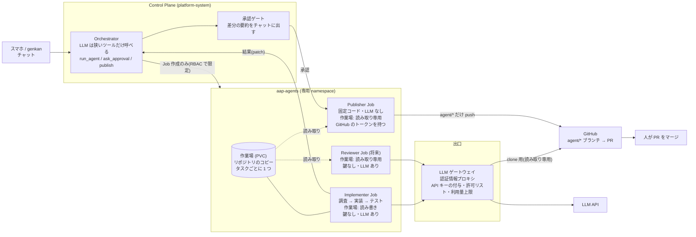
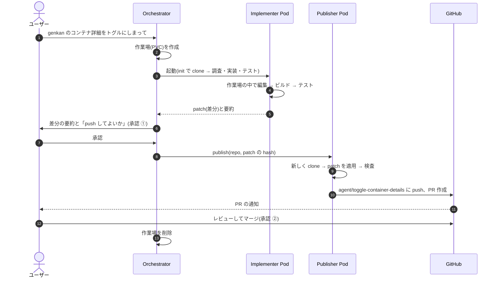
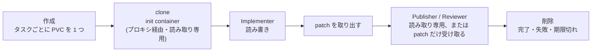
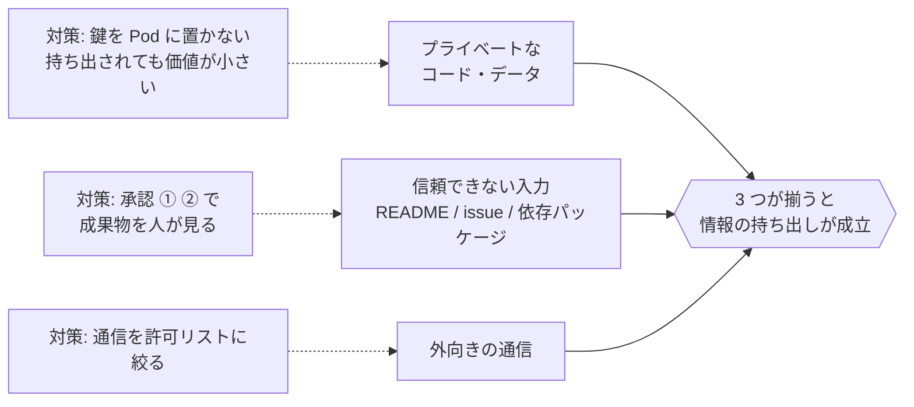

# マルチエージェント基盤: 権限設計(ユースケース起点)

> 状態: **設計メモ(2026-11-25 改訂)**。未実装。実装済みの範囲は [`architecture.md`](architecture.md)、
> Agent の現行設定は [`AGENTS.md`](AGENTS.md)。

## 1. 実現したいこと

チャットで「GitHub リポジトリ(genkan)を選んで、インフラ画面のコンテナ詳細をトグルにしまって」と頼むと、
Orchestrator が必要な agent Pod を立ち上げて制御し、push(または PR)まで進めて実装を完了する。
重要な操作の前には承認を求める。

課題は、**agent Pod に権限をたくさん持たせたくない**こと。

## 2. 方針(3 つの原則)

1. **agent に権限を持たせず、権限は仲介役に集める。** 鍵を持つ小さな部品が、agent の代わりに GitHub や LLM へ繋ぐ。
2. **Pod を分けるのは「権限の境目」だけ。仕事の種類では分けない。**
   調査係と実装係に分けても、どちらも「コードを読んで LLM に送る」だけで、権限は同じ。分けても得るものが少なく、
   文脈の受け渡しで質が落ちる。分ける価値があるのは、鍵を持つ部品と、任意コードを動かす部品の間。
3. **「1 つの作業場」と「役割ごとの Pod」を両立する。** 作業場は**ボリューム(リポジトリのコピー)**、
   Pod はその上で動く**使い捨ての実行者**と考える。

> 原則: **任意コードを実行する部品**と**鍵を持つ部品**を、同じ場所に置かない。

## 3. 全体構成



要点は次の 5 つ。

| # | 設計 | 守るもの |
|---|---|---|
| 1 | GitHub の書き込み用の鍵は Publisher だけが持つ。clone は認証情報プロキシが読み取り専用のトークンを付けるので、Implementer の Pod には何も入らない | リポジトリへの書き込み権限 |
| 2 | push は `agent/*` ブランチだけ。main へのマージは必ず人が行う | main ブランチ |
| 3 | LLM の API キーは Pod に置かず、出口のゲートウェイで付与する。通信先の許可リストと利用量の上限も同じ場所でかける | API キー・費用 |
| 4 | Pod は権限の境目だけで分ける(§5)。作業は Implementer 1 つに集める | 権限の最小化・文脈の維持 |
| 5 | Orchestrator も狭い権限にする。Job 作成と承認管理だけで、Secret の読み取りや他 namespace の操作は持たない | 司令塔の乗っ取り被害 |

## 4. 処理の流れ(承認の位置)



- **承認 ①(チャット)**: push する前。patch の hash を Publisher に渡すので、承認後に中身がすり替わらない。
- **承認 ②(PR のマージ)**: main に入る前。agent には許さない。
- インフラ変更(manifest など)も、Pod から `kubectl` で触らず、PR → Argo CD に流す。

## 5. 作業場と Pod の役割

### 5.1 作業場(ボリューム)の一生



- 作業場のデータは PVC に置き、Pod は使い捨てにする。**Implementer が成功したら、patch は Control Plane に保存されるので、作業場はすぐ解放する**
  (PVC のクォータを使い切らないため。2026-11-25 の実装で、保持期間 24 時間のままだと 8 タスクで頭打ちになると分かった)。
  失敗したタスクの作業場は、デバッグ用に保持期間まで残す。Implementer が終わったあと、
  別の役割の Pod が同じ作業場を使える。
- **PVC の実体は worker のディスク上(local-path)**。後続の Pod は、PV のノード親和性で
  同じノードに配置される。そのノードが落ちる・cordon されると、タスクは止まる。
  タスクは短いので許容し、失敗したら作業場ごと作り直す(`architecture.md` §2 と同じ前提)。

### 5.2 Pod の役割

| 役割 | 作業場 | 通信 | 鍵 | LLM | 備考 |
|---|---|---|---|---|---|
| **Implementer** | 読み書き | LLM ゲートウェイ + package 許可リスト | なし | あり | 調査・実装・テストを 1 つの文脈で行う。**任意コードを動かすのはここだけ** |
| **Publisher** | 読み取り専用(または patch のみ) | GitHub のみ | **あり(repo 限定・短命)** | **なし** | 固定コード。LLM も任意コードも動かさない |
| Reviewer(将来) | 読み取り専用 | LLM ゲートウェイのみ | なし | あり | 作った本人とは別の目で確認する。最初は人が PR を見るので不要 |

調査だけのユースケースは、Implementer のテンプレートから、書き込みと package の通信を外したもの
(読み取り専用の作業場、LLM ゲートウェイだけ)として用意する。別の役割は増やさない。

Pod 共通の制約(現行を踏襲): ServiceAccount トークンなし / 非 root / readOnlyRootFilesystem /
NetworkPolicy で LAN 宛てを禁止。

### 5.3 Publisher は作業場を信用しない

Implementer は信頼できない(乗っ取られうる)。その Implementer が書いた作業場を、鍵を持つ Publisher が
そのまま開くと、危ない。`.git/hooks` や `.git/config`(`core.fsmonitor` など)には、
`git` の実行時に任意コードが動く経路がある。

そこで Publisher は、作業場の `.git` を使わない。

1. Implementer が **patch(差分)だけ**を取り出す(Orchestrator が回収して承認 ① に使う)。
2. Publisher は、**新しく clone した**リポジトリに patch を適用する。作業場の `.git` には触れない。
3. 適用前に patch を検査する。
   - 保護するパスは変更させない(`.github/`、lockfile、CODEOWNERS、Dockerfile、デプロイ用の manifest など)
   - サイズの上限
   - バイナリ・シンボリックリンク・実行権限の変更は、既定で拒否する
4. `agent/*` ブランチに push し、PR を作る。ブランチの削除やタグの push はしない。

承認 ① に出す patch の hash と、Publisher が適用する patch が同じであることを確認する。

### 5.4 役割の宣言(YAML)

役割ごとの権限は、コードではなく YAML で宣言する。Orchestrator の LLM が選べるのは、
テンプレート名と、検証済みのパラメータだけ。Pod の spec を LLM に書かせない。

```yaml
# agent-roles/implementer.yaml (例)
name: implementer
image: ghcr.io/k-kanke/agent-runtime:sha-xxxx
workspace: { access: rw }              # 作業場の PVC
network: [llm-gateway, pkg-allowlist]
secrets: []                            # 空であることを検証する
resources: { cpu: "1", memory: 2Gi, timeout: 30m }
params:                                # LLM が渡せる値はここだけ
  repo: { pattern: "^k-kanke/[\\w.-]+$" }   # 許可リスト方式
  task: { maxLength: 4000 }
```

テンプレートは、Control Plane が検証して Job に展開する。同時に、クラスタ側にも
ValidatingAdmissionPolicy(または Kyverno)を置き、`aap-agents` の Pod に「Secret を mount しない」
「SA トークンなし」を強制する。バグや乗っ取りがあっても、Control Plane をすり抜けられない。
テンプレートの変更は PR を必須にする(権限の変更が最も重要な変更なので)。

## 6. 脅威モデル



| 乗っ取りで起きうること | 抑える仕組み |
|---|---|
| 他リポジトリへの書き込み | トークンがリポジトリ限定で、Implementer は持っていない |
| main の書き換え | `agent/*` のみ push 可。マージは人 |
| API キーの盗難 | Pod に置かない(ゲートウェイが付与) |
| クラスタへの侵入 | SA トークンなし、LAN 宛て通信禁止、Admission Policy |
| 作業場経由で Publisher を乗っ取る | Publisher は作業場の `.git` を使わず、patch だけを新しい clone に適用する(§5.3) |
| CI や権限定義の書き換え | 保護パス(`.github/` など)の変更を Publisher が拒否する |
| 書き込み用トークンの悪用 | Publisher だけが持つ。ブランチの削除やタグの push はしない |
| コードの持ち出し | **残る**。許可リスト内(LLM API・GitHub)経由の持ち出しは完全には防げない |

守る対象の優先順位は **鍵 > main ブランチ > クラスタ > コードの秘匿** と置く(仮)。コードの秘匿は、
プライベートリポジトリを扱うときに改めて決める。

## 7. ユースケースから見た権限表

| ユースケース | 使う役割 | 通信先 | 承認 |
|---|---|---|---|
| A. 単一リポジトリの実装(genkan のトグル追加) | Implementer → Publisher | LLM / package / GitHub | ① push 前、② PR マージ |
| B. 複数リポジトリにまたがる変更(フロントとインフラ) | A を repo ごとに並列。Orchestrator が順序を管理 | 同上 | repo ごとの ①、② はまとめて確認 |
| C. 調査だけ(コードを読んで質問に答える) | Implementer の調査用テンプレート(読み取り専用) | LLM のみ | なし |
| D. インフラ変更(kubernetes-platform の manifest) | A と同じ。ただし Argo CD の diff を要約に含める | 同上 | ② は必須 |

## 8. 実行基盤: Job を既定にする

### 8.1 方針

Implementer と Publisher は、**1 回のタスクごとの Job**で動かす。完了が自然に分かり、
今の Agent Job(`architecture.md` §3)の延長で作れる。隔離を強めたければ、Job でも
`runtimeClassName`(gVisor など)を指定できる。

### 8.2 Agent Sandbox は選択肢として残す

[kubernetes-sigs/agent-sandbox](https://github.com/kubernetes-sigs/agent-sandbox) は、
「1 Pod の隔離環境」を CRD で宣言する SIG Apps のプロジェクト(`v1beta1`、最新は v1.0.12)。
期限(`shutdownTime`、`ttlSecondsAfterFinished`)を付ければ、一時的な環境としても使える。
ただし、想定している使い方は、**環境を 1 つ確保し、外から何度もコマンドを実行する**形
(`sandboxd` と `sandbox-router` 経由)。

| Agent Sandbox の利点 | 今回のタスク(ワンショット)での効き方 |
|---|---|
| WarmPool(起動済みを待機) | 効きにくい。リポジトリが毎回違い、環境変数などを渡すとコールドスタートになる |
| Suspend / Resume | 使い道が薄い |
| `sandboxd` / router による外部からの実行 | 対話的に操作するときだけ意味がある |
| gVisor / Kata の切り替え | Job でも `runtimeClassName` で使える |
| テンプレートごとの NetworkPolicy | Job でも、自前のテンプレートで足りる |

追加の依存に見合う利点が、ワンショットでは薄い。次のような用途が出たときに検討する。

- 同じ作業場を、複数の役割が順に使い、差し戻しで何度も戻る
- 開発環境を、チャットで対話的に触り続ける

その場合の対応は次のとおり。`SandboxTemplate` が役割の宣言(§5.4 の YAML に相当)、
`SandboxClaim` が 1 回の実行に当たる。`SandboxTemplate` の `envVarsInjectionPolicy`
(既定は拒否)は、「LLM に渡せる値を絞る」ことにも使える。独自の CRD は、その時点でも不要な可能性が高い。
なお `ttlSecondsAfterFinished` の「finished」の定義は、API リファレンスに書かれておらず、未確認。

### 8.3 独自 CRD(`AgentRun` など)

Kubernetes のリソースとして実行を宣言し、controller が Job を管理する形は、拡張性は高い。
ただし controller の実装(controller-runtime)と CRD のバージョン管理が増える。
承認待ちなど、Job に収まらない状態が増えてから検討する。最初は、Control Plane が Job を直接作る。

## 9. 既存設計との関係

- 信頼境界を「Control Plane の API と RBAC」に置く方針(`architecture.md` §4)はそのまま使う。
  Orchestrator は Control Plane の延長で、`aap-agents` の Job と PVC を作る権限だけを持つ。
- `AGENTS.md` の「変更は稼働中の Source を直接書き換える」制限は、Implementer が作業場
  (リポジトリのコピー)だけを触る形にすると解消できる。Stage 2 の Isolated Workspace に当たる。
- Agent に Secret を渡す現行の仕組み(`agent-credentials`)は、LLM ゲートウェイに置き換える。
- 状態の持ち分は `architecture.md` §3 の方針に揃える(意図・履歴は SQLite、実状態は Kubernetes が正)。

## 10. 段階的な進め方

1. **今の Agent Job を、作業場(PVC)+ Implementer の形に整理する**: 家族向けアプリの生成とは別の namespace
   (`aap-agents`)に、テンプレート 1 つ(Implementer)を置く。まだ GitHub には繋がない。
2. **patch の取り出しと承認 ①**: Implementer の結果を patch として回収し、チャットに要約を出す。
3. **LLM ゲートウェイを置く**: API キーを Pod から外す。通信先の許可リストと利用量の上限もここで。
4. **認証情報プロキシと Publisher を足す**: ここで初めて GitHub に繋ぐ。clone は読み取り専用、
   push は Publisher だけ。patch の検査(§5.3)もここ。
5. **Admission Policy で強制する**: テンプレート外の Pod、Secret の mount、SA トークンを拒否する。
6. **Reviewer、Agent Sandbox、独自 CRD は、必要になってから**。

## 11. 未決事項

1. 守る対象の優先順位(§6)は、これでよいか。プライベートリポジトリを扱うか。
2. 承認 ① は、変更が小さいときは自動にするか。基準(変更行数、触るファイル)をどうするか。
3. LLM ゲートウェイは自作するか、既存の OSS(LiteLLM など)を使うか。認証情報プロキシも兼ねるか。
4. 出口の許可リストは、プロキシ(Squid など)か、Cilium の FQDN ポリシーか。Cilium は導入済みなので後者が軽い。
5. Implementer のテスト実行で、任意のコマンドを許す範囲をどこまでにするか。
6. GitHub App の作成と、リポジトリごとの installation の管理方法。
7. 保護パスの一覧と、patch の上限(サイズ・ファイル数)をどう決めるか。リポジトリごとに変えるか。
8. 作業場のノード固定(local-path)で、ノード障害時にどこまで自動で復旧するか。
9. gVisor を入れるか、入れずに始めるか。ubuntu 26.04 + Cilium での動作確認が要る。
10. 調査用テンプレート(読み取り専用の作業場)は、別の役割として切り出すか、Implementer の設定違いで済ませるか。

## 12. 参考(2026-11-25 時点)

- [kubernetes-sigs/agent-sandbox](https://github.com/kubernetes-sigs/agent-sandbox)(★約 4,700、v1.0.12)と、
  その [`docs/api.md`](https://raw.githubusercontent.com/kubernetes-sigs/agent-sandbox/HEAD/docs/api.md)
- [kagent](https://kagent.dev/docs/kagent/latest/about/core-concepts/): `AgentTemplate` と `Harness` を分ける 1.0(アルファ)の設計
- [Kelos](https://sanj.dev/post/kelos-kubernetes-autonomous-ai-agents/): issue 起点で PR まで進める CRD 群。
  認証情報は Secret から注入する方式で、本書より緩い。まだ若い(★360)
- [Scoped Credentials via Proxy(AgentPatterns.ai)](https://agentpatterns.ai/security/scoped-credentials-proxy/):
  認証情報プロキシのパターン。書き込み権限のトークンは、プロキシ経由でも悪用されうるので、
  ブランチ削除などを禁止する必要がある
- [Running AI Agents on Kubernetes(Signadot)](https://www.signadot.com/blog/running-ai-agents-on-kubernetes/):
  周辺プロジェクトの成熟度の比較。企業の本番採用の事例は、調べた範囲では確認できていない
