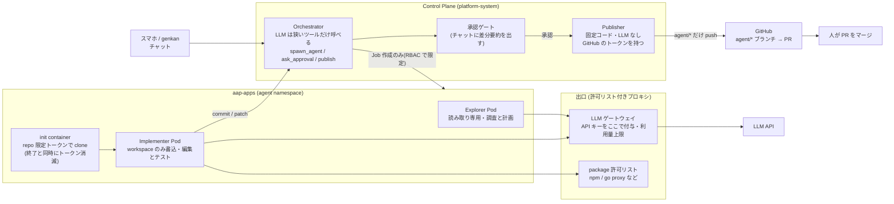
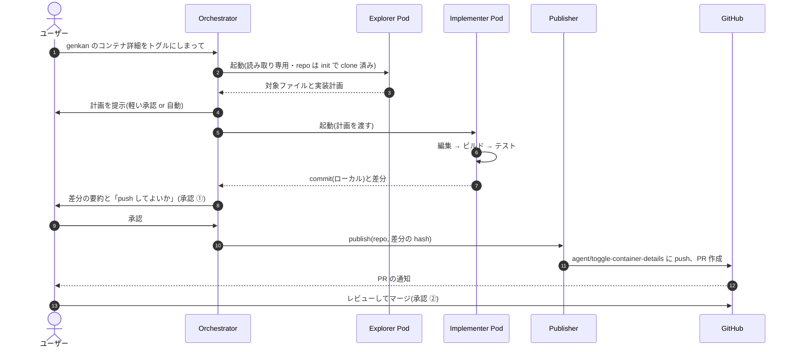
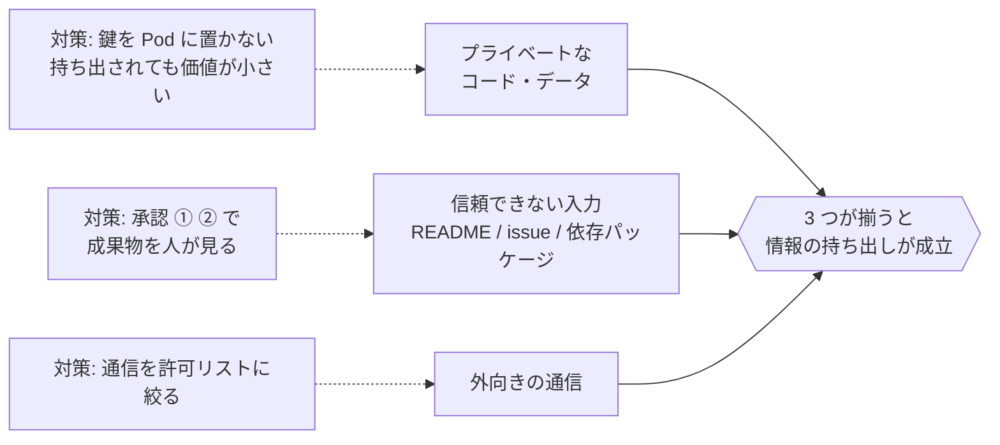

# マルチエージェント基盤: 権限設計(ユースケース起点)

> 状態: **設計メモ(2026-11-25)**。未実装。実装済みの範囲は [`architecture.md`](architecture.md)、
> Agent の現行設定は [`AGENTS.md`](AGENTS.md)。

## 1. 実現したいこと

チャットで「GitHub リポジトリ(genkan)を選んで、インフラ画面のコンテナ詳細をトグルにしまって」と頼むと、
Orchestrator が必要な agent Pod を立ち上げて制御し、push(または PR)まで進めて実装を完了する。
重要な操作の前には承認を求める。

課題は、**agent Pod に権限をたくさん持たせたくない**こと。

## 2. 方針: agent に権限を持たせず、権限は仲介役に集める

`aap-apps` の Agent Job は現状でも、Source PVC だけを mount し、ServiceAccount トークンなし・非 root・
egress は 443 のみ、という作りになっている(`AGENTS.md` 「安全面」)。この方針を保ったまま次の2つを実現する。

- GitHub の clone / push
- 任意リポジトリのテスト実行

どちらも「agent が鍵を持つ」のではなく、**鍵を持つ別の小さな部品が代行する**。

> 原則: **任意コードを実行する部品**と**鍵を持つ部品**を、同じ場所に置かない。

## 3. 全体構成

ポイントは次の5つ。

| # | 設計 | 守るもの |
|---|---|---|
| 1 | GitHub の鍵は agent に渡さない。GitHub App の installation token(リポジトリ・権限を絞った 1 時間のトークン)を、clone 用 init container と Publisher だけが使う | リポジトリへの書き込み権限 |
| 2 | push は `agent/*` ブランチだけ。main へのマージは必ず人が行う | main ブランチ |
| 3 | LLM の API キーは Pod に置かず、出口のゲートウェイで付与する。通信先の許可リストと利用量の上限も同じ場所でかける | API キー・費用 |
| 4 | Pod の役割を分け、役割ごとに最小権限にする(§5) | 権限の最小化 |
| 5 | Orchestrator も狭い権限にする。Job 作成と承認管理だけで、Secret の読み取りや他 namespace の操作は持たない | 司令塔の乗っ取り被害 |

## 4. 処理の流れ(承認の位置)

- **承認 ①(チャット)**: push する前。差分の hash を Publisher に渡すので、承認後に中身がすり替わらない。
- **承認 ②(PR のマージ)**: main に入る前。agent には許さない。
- インフラ変更(manifest など)も、Pod から `kubectl` で触らず、PR → Argo CD に流す。

## 5. Pod の役割と権限

| 役割 | 書き込み | 通信 | 鍵 | LLM |
|---|---|---|---|---|
| Explorer(調査・計画) | なし | LLM ゲートウェイのみ | なし | あり |
| Implementer(実装・テスト) | workspace のみ | LLM ゲートウェイ + package 許可リスト | なし | あり |
| Publisher | なし | GitHub のみ | **あり(repo 限定・短命)** | **なし** |

Pod 共通の制約(現行を踏襲): ServiceAccount トークンなし / 非 root / readOnlyRootFilesystem /
NetworkPolicy で LAN 宛てを禁止。

## 6. 脅威モデル

| 乗っ取りで起きうること | 抑える仕組み |
|---|---|
| 他リポジトリへの書き込み | トークンがリポジトリ限定で、agent は持っていない |
| main の書き換え | `agent/*` のみ push 可。マージは人 |
| API キーの盗難 | Pod に置かない(ゲートウェイが付与) |
| クラスタへの侵入 | SA トークンなし、LAN 宛て通信禁止 |
| コードの持ち出し | **残る**。許可リスト内(LLM API・GitHub)経由の持ち出しは完全には防げない |

守る対象の優先順位は **鍵 > main ブランチ > クラスタ > コードの秘匿** と置く。コードの秘匿は、
プライベートリポジトリを扱うときに改めて決める。

## 7. ユースケースから見た権限表

| ユースケース | 使う役割 | 通信先 | 承認 |
|---|---|---|---|
| A. 単一リポジトリの実装(genkan のトグル追加) | Explorer → Implementer → Publisher | LLM / package / GitHub | ① push 前、② PR マージ |
| B. 複数リポジトリにまたがる変更(フロントとインフラ) | A を repo ごとに並列。Orchestrator が順序を管理 | 同上 | repo ごとの ①、② はまとめて確認 |
| C. 調査だけ(コードを読んで質問に答える) | Explorer のみ | LLM のみ | なし |
| D. インフラ変更(kubernetes-platform の manifest) | A と同じ。ただし Argo CD の diff を要約に含める | 同上 | ② は必須 |

## 8. 既存設計との関係

- 信頼境界を「Control Plane の API と RBAC」に置く方針(`architecture.md` §4)はそのまま使う。
  Orchestrator は Control Plane の延長で、`aap-apps` の Job 作成権限だけを持つ。
- `AGENTS.md` の「変更は稼働中の Source を直接書き換える」制限は、Implementer が workspace
  (リポジトリのコピー)だけを触る形にすると解消できる。Stage 2 の Isolated Workspace に当たる。
- Agent に Secret を渡す現行の仕組み(`agent-credentials`)は、LLM ゲートウェイに置き換える。

## 9. 未決事項

1. 守る対象の優先順位(§6)は、これでよいか。プライベートリポジトリを扱うか。
2. 承認 ① は、変更が小さいときは自動にするか。基準(変更行数、触るファイル)をどうするか。
3. LLM ゲートウェイは自作するか、既存の OSS(LiteLLM など)を使うか。
4. 出口の許可リストは、プロキシ(Squid など)か、Cilium の FQDN ポリシーか。Cilium は導入済みなので後者が軽い。
5. Implementer のテスト実行で、任意のコマンドを許す範囲をどこまでにするか。
6. GitHub App の作成と、リポジトリごとの installation の管理方法。
