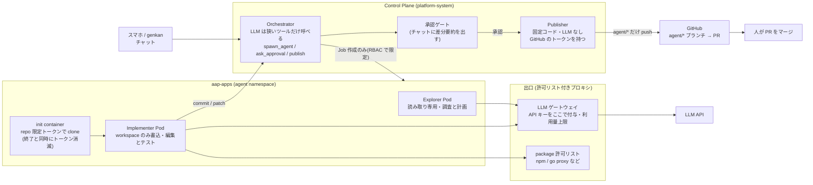
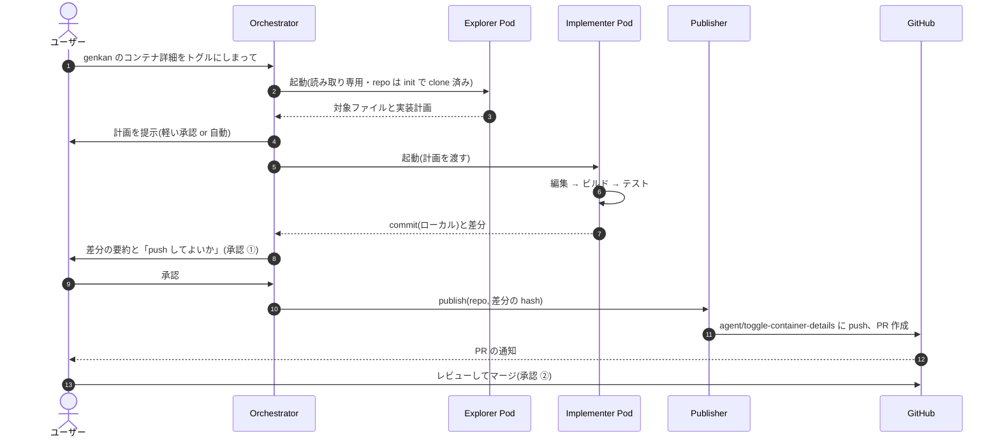
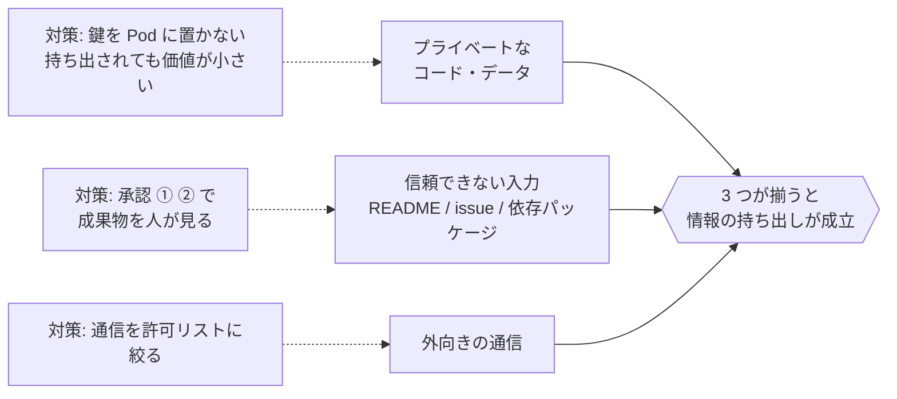
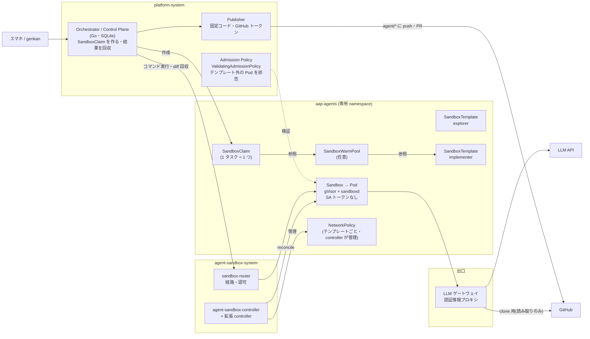
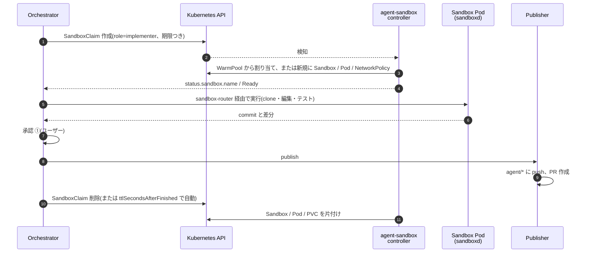

# マルチエージェント基盤: 権限設計(ユースケース起点)

> 状態: **設計メモ(2026-11-25)**。未実装。実装済みの範囲は [`architecture.md`](architecture.md)、
> Agent の現行設定は [`AGENTS.md`](AGENTS.md)。

## 1. 実現したいこと

チャットで「GitHub リポジトリ(genkan)を選んで、インフラ画面のコンテナ詳細をトグルにしまって」と頼むと、
Orchestrator が必要な agent Pod を立ち上げて制御し、push(または PR)まで進めて実装を完了する。
重要な操作の前には承認を求める。

課題は、**agent Pod に権限をたくさん持たせたくない**こと。

## 2. 方針: agent に権限を持たせず、権限は仲介役に集める

`aap-apps` の Agent Job は現状でも、Source PVC だけを mount し、ServiceAccount トークンなし・非 root・
egress は 443 のみ、という作りになっている(`AGENTS.md` 「安全面」)。この方針を保ったまま次の2つを実現する。

- GitHub の clone / push
- 任意リポジトリのテスト実行

どちらも「agent が鍵を持つ」のではなく、**鍵を持つ別の小さな部品が代行する**。

> 原則: **任意コードを実行する部品**と**鍵を持つ部品**を、同じ場所に置かない。

## 3. 全体構成

ポイントは次の5つ。

| # | 設計 | 守るもの |
|---|---|---|
| 1 | GitHub の鍵は agent に渡さない。GitHub App の installation token(リポジトリ・権限を絞った 1 時間のトークン)を、clone 用 init container と Publisher だけが使う | リポジトリへの書き込み権限 |
| 2 | push は `agent/*` ブランチだけ。main へのマージは必ず人が行う | main ブランチ |
| 3 | LLM の API キーは Pod に置かず、出口のゲートウェイで付与する。通信先の許可リストと利用量の上限も同じ場所でかける | API キー・費用 |
| 4 | Pod の役割を分け、役割ごとに最小権限にする(§5) | 権限の最小化 |
| 5 | Orchestrator も狭い権限にする。Job 作成と承認管理だけで、Secret の読み取りや他 namespace の操作は持たない | 司令塔の乗っ取り被害 |

## 4. 処理の流れ(承認の位置)

- **承認 ①(チャット)**: push する前。差分の hash を Publisher に渡すので、承認後に中身がすり替わらない。
- **承認 ②(PR のマージ)**: main に入る前。agent には許さない。
- インフラ変更(manifest など)も、Pod から `kubectl` で触らず、PR → Argo CD に流す。

## 5. Pod の役割と権限

| 役割 | 書き込み | 通信 | 鍵 | LLM |
|---|---|---|---|---|
| Explorer(調査・計画) | なし | LLM ゲートウェイのみ | なし | あり |
| Implementer(実装・テスト) | workspace のみ | LLM ゲートウェイ + package 許可リスト | なし | あり |
| Publisher | なし | GitHub のみ | **あり(repo 限定・短命)** | **なし** |

Pod 共通の制約(現行を踏襲): ServiceAccount トークンなし / 非 root / readOnlyRootFilesystem /
NetworkPolicy で LAN 宛てを禁止。

## 6. 脅威モデル

| 乗っ取りで起きうること | 抑える仕組み |
|---|---|
| 他リポジトリへの書き込み | トークンがリポジトリ限定で、agent は持っていない |
| main の書き換え | `agent/*` のみ push 可。マージは人 |
| API キーの盗難 | Pod に置かない(ゲートウェイが付与) |
| クラスタへの侵入 | SA トークンなし、LAN 宛て通信禁止 |
| コードの持ち出し | **残る**。許可リスト内(LLM API・GitHub)経由の持ち出しは完全には防げない |

守る対象の優先順位は **鍵 > main ブランチ > クラスタ > コードの秘匿** と置く。コードの秘匿は、
プライベートリポジトリを扱うときに改めて決める。

## 7. ユースケースから見た権限表

| ユースケース | 使う役割 | 通信先 | 承認 |
|---|---|---|---|
| A. 単一リポジトリの実装(genkan のトグル追加) | Explorer → Implementer → Publisher | LLM / package / GitHub | ① push 前、② PR マージ |
| B. 複数リポジトリにまたがる変更(フロントとインフラ) | A を repo ごとに並列。Orchestrator が順序を管理 | 同上 | repo ごとの ①、② はまとめて確認 |
| C. 調査だけ(コードを読んで質問に答える) | Explorer のみ | LLM のみ | なし |
| D. インフラ変更(kubernetes-platform の manifest) | A と同じ。ただし Argo CD の diff を要約に含める | 同上 | ② は必須 |

## 8. 既存設計との関係

- 信頼境界を「Control Plane の API と RBAC」に置く方針(`architecture.md` §4)はそのまま使う。
  Orchestrator は Control Plane の延長で、`aap-apps` の Job 作成権限だけを持つ。
- `AGENTS.md` の「変更は稼働中の Source を直接書き換える」制限は、Implementer が workspace
  (リポジトリのコピー)だけを触る形にすると解消できる。Stage 2 の Isolated Workspace に当たる。
- Agent に Secret を渡す現行の仕組み(`agent-credentials`)は、LLM ゲートウェイに置き換える。
- Pod の実体を Agent Sandbox に任せる案は §9 を参照。独自 CRD(`AgentRole` / `AgentRun`)を作る前に、
  `SandboxTemplate` / `SandboxClaim` で足りるかを確かめる。

## 9. Agent Sandbox を土台にした場合の構成

> 調査日 2026-11-25。出典は §11。ここに書く仕様は `docs/api.md`(`kubernetes-sigs/agent-sandbox` の
> main)で確認したもの。**未確認の点は §10 の未決事項に回した。**

### 9.1 Agent Sandbox とは

Kubernetes SIG Apps のプロジェクト。「1 Pod の隔離環境」を CRD で宣言し、controller が Pod・Service・PVC を管理する。
API は `v1beta1`(2026-11-20 時点の最新リリースは v1.0.12)。

| CRD | 役割 | 主な項目 |
|---|---|---|
| `Sandbox` | 1 Pod + 安定した名前 + 任意の PVC | `podTemplate`、`volumeClaimTemplates`、`shutdownTime`、`operatingMode`(Running / Suspended) |
| `SandboxTemplate` | 再利用する実行環境の定義 | `podTemplate`、`networkPolicy`(テンプレートごとに 1 つ、controller が管理)、`envVarsInjectionPolicy`(既定 Disallowed) |
| `SandboxClaim` | テンプレートから Sandbox を 1 つ要求する | `warmPoolRef`、`lifecycle`(期限・完了後の TTL)、`env`、`volumeClaimTemplates` |
| `SandboxWarmPool` | 起動済みの Sandbox を事前に用意 | `replicas`、`sandboxTemplateRef` |

構成要素: `agent-sandbox-controller`(Sandbox)、拡張 controller(Claim / Template / WarmPool。opt-in)、
`sandbox-router`(Sandbox への HTTP/gRPC の経路・認可・TLS)、`sandboxd`(Sandbox 内で動く
プロセス実行・ファイル操作の gRPC デーモン)、Go / Python / TypeScript の SDK。
隔離は gVisor や Kata などの RuntimeClass を選べる(デプロイ側の選択)。

### 9.2 構成図

### 9.3 タスクの流れ

### 9.4 これまでの案との対応

| 本書の案 | Agent Sandbox での実現 | 備考 |
|---|---|---|
| `AgentRole`(役割テンプレート) | `SandboxTemplate` | `podTemplate` と `networkPolicy` で権限を宣言できる。**独自 CRD は不要** |
| `AgentRun`(1 回の実行) | `SandboxClaim` | `lifecycle` で期限と完了後の TTL を持てる |
| LLM に渡せる値を絞る(`params`) | `envVarsInjectionPolicy: Disallowed`(既定) | 既定では Claim から環境変数を渡せない。許可しても、渡せる範囲をテンプレート側で決められる |
| 役割ごとの egress | テンプレートごとの `networkPolicy` | controller がテンプレートごとに 1 つの NetworkPolicy を作る |
| Explorer / Implementer | テンプレートを 2 つ | Publisher は Sandbox にしない(固定コード側) |
| 実行の期限・片付け | `shutdownTime`、`ttlSecondsAfterFinished` | 暴走・放置の防止に使える |
| 中断・再開 | `operatingMode: Suspended` | Pod は消え、PVC は残る(メモリ上の状態は失われる) |

### 9.5 何を作り、何を任せるか

| Agent Sandbox に任せる | 自分で作る |
|---|---|
| Pod・Service・PVC のライフサイクル | Orchestrator(依頼の解釈・承認管理・タスクの状態) |
| テンプレート化と、Claim からの払い出し | `SandboxTemplate` の中身(explorer / implementer の設計) |
| テンプレートごとの NetworkPolicy | LLM ゲートウェイ兼、認証情報プロキシ |
| 期限切れの片付け、Suspend | Publisher(push と PR) |
| Sandbox 内の実行 API(sandboxd)と SDK | Admission Policy(テンプレート外の Pod を拒否) |
| gVisor / Kata の切り替え口 | 承認 UI(genkan のチャット欄) |

### 9.6 注意点

- **Sandbox は常駐を前提にした「単一 Pod」で、Job ではない。** 「完了」を自分で判断して Claim を消す必要がある
  (`ttlSecondsAfterFinished` が何をもって finished とするかは、要確認)。今の Agent Job は完了が自然に分かるので、
  ここは書き方が変わる。
- **タスクの渡し方に制約がある。** Claim に環境変数やボリュームを渡すと**コールドスタート**になり、
  WarmPool の利点(すぐ使える)を失う。リポジトリが毎回違うなら、WarmPool は効きにくい。
  実行は sandbox-router や SDK 経由で、起動後に渡すほうが自然。
- **clone の認証。** Pod に Secret を入れない方針とぶつかる。認証情報プロキシが clone 用の読み取り専用トークンを
  付ける形にすれば、init container にもトークンは要らない。
- **gVisor の導入は別作業。** RuntimeClass を使うには、各ノード(ubuntu 26.04)に runsc などを入れる必要がある。
  Cilium との組み合わせを含め、動作は未確認。入れずに通常のコンテナ(runc)のまま、
  NetworkPolicy・非 root・SA トークンなしで始める選択もある。
- **WarmPool は常に資源を使う。** ワーカーは今 3 台(うち 1 台は cordon 中)で、メモリも小さい。
  `replicas: 0` か、使わない構成から始める。
- **API が変わりうる。** `v1beta1` で、Substrate や AX など周辺の Google 発プロジェクトはまだ流動的。
  Sandbox / Template / Claim だけに依存し、周辺には依存しない。
- **状態の二重管理。** Control Plane の SQLite(意図・履歴)と、Claim(実状態)の持ち分は、
  `architecture.md` §3 の方針(実状態は Kubernetes が正)に揃える。

### 9.7 段階的な進め方

1. **kind で試す**: `make deploy-kind`(`EXTENSIONS=true`)で動かし、手動で `SandboxTemplate` と `SandboxClaim` を作る。
2. **Implementer 用テンプレートを 1 つ書く**: SA トークンなし、非 root、egress は LLM ゲートウェイのみ。
3. **Control Plane から Claim を作る**: 今の Job 生成(`kube` パッケージ)の隣に、Claim 生成を追加する。
4. **認証情報プロキシと Publisher を足す**: ここで初めて GitHub に繋ぐ。
5. **Admission Policy で強制する**: テンプレート外の Pod を拒否する。
6. **独自 CRD(`AgentRun` など)は、必要になってから**: 承認待ちなど、Claim に収まらない状態が増えたときに検討する。

## 10. 未決事項

1. 守る対象の優先順位(§6)は、これでよいか。プライベートリポジトリを扱うか。
2. 承認 ① は、変更が小さいときは自動にするか。基準(変更行数、触るファイル)をどうするか。
3. LLM ゲートウェイは自作するか、既存の OSS(LiteLLM など)を使うか。認証情報プロキシも兼ねるか。
4. 出口の許可リストは、プロキシ(Squid など)か、Cilium の FQDN ポリシーか。Cilium は導入済みなので後者が軽い。
   ただし `SandboxTemplate` の `networkPolicy` は標準の NetworkPolicy なので、FQDN で絞るには別途 CiliumNetworkPolicy が要る(要確認)。
5. Implementer のテスト実行で、任意のコマンドを許す範囲をどこまでにするか。
6. GitHub App の作成と、リポジトリごとの installation の管理方法。
7. (§9)Agent Sandbox を採用するか。採用する場合、まず kind で §9.7 の 1〜2 を試してよいか。
8. (§9)gVisor を入れるか、入れずに始めるか。ubuntu 26.04 + Cilium での動作確認が要る。
9. (§9)タスクの渡し方: 環境変数(コールドスタート)か、起動後に sandboxd / router 経由か。後者の場合の認可の仕組み。
10. (§9)`ttlSecondsAfterFinished` の「finished」の定義と、Control Plane が完了をどう伝えるか。
11. (§9)WarmPool を使うか。使うなら `replicas` と、ワーカーの余力。

## 11. 参考(2026-11-25 時点)

- [kubernetes-sigs/agent-sandbox](https://github.com/kubernetes-sigs/agent-sandbox)(★約 4,700、v1.0.12)と、
  その [`docs/api.md`](https://raw.githubusercontent.com/kubernetes-sigs/agent-sandbox/HEAD/docs/api.md)
- [kagent](https://kagent.dev/docs/kagent/latest/about/core-concepts/): `AgentTemplate` と `Harness` を分ける 1.0(アルファ)の設計
- [Kelos](https://sanj.dev/post/kelos-kubernetes-autonomous-ai-agents/): issue 起点で PR まで進める CRD 群。
  認証情報は Secret から注入する方式で、本書より緩い。まだ若い(★360)
- [Scoped Credentials via Proxy(AgentPatterns.ai)](https://agentpatterns.ai/security/scoped-credentials-proxy/):
  認証情報プロキシのパターン。書き込み権限のトークンは、プロキシ経由でも悪用されうるので、
  ブランチ削除などを禁止する必要がある
- [Running AI Agents on Kubernetes(Signadot)](https://www.signadot.com/blog/running-ai-agents-on-kubernetes/):
  周辺プロジェクトの成熟度の比較。企業の本番採用の事例は、調べた範囲では確認できていない
