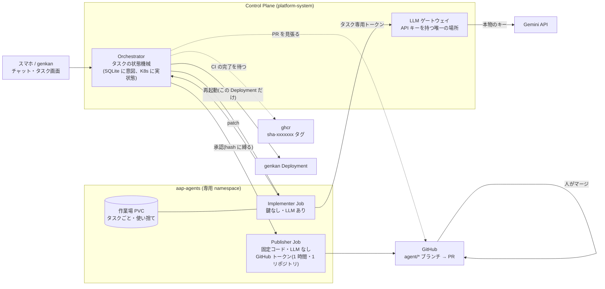

# マルチエージェント基盤の開発を振り返る(tech blog の素材)

> 2026-11-25 に書いた。**時系列ではなく、論点別**に整理してある(ブログは、論点ごとに切り出しやすい)。
> 日々の記録は [`multi-agent-impl-log.md`](multi-agent-impl-log.md)、設計の最終形は [`multi-agent-permissions.md`](multi-agent-permissions.md)、
> 計画は [`multi-agent-execution-plan.md`](multi-agent-execution-plan.md)。ここでは「なぜそうしたか」と「何が難しかったか」を残す。
> 事実(数字、挙動)は、実機かテストで確かめたものだけを書いた。確かめていないものは、そう書いた。

---

## 1. 何を作りたかったか

自宅の Kubernetes(3 ノード+ control-plane)に、**チャットで頼むと、エージェントがコードを変更し、人が承認して、PR になり、マージされたら自動で反映される**基盤を作る。

最初の依頼文は、これだった。

> チャット欄で、GitHub リポジトリを選択して「genkan app のインフラ画面のコンテナ詳細はトグルにしまってください」と送ると、
> それに必要な agent Pod を Orchestrator が立ち上げて、制御して、push までして、実装完了するぐらい(承認を求めるのもあり)。

**一番の悩みは、最初から権限だった。** 「各 agent Pod に色々な権限を持たせるのは微妙」。コードを書く LLM は、プロンプトインジェクションを受けうる。
鍵を持たせた Pod が乗っ取られると、リポジトリも、API キーも、クラスタも危ない。

土台になった既存の基盤(`ai-app-platform`)は、「家族がスマホで頼むと、小さなアプリを作る」ためのもので、Agent の Job には、すでに次の制約があった。
ServiceAccount トークンなし、非 root、Source の PVC だけを mount、通信は 443 だけ。この方針を、**GitHub 連携に広げる**のが、今回の仕事だった。

### 結果(2026-11-25 時点)

- 依頼 → 本物の Gemini が作業 → 差分 → 承認 → PR → 人がマージ → 自動で再起動、が**実機で一周した**。
  genkan の 6 件の PR のうち、**5 件は基盤のエージェント自身が作った**(残り 1 件は、Claude Code が作った基盤の改修で、これも PR を経由し、あなたがマージした)。
  「各 Pod の稼働数をトグルにしまう」という、最初の依頼文に近い依頼も、承認 → PR → マージ → 自動の再起動まで通った。
- 規模(この日の作業): コミットは `ai-app-platform` 20、`kubernetes-platform` 14、`genkan` 11。Go のテスト関数は 85(うち 57 が今回の作業)。
  新しい Go のパッケージ(`patch`、`registry`、`github`、`publisher`、`llmgateway`)は、コード約 1,700 行、テスト約 760 行。設計・計画・記録は 5 ファイル 約 1,050 行
  (この振り返りを除く)。
- 実機、kind、テストで見つけて直した問題は、10 件を超えた(§5。直していないものも、そう書いた)。

---

## 2. 最終的な構成

| 部品 | 役割 | 持っている権限 |
|---|---|---|
| Orchestrator(Control Plane の中) | タスクの手順と状態、承認、反映 | `aap-agents` の Job と PVC、`genkan` の Deployment の参照と patch だけ。Secret は読めない |
| Implementer(Job) | clone、調査、実装、テスト、patch の作成 | **なし**。SA トークンなし、Secret なし。通信は、LAN 以外の HTTPS と、Control Plane、ゲートウェイ |
| LLM ゲートウェイ | タスクのトークンを検証し、本物のキーに差し替えて転送 | 本物の API キー(唯一の保持者)。リクエスト数の上限つき |
| Publisher(Job) | 承認された patch を、新しい clone に適用し、ブランチと PR にする | GitHub のトークン(**1 リポジトリ限定・1 時間**)。LLM は動かさない |
| 承認ポリシー(クラスタ) | 上の約束を、バグや乗っ取りがあっても破れない形で強制 | — |

---

## 3. 設計の判断(論点ごと)

各項目は「課題 → 選択肢 → 決めたこと → 理由 → 今どうなったか」。**ブログの見出しにできる粒度**にした。

### 3.1 エージェントに権限を持たせない — 鍵は仲介役に集める

- **課題**: コードを書く Pod に、GitHub と LLM の鍵が要る。でも、乗っ取られたくない。
- **選択肢**: (a) 鍵を Secret で Pod に渡す(多くのフレームワークがこれ。例: Kelos は Secret から注入)。(b) 鍵を持つ小さな仲介役を置く。
- **決めたこと**: (b)。**任意のコードを動かす部品と、鍵を持つ部品を、同じ場所に置かない。** GitHub の書き込みは Publisher、LLM は ゲートウェイが持つ。
- **理由**: プロンプトインジェクションで Implementer が乗っ取られても、盗める鍵がない。
- **今**: 実機で、Implementer の Pod には、タスク専用の短命なトークン以外の認証情報がない。承認ポリシーで、Pod が Secret を参照すること自体を禁止した。

### 3.2 Pod を分ける基準は「仕事の種類」ではなく「権限の境目」

- **課題**: 最初の設計は、Explorer(調査)、Implementer(実装)、Publisher(公開)の 3 役だった。「責務を分けた複数の Pod」と「1 つの作業場で何でも」のどちらがよいか。
- **選択肢**: (a) 役割ごとに Pod(調査係、実装係、…)。(b) 1 つの作業場で、1 つのエージェントが全部。(c) 中間。
- **決めたこと**: (c)。**権限が本当に違う所でだけ分ける。** 調査と実装は同じ権限(コードを読んで LLM に送る)なので、1 つの Implementer にまとめた。Publisher だけを分ける。
- **理由**: コーディングの質は、文脈を持ったまま進めるほうが高い。調査と実装に分けると、要約の受け渡しで細部が落ちる。分けて得るものは権限の面では、ほとんどない。
- **今**: 役割は Implementer と Publisher の 2 つ。Reviewer(鍵なし・読み取り専用)は、将来の候補として残した。
- **ブログ向きの一言**: 「マルチエージェント」と言うと、仕事の種類で分けたくなる。でも、分ける価値があるのは、**権限の境目**だった。

### 3.3 「1 つの作業場」と「役割ごとの Pod」の両立 — 作業場はボリューム、Pod は使い捨て

- **決めたこと**: 作業場(リポジトリのコピー)は PVC に置き、Pod はその上で動く使い捨ての実行者にする。
- **ここでの発見**: 最初は「後続の Pod も同じ作業場を使う」と設計したが、後述の 3.5 で、**Publisher は作業場を開かない**ことにした。結局、作業場を使うのは Implementer だけになり、
  「共有」の必要は、ほとんどなくなった(§3.4)。
- **実装中の修正**: 成功したタスクの作業場は、patch を保存した時点で**すぐ解放**する。保持期間 24 時間のままだと、PVC のクォータ(8 個)に、**1 日 8 タスクで頭打ち**になると、kind の通しテストで分かった(§5)。

### 3.4 ノードをまたぐストレージは、要るのか — 要らなかった

- **課題**: 「ノードをまたいでデータ共有できるようにしたい。PVC を各ノードのディスクにするのではなく」。すでに、別の検討(`storage-decision.md`)で、NFS / Longhorn / Garage を、実測つきで比べていた。さらに、Piraeus(DRBD / LINSTOR)という候補も挙がった。
- **選択肢**: NFS、Longhorn、Garage(S3)、Piraeus、`local-path` のまま。
- **決めたこと**: 作業場は **`local-path`** のまま。共有ストレージには依存しない。
- **理由**: 作業場は**短命**(タスクごとに作って捨てる)で、新しく作るたびにスケジューラがノードを選ぶので、「偏り」は起きない。ノードが落ちても、作り直せばよい。
  しかもビルドとテストは、小さいファイルを大量に読み書きするので、NFS では遅くなる(実測: fsync が約 3 倍)。共有が効くのは、**リポジトリのミラーや依存のキャッシュ**のような、読み取りが中心のものだった。
- **Piraeus**: ブロックストレージの複製型で、Longhorn より速いという情報があった(個人の比較のみ。この環境の数字ではない)。カーネルとの相性が最初の関門だと整理して、**今回は見送った**。
- **教訓**: 「共有したい」という要望は、**何を共有したいのか**に戻すと、要らないことがある。

### 3.5 Publisher は、Implementer の作業場の `.git` を信用しない

- **課題**: 鍵を持つ Publisher が、乗っ取られうる Implementer の作業場を、そのまま開くと危ない。`.git/hooks` や `.git/config`(`core.fsmonitor` など)には、git の実行時に任意のコードが動く経路がある。
- **決めたこと**: Publisher は、作業場を使わない。Implementer が **patch(差分)だけ**を取り出し、Publisher は**新しく clone した**リポジトリに、その patch を適用する。
- **加えた守り**: 承認時の patch の sha256 と、Publisher が受け取った patch を照合する。適用後に、変更されたファイルが、承認済みの一覧と**完全に一致**することを確認する。
  保護パス(`.github/`、ロックファイル、`Dockerfile`、`deploy/`、CODEOWNERS)、バイナリ、実行権限、シンボリックリンクの変更は、既定で拒否する。
  トークンは HTTP ヘッダでだけ渡し、リモート URL や設定には書かず、エラー文からも除く。
- **ブログ向きの一言**: 「信用しない」対象は、外から来る入力だけでなく、**自分が作った Pod の出力**でもある。

### 3.6 LLM の API キー — ゲートウェイとタスク専用トークン

- **課題**: Implementer は LLM を呼ぶ。キーを Pod に置きたくない。
- **選択肢**: (a) Secret を Pod に渡す。(b) 出口にプロキシを置き、そこでキーを付ける(認証情報プロキシ)。
- **決めたこと**: (b)。ゲートウェイは、`<タスク>.<期限>.<hmac>` のトークンを検証し、許可した呼び出し(generate / count / embed)と、`gemini-*` のモデルだけを通し、**タスクごと(400)と 1 日(3000)のリクエスト数の上限**を守り、本物のキーに差し替えて転送する。
- **実現の鍵**: Gemini CLI は、`GOOGLE_GEMINI_BASE_URL` で通信先を変えられ、`GEMINI_API_KEY` の値を、そのまま `x-goog-api-key` で送る。タスクのトークンを「キー」として渡せた(CLI のソースで確認)。
- **今**: 実機で、本物の CLI から、ゲートウェイ経由で、本物のキーで動いている。

### 3.7 承認は 2 か所 — push の前(hash に縛る)と、マージ

- **決めたこと**: ① チャットか画面で、差分を見て承認する(**見た patch の sha256 が一致したときだけ**通る。承認後に patch を差し替えられない)。② PR のマージは、GitHub 上で人が行う(agent には許さない。`main` のブランチ保護で二重に止める)。
- **PR が必ず経由する**ので、人の目が最後に入る。チャットのカードには、「PR を開いてマージする」ボタンが出る。

### 3.8 実行基盤 — Job を既定にし、Agent Sandbox と独自 CRD は見送った

- **選択肢**: (a) `kubernetes-sigs/agent-sandbox`(SIG Apps、`Sandbox` / `SandboxTemplate` / `SandboxClaim` / `SandboxWarmPool`)。(b) 独自の CRD と controller(`AgentRole` / `AgentRun`)。(c) タスクごとの Job を、Control Plane が直接作る。
- **調べたこと**: Agent Sandbox は ★約 4,700、v1.0.12。kagent(CNCF Sandbox、★約 4,500)、Kelos(★約 360。issue 起点で PR まで。認証情報は Secret から注入)。**企業の本番採用の事例は、調べた範囲では確認できなかった。**
- **決めたこと**: (c)。**Job を既定**にする。
- **理由**: タスクは**ワンショット**(clone → 実装 → patch → 終わり)。Agent Sandbox の利点(WarmPool、一時停止と再開、外から何度もコマンドを実行する API)は、ワンショットでは効きにくい。gVisor の切り替えも、Job の `runtimeClassName` で足りる。
  独自 CRD は、controller の実装と、バージョン管理が増える。**承認待ちなど、Job に収まらない状態が増えてから**検討する。
- **訂正の記録**: 私は一度、Agent Sandbox を「常駐前提」と書いたが、期限(`shutdownTime`、TTL)を付ければ一時的にも使える。想定の使い方は、「環境を 1 つ確保し、外から何度も実行する」形、と直した。

### 3.9 出口の制限 — FQDN の許可リストは、このクラスタでは動かなかった

(失敗談としては §5 に詳しく書く。)設計は「Implementer が通信できるのは、Control Plane、ゲートウェイ、`github.com`、パッケージのレジストリだけ」だったが、Cilium の FQDN ポリシーで、**名前解決が通らなくなった**。
実機で確認して、すぐに元に戻した。**今の出口は、「LAN、クラスタ、他の namespace は遮断。公開 HTTPS はどこでも可」まで。** 情報の持ち出しは、まだ防げていない(鍵を持たないので、盗まれるものは小さい)。設計と実装の、正直なズレとして残す。

### 3.10 最初の Orchestrator は、LLM を使わない

- **決めたこと**: チャットの文に、リポジトリ名(`k-kanke/genkan` や `genkan`)があれば、本物のタスクとして扱う**ルールベース**。まず確認の吹き出し(1 つ目の確認)を出し、「依頼する」で作る。
- **理由**: 権限と承認の仕組みを先に固め、LLM による判断は、後から載せる。LLM に「Pod の spec を書かせる」ことは、最初からしない(選べるのは、リポジトリ名と依頼文だけ)。

### 3.11 マージ後の反映 — 5 つの案から「タスクに反映の段階を足す」へ

- **課題**: PR をマージしても、画面に反映されなかった。原因は 2 層あった。(1) genkan は Argo CD の管理外で、`:latest` の新しいイメージが出ても、Pod は再起動されない(`imagePullPolicy: Always` は、Pod が起動するときにしか効かない)。(2) スマホの PWA は、新しい版を取得しても、開き直すまで切り替わらない。
- **選択肢**:
  1. genkan を **Argo CD の管理下**に置く。→ YAML は Git と一致するが、**イメージの更新は別問題**(Git が変わらないので、Argo は気づかない)。
  2. **CI が Git にタグを書き戻す**(Argo と組み合わせる)。→ `main` のブランチ保護(PR 必須)と、おそらくぶつかる。
  3. Argo CD Image Updater。→ 部品が増える。
  4. レジストリを見て再起動する CronJob。→ 小さいが、タスクと無関係に動く。
  5. **タスクの処理に「反映」の段階を足す。**
- **決めたこと**: 5。実務の分け方は「誰が、どの仕組みで、新しいイメージを入れるか」で、この基盤では Control Plane が、デプロイ専用のサービスの役を担える。マージ後にチャットで完結し、状態が見える。
- **設計の穴を、実装中に見つけて直した**: 最初の判定は「レジストリの `:latest` が、動いているものと違う」だった。これだと、**この PR と無関係の push で差があると、この PR の変更が入る前のイメージに再起動して、「反映済み」と誤報告**する。
  → genkan の CI は `:latest` のほかに `:sha-<マージコミットの先頭 7 文字>` も push しているので、**マージコミットのタグが現れるのを待つ**ようにした。
- **確かめたこと**: Pod の `imageID` とレジストリのタグのダイジェストが、**同じ値として比べられる**(実機で、どちらも `sha256:5939ac82…`)。
- **権限**: Control Plane が触れるのは、`genkan` の Deployment `genkan` の参照と patch だけ(`resourceNames` で絞った Role)。`kubectl auth can-i` で、それ以上できないことを確かめた。
- **PWA**: 5 分ごとと、画面に戻ったときに、新しい版を確認し、新しい Service Worker が引き継いだら、1 回だけ再読み込みする。実際の Chrome で、「更新の確認を呼ぶだけで、ページが自動で切り替わる」ことを確認した。

---

## 4. 調べ方と、進め方で、うまくいったこと

- **先行事例を先に調べた**: Agent Sandbox、kagent、Kelos、認証情報プロキシのパターン。「自作するか、使うか」の判断が、速くなった。ただし、採用事例は確認できなかったので、成熟度は 1 つの記事(Signadot)に頼った部分がある、と明記した。
- **ユースケース起点で権限表を作った**: 「単一リポジトリの実装」「複数リポジトリ」「調査だけ」「インフラ変更」ごとに、必要な役割、通信先、承認を埋めた。
- **設計メモ → 実行計画(Phase 0〜6)→ 実装ログ**の順に文書を残し、判断を変えたときは、文書も直した(例: Explorer と Implementer の統合、FQDN の撤回)。
- **kind で先に確認し、実機に反映した**。Argo CD が `master` を `automated` + `prune` で同期するので、push が、そのまま実機への反映になる。そのため、**マニフェストは、サーバー側の dry-run で検証してから** push した。
- **回帰テストは、旧いコードで失敗することを確かめた**。「修正後に通る」だけでは、テストが意味のあるものか分からない。
  (例: 「失敗したエージェントが『変更なし』と報告される」バグは、旧いスクリプトに一時的に戻して、実機と同じ症状で検査が失敗するのを確認した。)

---

## 5. 難しかったこと・ハマったこと(症状 → 原因 → 対処 → 教訓)

**ブログの読みどころになる。「動かして初めて分かった」ものを中心に並べた(実機、kind、テストで見つけたもの)。**

### 5.1 エージェントが失敗しているのに「変更なし(成功)」になった

- **症状**: API キーがない状態でタスクを流すと、`NO_CHANGES` で終わった。Pod のログには、`status: 503` の失敗が並んでいた。
- **原因**: 5xx が続くと、見張り役が CLI を `kill` する。**CLI は SIGTERM で `exit 0` で終わる**ので、失敗として伝わらず、差分もないので、「変更なし」と報告された。
  家族向けのアプリを作る流れでは、後段の検査(`package.json` の有無など)が拾っていたので、隠れていた。
- **対処**: 見張り役が目印のファイルを残し、スクリプトは、目印があれば **exit 70(失敗)**で終わる。
- **教訓**: 「失敗を成功と報告する」ことが、一番怖い。**プロセスの終了コードを、そのまま信じない。**

### 5.2 Cilium の FQDN 許可リストで、DNS が全部通らなくなった

- **症状**: `toFQDNs` を入れると、許可した名前を含め、Pod の名前解決が全部タイムアウトした。DNS プロキシのインスタンスは作られ、拒否の記録もない。
- **原因の見立て**: このクラスタの Cilium は 1.18.2 で `kube-proxy-replacement=false`、`bpf-lb-sock=false`(Service の変換は kube-proxy)。kube-dns の Service IP を許可する書き方も足したが、直らなかった。**原因は未確認。**
- **対処**: 実機のテスト Pod で確認して、すぐ元に戻した。FQDN 版は `experimental/` に、理由つきで残した。
- **教訓**: ネットワークポリシーは、**許可と遮断の両方を、実際の Pod から確かめる**。テスト用の Pod(同じラベル、同じ制約)を使うと、速い。

### 5.3 Gemini CLI が、ゲートウェイの設定だと認証方式エラーで止まった

- **症状**: `Invalid auth method selected.`。ゲートウェイには何も届かない。
- **原因**: `GOOGLE_GEMINI_BASE_URL` を設定すると、CLI は認証方式を `gateway` と自動選択するが、**ヘッドレス(画面なし)の検証が `gateway` を知らず、弾く**(CLI のソースを読んで確認)。
- **対処**: `settings.json` に `security.auth.selectedType: "gemini-api-key"` を足す。この方式でも、`GEMINI_API_KEY` が、設定した通信先へ送られる。
- **教訓**: 本物の CLI を、偽のサーバーに向けて動かす**回帰テスト**(`hack/check-gemini-gateway.sh`)にした。CLI のバージョンが上がると、同じことが起きうる。

### 5.4 差分の作成で、`node_modules` のせいで失敗した

- **症状**: エージェントは正しく作業を終えたのに、`差分を作れませんでした`。
- **原因**: `git add -A -- . ':(exclude)node_modules'` は、`node_modules` が `.gitignore` に入っていると、「ignore されたパスを明示した」という警告を出して exit 1 になる。`npm ci` を実行するタスクは、必ず失敗する作りだった。
  kind の通しテストが見逃したのは、**スタブのエージェントが `npm` を実行せず、`node_modules` ができなかった**ため。
- **対処**: `git add -A` のあと、差分の側で除外する。`node_modules` あり・なし、`.gitignore` あり・なしの 2 通りの回帰テストを足した。
- **教訓**: スタブで通る通しテストは、**本物が作る副産物**(ここでは `node_modules`)を、再現していない。

### 5.5 PVC のクォータが、1 日 8 タスクで頭打ちになった

- **症状**: kind で通しテストを繰り返すと、「準備の途中で問題が起きました」で失敗した。
- **原因**: 保持期間 24 時間 × PVC 8 個。成功した作業場も、24 時間残していた。
- **対処**: 成功したタスクの作業場は、patch を保存した時点で解放する(失敗したタスクの作業場だけ、デバッグ用に残す)。クォータ超過のときは、説明つきで失敗させる。
- **教訓**: リソースの**寿命の設計**は、クォータとセットで考える。

### 5.6 nginx の設定の落とし穴 2 つ

- 波括弧を含む正規表現(`{1,32}`)を**引用符で囲まない**と、nginx は設定の波括弧と解釈して、起動に失敗した。本番と同じイメージを、ローカルで動かして見つけた。
- genkan は `readOnlyRootFilesystem` で動くので、起動時の設定ファイルの生成に失敗して CrashLoop になった。`/etc/nginx/conf.d` に emptyDir を足して解決。古い Pod が動き続けたので、公開は止まらなかった(ローリングアップデートに助けられた)。

### 5.7 「CI が終わるのを待つ」処理が、1 つ前の実行を見ていた

- **症状**: 修正を push して、実機で試すと、「修正が効かない」。
- **原因**: push 直後に `gh run list -L 1` で完了を待つと、**1 つ前の(完了済みの)実行**を見て、「成功」と誤判定した。実際の CI は、まだ実行中だった。
- **対処**: コミットを指定して待つ。
- **教訓**: 「最新の 1 件」は、**自分の push が登録される前**は、古いものを指す。
- **同型の落とし穴**: 設計中にも、同じ形の穴があった(§3.11 の「`:latest` が違えば新しい」判定)。**「最新」を、特定の変更と結びつけずに信じない。**

### 5.8 PR が必須のブランチ保護が、自分の push も止めた

- **症状**: 自分の変更を genkan の `main` に push すると、`Changes must be made through a pull request`。
- **対処**: ブランチに push して、PR にした。**自分で作った PR を、自分でマージしない**(保護の意図に反する)。マージは、あなたの操作として残した。
- **教訓**: 守りを入れると、**自分も守られる側**になる。それが、設計どおり、という確認にもなった。

### 5.9 テストの落とし穴

- `set -o pipefail` の下で、`kubectl … | grep -q` は、`grep` が早く終了すると、SIGPIPE でパイプ全体が失敗扱いになる。出力を変数に取ってから判定する。
- PVC の削除は非同期(PVC 保護のファイナライザが外れるまで `Terminating`)。「存在しない、または削除中」を、解放済みとみなす。
- **既存のテスト `TestReleaseStrategyLifecycle` が、まれに落ちる**。タスク機能を入れる前のコミットでも落ちることを確認した。タイムアウトを広げても直ったという証拠がなかったので、その変更は戻し、失敗したジョブを再実行して通した。**直していない**(別の課題として残した)。
- macOS の `sed -i` は、GNU と書き方が違う。`omitzero` の修正が、適用されないまま、記録だけコミットした。**変更が入ったことを、必ず確認する。**

### 5.10 GitHub の画面が、手順書と違った

- 「Private keys」が見つからない、と言われた。**GitHub の画面が新しく、秘密鍵は「Credentials」→「Key pairs」にあった。** 手順書の画面の説明を、実際の画面に合わせて直した。
- **教訓**: 外部サービスの画面の説明は、すぐ古くなる。**手作業の手順は、「どこに行くか」より、「何をして、何が得られるか」を先に書く。**

### 5.11 自分の操作が、他人の作業を巻き込んだ

- `git add -A docs` が、**あなたの未コミットの変更**(スライド用の HTML の、色分け 6 行)を、私のコミットに混ぜて push した。内容は無害だったが、意図しない混入だった。
- **対処**: 履歴は書き換えず、事実として記録した。以降は、パスを明示して `git add` する。
- **教訓**: 「`-A` で全部」は、**自分のものでない変更**を巻き込む。

---

## 6. AI(Claude Code)に、自律で任せて進めるときの工夫

> ブログの切り口の 1 つ。「エージェントに任せると、何が起きるか」の実例になる。

1. **記録を残す**: 作業ごとに、やったこと、判断、確認、詰まったことを、**同じファイルに追記**させた(`multi-agent-impl-log.md`)。あとで見返せるし、AI 自身が文脈を失っても、続けられる。
2. **「確認した」と「確認していない」を、分けて書く**: 状態の一覧に、実機で確認したもの(✅)と、未確認のもの(⚠)を、分けた。「通ったはず」を「通った」と書かない。
3. **実機で、小さく試す**: 失敗しても影響が小さいように、最初は本物のキーなし、承認の手前で止める、など、**段階を踏んだ**。
4. **回帰テストは、バグを再現してから**: 旧いコードで失敗することを確かめた。
5. **承認の境界を、自分にも当てる**: 自分で作った PR は、自分でマージしない。鍵を持つ操作(Secret の複製)が自動モードの分類器に拒否されたときは、**回避せず、あなたの手作業として切り出した**。
6. **間違いは、正直に訂正する**: 「キーはまだ」と言ったが実はセット済みだった、「CI は成功」と言ったが 1 つ前の実行だった、他人の変更を巻き込んだ、などを、その場で報告した。
7. **設計を、実装で直す**: 実装して初めて分かる穴(`:latest` の判定、作業場の寿命、FQDN)を、設計メモに戻して反映した。

---

## 7. 未解決・未検証・次の一手

- **出口の制限**(§3.9): 公開 HTTPS はどこでも可。Cilium の kube-proxy 置き換え(またはソケット LB)を有効にしてから、FQDN 版を再試行する。または、プロキシ(Squid など)にする。
- **自動反映の対象**: タスク経由でマージした PR だけ。手で直接 push した変更は、反映されない。「レジストリの更新を見て再起動する」仕組みを、保険に足せる。
- **Publisher の拒否**: 依存を足す変更(ロックファイル)、`Dockerfile`、`.github/`、`deploy/` の変更は、既定で拒否される。緩める場合の許可リストは、未決。
- **既存のフレーキーなテスト**(§5.9): 直していない。
- **家族向けの `gemini.sh`** にも、`kill` されると `exit 0` になる同じ書き方がある(後段の検査があるので、今は害がない)。
- **Reviewer**(別の目で確認する役)、**Agent Sandbox**、**独自 CRD**、**共有ストレージ**、**gVisor** は、必要になってから。
- ブラウザでの確認が済んでいないもの: 「却下」「やめる」、失敗時の表示(コードはある)。

---

## 8. ブログの切り口案

### 案 A: 「エージェントに鍵を渡さない」設計(技術寄り、一番の主張)
1. 何を作りたかったか(チャットで頼む → PR まで)と、悩み(権限)
2. 原則: 任意のコードを動かす部品と、鍵を持つ部品を、同じ場所に置かない
3. 「マルチエージェント」は、仕事の種類ではなく、**権限の境目**で分ける
4. Publisher は、**作業場の `.git` を信用しない**(patch だけを新しい clone に)
5. LLM の鍵は、**ゲートウェイ + タスク専用トークン**(Gemini CLI の `GOOGLE_GEMINI_BASE_URL`)
6. 承認は、見た差分の**ハッシュに縛る**
7. 実機で動かして、分かったこと(§5 から 3 つ)

### 案 B: 「動かして初めて分かった 10 の問題」(読み物寄り)
§5 を、症状 → 原因 → 教訓の形で並べる。特に読ませどころは次の 4 つ。
- 失敗を成功と報告した(`kill` → `exit 0`)
- スタブで通ったのに、本物では落ちた(`node_modules`)
- 最新の 1 件を信じて、1 つ前の CI を見ていた(`:latest` / `gh run list -L 1`)
- 設計の穴を、実装中に見つけた(`:latest` が違えば新しい、は誤報告になる)

### 案 C: 「AI に自律で任せて、基盤を作った」(運用寄り)
§6 を軸にする。記録、確認済みと未確認の区別、承認境界を自分にも当てる、間違いの訂正。
1 日で、`ai-app-platform` 20、`kubernetes-platform` 14、`genkan` 11 のコミット。人がやったことは、**判断、手作業(鍵と GitHub の設定)、承認とマージ**。

### 図の候補
- §2 の全体図(mermaid)
- `multi-agent-permissions.md` の承認のシーケンス図、脅威モデルの図
- §3.11 の状態遷移(`PUBLISHED → MERGED → DEPLOYING → DEPLOYED`)
- genkan のチャットの、タスクカードのスクリーンショット(確認 → 作業中 → 承認待ち → PR を開いてマージする → 反映済み)

### 引用しやすい「一言」
- 任意のコードを動かす部品と、鍵を持つ部品を、同じ場所に置かない。
- 分ける価値があるのは、仕事の種類ではなく、権限の境目だった。
- 信用しないのは、外から来る入力だけではない。自分が作った Pod の出力もだ。
- 「共有したい」は、何を共有したいのかに戻すと、要らないことがある。
- 失敗を成功と報告するのが、一番怖い。
- スタブで通る通しテストは、本物が作る副産物を再現していない。

---

## 9. 参照

| 文書 | 内容 |
|---|---|
| [`multi-agent-permissions.md`](multi-agent-permissions.md) | 設計の最終形(構成、承認、脅威モデル、ユースケースの権限表) |
| [`multi-agent-execution-plan.md`](multi-agent-execution-plan.md) | 実行計画(Phase 0〜6)と、決めたこと |
| [`multi-agent-impl-log.md`](multi-agent-impl-log.md) | 実装ログ(日付つき。現在の状態の一覧が冒頭) |
| [`multi-agent-manual-steps.md`](multi-agent-manual-steps.md)、[`multi-agent-github-app.md`](multi-agent-github-app.md) | 手作業の手順 |
| [`storage-decision.md`](storage-decision.md)、[`storage-options.md`](storage-options.md) | ストレージの検討(NFS / Longhorn / Garage) |
| `hack/check-gemini-gateway.sh`、`hack/check-task-entrypoint.sh`、`hack/e2e-tasks-kind.sh` | 回帰テストと通しテスト |

先行事例(2026-11-25 に調べた): [kubernetes-sigs/agent-sandbox](https://github.com/kubernetes-sigs/agent-sandbox)、
[kagent](https://kagent.dev/docs/kagent/latest/about/core-concepts/)、[Kelos](https://sanj.dev/post/kelos-kubernetes-autonomous-ai-agents/)、
[Scoped Credentials via Proxy](https://agentpatterns.ai/security/scoped-credentials-proxy/)、
[Running AI Agents on Kubernetes(Signadot)](https://www.signadot.com/blog/running-ai-agents-on-kubernetes/)。
