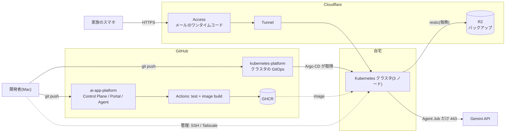
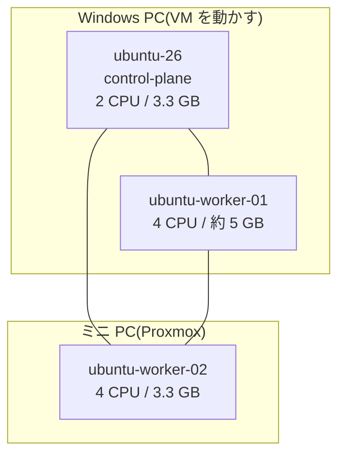
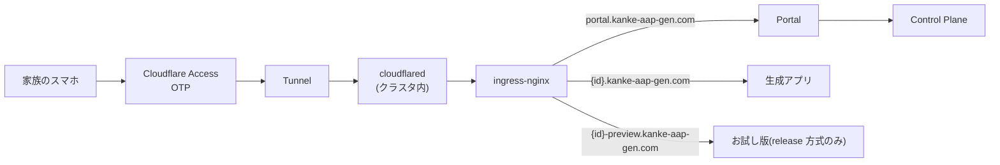
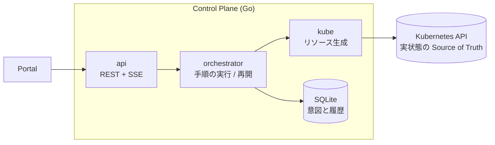
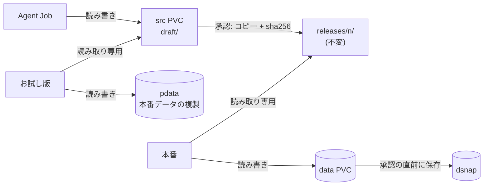
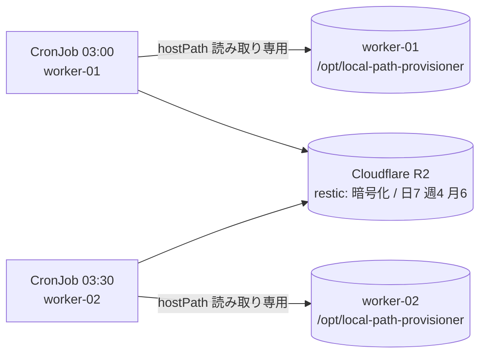

# 現在の構成(2026-10-11 時点)

ITに詳しくない家族が、スマホから自然言語で頼むだけで、自分たち向けの小さな Web アプリを作り、使いながら変更していける基盤。
AI Agent がアプリを生成・修正し、自宅の Kubernetes 上で動かす。

この文書は「**いま実際に動いているもの**」の全体像。細部は次の文書にある。

| 知りたいこと | 文書 |
|---|---|
| コンポーネントの責務、状態遷移、信頼境界の詳細 | [`architecture.md`](architecture.md)(10/5 時点。release 方式以降は本書が新しい) |
| 公開経路(Cloudflare)の設定手順 | [`exposure.md`](exposure.md) |
| Agent の選び方と設定 | [`agents.md`](agents.md) |
| バックアップと復元 | [`backup-restore.md`](backup-restore.md) |
| 計測した数字とその条件 | [`measurements/log.md`](measurements/log.md) |
| 実装中に起きた問題と判断 | [`dev-log.md`](dev-log.md) |

---

## 1. 全体像

- **公開**は Cloudflare Tunnel + Access(家族のメールのみ)。**管理**は Tailscale。経路を分けているので、家族に VPN を入れさせない。
- クラスタから外へ出るのは、Agent Job の Gemini API(443 のみ)、バックアップ(R2)、image の取得だけ。
- 認証は Cloudflare Access だけ。Portal にも生成アプリにもログイン機能はない。

---

## 2. クラスタ(物理 → 論理)

| 項目 | 内容 |
|---|---|
| Kubernetes | v1.36.4、CNI は **Cilium**(NetworkPolicy を強制) |
| ノード | control-plane 1(スケジュール対象外)、worker 2。全ノードを Tailscale に接続 |
| ストレージ | `local-path`(`WaitForFirstConsumer`)。データは各 worker の `/opt/local-path-provisioner` |
| 外への入口 | cloudflared(クラスタ内、外向き接続のみ)→ ingress-nginx。LAN / Tailscale からは ingress-nginx の NodePort 30833 |

### Namespace と役割

| namespace | 中身 | Pod Security |
|---|---|---|
| `platform-system` | Control Plane(Go、SQLite、replicas 1)、Portal(Next.js) | restricted |
| `aap-apps` | 生成アプリ `aap-gen-*` と、その Agent / helper の Job | baseline |
| `cloudflared` | cloudflared ×2 | restricted |
| `backup` | restic の CronJob(ノードごと) | privileged(hostPath のため。この namespace はこれだけ) |
| `monitoring` | kube-prometheus-stack(Prometheus / Grafana / kube-state-metrics / node-exporter)、ダッシュボード | - |
| その他の基盤 | ingress-nginx、Argo CD、local-path-provisioner、metrics-server、Tailscale operator | - |

### 何を GitOps で配り、何を配らないか

| | 担当 | 変更頻度 |
|---|---|---|
| **静的な基盤**(platform-system、cloudflared、backup、monitoring、RBAC、NetworkPolicy など) | `kubernetes-platform` → **Argo CD**(app-of-apps) | 低(人が変える) |
| **動的なアプリ**(`aap-gen-*` の PVC / Job / Deployment / Service / Ingress) | **Control Plane**が Kubernetes API で作る | 高(家族の依頼で変わる) |

アプリのリソースには Argo のラベルを付けないので、Argo CD の prune / selfHeal の対象外。
**アプリのコードは Git に置かない**(PVC に置く)。理由は §6 と [`measurements/log.md`](measurements/log.md)(GitOps 経由は 1 回の修正に約 7 分の上乗せ)。

---

## 3. 公開経路

- ホスト名は 1 階層(無料の証明書の範囲)。`portal` `www` `api` `admin` などはアプリ ID に使えない。
- Control Plane の API は公開しない(Portal 経由のみ)。
- 管理用の画面(Argo CD、Grafana)は公開せず、LAN / Tailscale 内だけ。

---

## 4. アプリが動く仕組み

### 4.1 コンポーネント

- **意図と履歴は SQLite、実状態は Kubernetes**。アプリの詳細は両者をその場で合成して返す。
- Kubernetes を呼ぶ前に Operation を保存(write-ahead)し、再起動したら未完了の Operation を最初から再実行する。全手順は冪等で、リソース名は `app-id` と `op-id` から決定的に作る。

### 4.2 1 つのアプリに作られるもの

| 種類 | 内容 |
|---|---|
| 常駐 | Runtime の Deployment 1 つ(replicas 1)、Service、Ingress |
| PVC | `src`(ソース)と `data`(実データ)。release 方式はさらに `pdata`(お試し版用のデータ)と `dsnap`(データのスナップショット) |
| 一時的 | Agent の Job(依頼ごと)、helper の Job(初期化、リリース作成、スナップショット、復元など)、お試し版の Pod |

実測では、常駐のアプリ 1 つは CPU 約 1m / メモリ約 30 MiB。Agent の Pod は一時的に約 220 MiB。

### 4.3 変更の方式(アプリごとに作成時に決まる)

| | `inplace`(従来) | `release` |
|---|---|---|
| Agent が編集する場所 | 稼働中の `current/` | `draft/`(本番とは別) |
| 変更中の本番 | 書き換わる(壊れた画面が見える) | **変わらない** |
| 確認 | 本番で | **お試し版**(別 URL、本番データの複製で動く) |
| 確定 | - | 承認 → 不変の `releases/<n>/` + 内容ハッシュ |
| 戻す | 変更前の snapshot から | 前の版へ参照先を切り替え(データも戻せる) |
| 使っているアプリ | 家族の既存アプリ | 新規作成で選んだアプリ(Portal は環境変数 `PORTAL_STRATEGY` で既定を切り替え。現在は未設定) |

- 「前の版」は `現在 − 1` ではなく**直前に本番で動いていた版**。データの復元は、そのスナップショットが一致するときだけ許す。
- Agent Job の権限: 非 root、ServiceAccount トークンなし、**ソースの PVC の該当ディレクトリだけ** mount、データは見えない、外へは 443 のみ。進捗の報告は操作ごとの HMAC トークン。

---

## 5. データの置き場所とバックアップ

- PVC は `local-path` なので、**最初にその PVC を使った Pod のノードに固定**される。以後、そのアプリの Pod(本番・Agent・お試し版・helper)は同じノードに寄る。
- 新しいアプリは、スケジューラが `requests` の割り当てが少ないノードを選ぶ。既存の 4 アプリと Control Plane の DB は worker-01。
- ノードが落ちると、そのノードのアプリは止まる。保険は毎晩のバックアップだけ(下記)。

- ノードごとに CronJob を持ち、restic のホスト名(`aap-worker` / `aap-worker-02`)でスナップショットを区別する。保持ルールと prune はホスト名ごと。
- 実行時刻をずらすのは、restic の prune / check がリポジトリ全体をロックするため。
- 復元の手順と練習は [`backup-restore.md`](backup-restore.md)。

---

## 6. なぜこの形か(設計の判断)

| 判断 | 理由(実測) |
|---|---|
| アプリのコードを GitOps に載せない | 基盤を GitOps で配った実測で、CI 約 4 分 + Argo CD 約 3 分。クラスタ内で完結させる修正は約 2.7 分(うち約 9 割は LLM) |
| ソースとデータの PVC を分ける | 更新してもデータが壊れないことが受け入れ条件。Agent にはソースだけ見せる |
| Git が担っていた責務を引き取る | 永続 = PVC、分離 = Source / Data、戻す = snapshot / release、履歴 = release + バックアップ |
| 変更を draft で行う(release 方式) | 旧方式では、壊れた画面を家族が約 23 秒見た(kind、壊れる変更を再現)。release 方式では 0 秒 |

数字の出典と条件は [`measurements/log.md`](measurements/log.md)(M-006 / M-009 / M-010 / M-011〜M-015)。

---

## 7. 運用と監視

- **Grafana**(`http://grafana.home:30833`、LAN / Tailscale 内): ダッシュボード「AAP: ノードとアプリの配置」で、どのノードにどのアプリの Pod があるか、`requests` の割り当て率、ノードのメモリ使用率とディスクの空きを見る。ダッシュボードは `kubernetes-platform/manifests/monitoring` の ConfigMap(Grafana のサイドカーが自動で読む)。
- **Argo CD**: Git の変更を約 3 分おきに取得して反映する。
- **バックアップ**: 毎晩。失敗の自動通知はまだない。

---

## 8. まだ無いもの(正直な一覧)

| 項目 | 状態 |
|---|---|
| 家族の既存アプリの release 方式への切り替え | 未実装(方式は作成時に決まる。切り替えは作り直し) |
| PVC ごとの容量の強制と使用量の監視 | `local-path` は容量を強制せず、使用量の統計も出ない。ノードのディスクの空きだけを見ている |
| 専用ディスク(XFS の reflink / クォータ) | 設計と部品の実測のみ。クラスタでは未使用 |
| コントロールプレーンの冗長化 | 1 台。落ちると新規作成・変更が止まる(既存アプリは動き続ける) |
| ノード障害時の自動復旧 | なし。バックアップから手動で復元する |
| Control Plane の認証 | なし(Portal 経由、NetworkPolicy、Access に依存) |
| 実行中の操作のキャンセル | なし |
| バックアップ失敗の通知 | なし |
| 実ユーザー(母)の継続的な利用の記録 | 未整理 |
