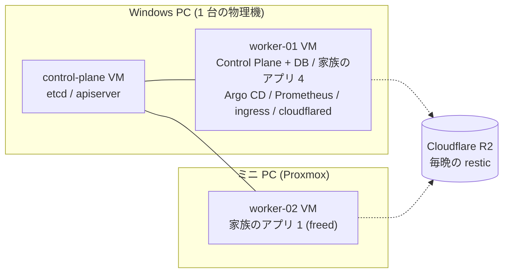

# 複数ノードのデータの扱い: 選択肢と判断材料(2026-11-06)

- 状態: **判断中**。有力は O3(アプリのボリュームを NFS に)。決まっていないのは「NFS サーバーの置き場」と「移す範囲」(§7)。
- 調査: [`storage-options.md`](storage-options.md)(実験前の調査)。計画: [`lt-storage-experiment-plan.md`](lt-storage-experiment-plan.md)。配置: [`lt-storage-lab-layout.md`](lt-storage-lab-layout.md)。
- 数字の出典はすべて [`measurements/log.md`](measurements/log.md)(M-016〜M-024)。実環境(家族のアプリが動く状態)、n=1〜3 の観察。
- スライドの下書き: [`lt-storage-slides-draft.md`](lt-storage-slides-draft.md)

> **根拠の凡例**: ✅ 実測(M-xxx)/ 📖 公式ドキュメント・構造から言える / ⚠ 推測・未検証

---

## 1. 何を解決したいか

| 目的 | 内容 |
|---|---|
| **G1 共有・配置の自由** | データを複数ノードから使えるようにして、アプリがノードをまたいで動ける(偏りの解消)。**今回の主目的** |
| G2 ノード障害時の再開 | ノードが落ちたとき、別ノードで再開できる |
| G3 データ損失の縮小 | 失うデータを減らす(今は最大 24 時間分) |
| G4 運用の軽さ | 一人で運用できる、部品とメモリを増やしすぎない |

**今の困りごと**: `local-path` の PVC は最初に使ったノードに固定される(✅ D1、M-016)。ノードが落ちると、戻るまで再開できない(✅ M-023。約 12 分)。新しいアプリはスケジューラが選ぶが、Pod は一度ノードが決まると動かせない。結果、アプリが worker-01 に偏る。

## 2. この基盤の事実(判断の前提)

### 2.1 障害の単位(物理機)

- **Windows PC が落ちると、control-plane も worker-01 も止まり、クラスタごと止まる。** どのストレージ方式を入れても、これは守れない。守っているのは R2 のバックアップだけ。
- ミニ PC(worker-02)が落ちても、今は家族のアプリ 1 つしか止まらない。→ **ストレージの分散で守れる範囲は、今は狭い**。
- 一方、アプリは worker-01 に偏っている。worker-01 は余裕が小さく(`available` 約 1.7 GB)、Prometheus は 143 回、`cloudflared` は 111〜113 回、Argo CD の `repo-server` は 106 回再起動している(M-022)。→ **偏りの解消(G1)には実益がある**。

### 2.2 データの種類

| データ | 場所 | 書き手 | 性質 |
|---|---|---|---|
| Control Plane の台帳 | `control-plane-db`(SQLite、WAL) | Control Plane(replicas 1) | 同期書き込みが多い。共有は不要 |
| `src`(ソース) | アプリごとの PVC | Agent(依頼ごとの Job)、お試し版・本番は読み取り | 小さなファイル。Agent と本番が同じ PVC を使う |
| `data`(アプリのデータ) | アプリごとの PVC | 本番ランタイム(replicas 1)、helper の Job | JSON ファイル。SQLite を使うアプリもありうる |
| `pdata` / `dsnap`(release 方式) | アプリごとの PVC | お試し版 / スナップショットの Job | 本番データの複製 / スナップショット |

- バックアップ対象の合計は小さい(worker-01 約 4.3 MiB、worker-02 約 0.37 MiB。M-016 周辺の restic のスナップショット)。1 回のバックアップ Job は 17〜28 秒。
- Control Plane は PVC の StorageClass を環境変数 `AAP_STORAGE_CLASS` で決める。`control-plane-db` は manifest で `local-path` を明示(✅ コードで確認)。

## 3. 方式ごとの Pros/Cons(実測つき)

### 3.1 `local-path`(基準)

| Pros | Cons |
|---|---|
| 速い。fio 約 590 IOPS、fsync p99 約 2.0 ms(✅ M-016) | PVC がノードに固定される。別ノードの Pod は `Pending`(✅ D1) |
| SQLite が安全。4 万行 約 65 秒、整合 ok(✅ M-016) | ノードが落ちると、戻るまで再開できない(✅ M-023。約 12 分) |
| 追加の部品も、メモリも要らない | 容量は強制されない(📖) |

### 3.2 NFS(`nfs-subdir-external-provisioner` + サーバー)

| Pros | Cons |
|---|---|
| **RWX。2 ノードの Pod が同じ PVC を使えた**(✅ M-017) | **サーバーが単一障害点**(📖) |
| **サーバーが別なら、ノードが落ちても約 6 分で別ノードで再開、データの欠けなし**(✅ M-023。大半は Kubernetes の既定の待ち時間) | **SQLite は別ノードが書くと壊れる**: `disk I/O error` が 1155 回、2000 行中 1837 行。しかも `integrity_check` は ok のまま(✅ M-017) |
| 導入が軽い。Helm で 7 秒、provisioner は約 7 MiB(✅ M-017) | 同一ノードの SQLite も動くが**約 8 倍遅い**(✅ M-017) |
| バックアップ元を 1 か所にできる(📖) | 書き込みが遅い。fio は `local-path` の約 6 割、fsync p99 は約 3 倍(5.6〜7.7 ms)(✅ M-017) |
| | 容量は強制されない(📖)。StorageClass は `allowVolumeExpansion: true` だが実際のリサイズは未検証(⚠) |

### 3.3 Longhorn

| Pros | Cons |
|---|---|
| ブロックストレージなので SQLite は壊れない(✅ M-020、M-021) | **replica 2 は書き込みが遅い**: fio 107〜113 IOPS、fsync p99 19〜25 ms、SQLite 347〜356 秒(約 5.4 倍)(✅ M-021) |
| アイドルのメモリは小さい。worker-02 で +約 0.45 GB、負荷中も増えない(✅ M-020、M-021) | **余裕の小さい worker-01 に載せたら、ノードが過負荷になった**(load average 78。原因は未特定)(✅ M-022) |
| 複製を持つ設計(📖) | 22 Pod が常駐。導入から全 Pod が Ready まで約 7 分(✅ M-020) |
| UI がある | 負荷中は CPU を使う(最大約 1 コア。replica 1)(✅ M-020) |
| `multipathd` の既知の落とし穴は、この環境では起きなかった(✅ M-020) | **ノード障害時の再開は試せていない**(M-022 で中止)。RWX は中で NFS(📖、未検証) |
| | バックアップ先ではない(📖)。`iscsid` の有効化や `iscsi_tcp` のロードなど、ノード側の準備が要る |

### 3.4 Garage(S3)

| Pros | Cons |
|---|---|
| とても軽い。1 Pod あたり 6〜7 MiB(✅ M-018) | **2 ノード・factor 2 では、1 台落ちると書き込みが止まる**(読み取りは続く)(✅ M-023) |
| restic の保存先として、バックアップ → 全消し → 復元 → sha256 照合が通った(✅ M-018) | ファイルとして使えない。アプリを S3 に書き換える必要がある。参照アプリで、依存 0 → 26 パッケージ(18 MB)、同期 → 非同期、App Contract の変更(✅ M-019) |
| 全員が S3 の API で共有できる(📖) | **「失敗」と返した PUT の約 7 割は実際には保存されていた**(✅ M-023) |
| GET は速い(2.5〜6.5 ms)(✅ M-018) | PUT は 4 KiB で p50 70〜140 ms(✅ M-018。原因は未確認) |
| | 導入後にレイアウトの手動設定が要る。chart は Helm リポジトリではなく Git から。クラスタ全体の CRD を作る |

### 3.5 どの方式も共通

- **複製・共有は削除や破損も反映する**(📖。単体の実演 D2 は**実施していない**)。復旧できるのは、独立したバックアップだけ。→ どの選択でも R2 のバックアップは維持する。

## 4. 選択肢(単独と組み合わせ)

| # | 選択肢 | G1 共有・配置 | G2 障害時の再開 | G3 損失の縮小 | G4 運用の軽さ | 性能 |
|---|---|---|---|---|---|---|
| **O1** | 現状維持(`local-path` + 夜間 R2) | × | × | × | ◎ | ◎ |
| **O2** | O1 + 守りの強化(1 時間おき、復元の自動化、失敗通知、復元ドリルの定期化) | × | △ 復元は手動か自作 | **◎** | ○ | ◎ |
| **O3** | アプリのボリュームを NFS に。DB は `local-path` | **◎** | **◎**(約 6 分) | ○ | △ サーバーが増える | △ fsync 約 3 倍 |
| O4 | O3 の最小版(`src` だけ NFS) | △ | △ | △ | ○ | ○ |
| O5 | Garage をバックアップの前段に | × | × | ○ | △ | - |
| O6 | Longhorn replica 2 | ○ | ?(未検証) | ○ | × | × 約 5 倍遅い |
| O7 | 3 台目の worker / NAS を足す | 他の方式を現実にする | | | × 費用 | |
| O8 | アプリを S3(Garage)に書き換える | ○ | △ | ○ | × App Contract の変更 | △ |

記号: ◎ 向く / ○ 条件つき / △ 部分的 / × 向かない / ? 未検証。

### 組み合わせ

| 組み合わせ | 向く場合 | 代償 |
|---|---|---|
| **O2 単独** | 失うデータを減らし、復旧を速くしたい。部品は増やしたくない | G1 は解決しない |
| **O3 + O2**(有力) | 偏りを解消し、ミニ PC の故障でもアプリを動かしたい。バックアップも強化 | NFS サーバーの運用。書き込みが遅くなる。SQLite アプリは書く Pod を 1 つに限る |
| O4 + O2 | 最小の変更で NFS を試す | 効果が限定的(偏りの主因は `data`) |
| O3 + O5 + O6 など | ほぼ全部 | 運用の数が多く、一人では重い。**おすすめしない** |

## 5. 現時点の見立て

1. **今回の目的は G1(共有・配置の自由)**。→ **O3 が最も合う**。
2. **G3(損失の縮小)は O2 で安く実現できるので、O3 と並行して行う価値が高い**(バックアップ元が NFS の 1 か所になれば、設定も簡単になる)。
3. **O6(Longhorn)と O5(Garage 前段)は見送る**。理由: Longhorn は書き込みの遅さと不安定さ(M-021、M-022)、Garage は 2 ノードだと止まる(M-023)。**3 ノード以上になったとき再検討**する。
4. O3 でも、次は**変えない**: Control Plane の DB は `local-path` のまま(M-017)。

## 6. O3 の構築で効いてくること

| 論点 | 内容 |
|---|---|
| コード | `AAP_STORAGE_CLASS` の変更だけで新しいアプリの `src` / `data` が NFS になる。既存の PVC は維持される。Control Plane の DB は `local-path` と明示済み(✅ コードで確認) |
| アクセスモード | PVC は `ReadWriteOnce` のまま。NFS の PV にはノード固定がないので、どのノードでも使える(⚠ 実機で確認) |
| 「スケール」の意味 | **配置の自由度と障害時の再開**まで。ランタイムの `replicas` は 1 固定で、複数レプリカが同じデータを書くのは別問題(参照アプリは状態をメモリに持つ) |
| SQLite を使うアプリ | 書くプロセスを 1 つに保つ。別ノードが加わると欠けた(M-017) |
| 書き込みの遅さ | 小さな JSON なら影響は小さいはず。Agent の `src` への書き込みへの影響は⚠ 未確認 |
| 既存アプリの移行 | restic のバックアップ → NFS の PVC を作る → 復元([`backup-restore.md`](backup-restore.md))。まず `freed` で確認するのが安全 |
| GitOps | provisioner は `kubernetes-platform/manifests/storage/` に Argo CD 管理で置く。NFS サーバー自体は GitOps の外 |
| 切り戻し | `AAP_STORAGE_CLASS` を `local-path` に戻す。移したアプリはバックアップから戻す |

## 7. 未決: NFS サーバーの置き場

| 置き場 | Pros | Cons |
|---|---|---|
| **Windows PC に新しい小さな VM** | control-plane の再起動・アップグレードと切り離せる。新しい物理的な故障の単位を増やさない(Windows PC が落ちればクラスタごと止まる) | VM を足す手間。メモリ(1 GB 程度)の空きが要る。Windows PC の空きは**未確認** |
| control-plane の VM(試行の場所) | 追加の VM が要らない | **再起動すると、NFS 上の全アプリの I/O が止まる**。etcd と同じディスク。メモリの余裕が小さい(`available` 約 0.8〜1.0 GB) |
| NAS を買う | 専用機で堅い | お金。NAS は未所有 |
| ミニ PC の VM | 物理機が分かれる | **ミニ PC の故障で全アプリが止まる**(今は 1 アプリで済んでいる)。避ける |

## 8. 決定ログ(決まったら書く)

| 日付 | 決めたこと | 理由 |
|---|---|---|
| 2026-11-06 | 目的を「複数ノード間でデータを共有し、アプリがノードをまたいで動けること」とした | ユーザーの意向 |
| 2026-11-06 | 有力案: O3 + O2(NFS + バックアップの強化) | §5 |
| (未) | NFS サーバーの置き場 | §7 |
| (未) | 移す範囲(新しいアプリだけか、`freed` なども移すか) | §6 |

## 9. 確かめられなかったこと

- Longhorn のノード障害時の再開(M-022 で中止)。
- 複製が削除も複製すること(D2)、NFS の RWX 同時書き込み(D3)の単体の実演。
- NFS サーバー自体が止まったとき。NFS のバージョン、マウントオプション。
- 3 ノードの構成(Garage の factor 3、Longhorn の replica 3)。
- 大きなデータ・多数のファイル(T5 は約 3 MB、T4 は 4 KiB)。
- Agent の `src` への書き込みが NFS でどれだけ遅くなるか。
- etcd のレイテンシへの影響(試行では NFS サーバーが etcd と同じディスク)。
- 全て n=1〜3 の観察。
